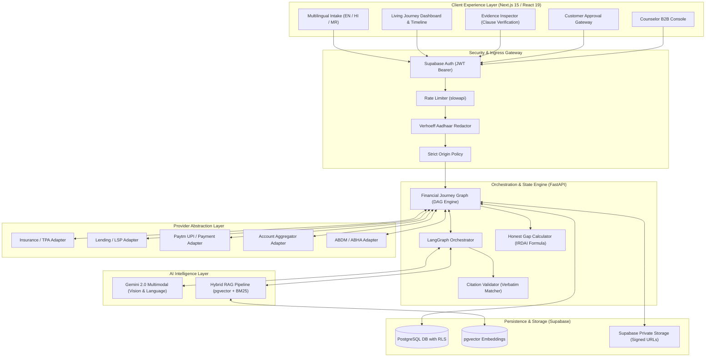

# LifeEvent AI

> **AI-Powered Financial Journey Operating System**  
> *Transforming life's most critical events into coordinated, evidence-backed financial actions.*

[](https://paytm.com)
[](#)
[](#)
[](#)
[](#)
[](#)

---

## 1. Executive Summary

During critical life events—such as an unexpected medical emergency—families are forced to navigate fragmented, adversarial financial systems in a state of extreme stress. At the hospital admission desk, a family attendant faces high-stakes questions:
1. *What will our health insurance actually pay?*
2. *Which documents does the TPA desk urgently require to prevent cashless rejection?*
3. *What is our real out-of-pocket financial shortfall?*
4. *How can we arrange emergency liquidity before ICU admission?*
5. *What is our single next best action right now?*

**LifeEvent AI** solves this by unifying insurance claim preparation, out-of-pocket gap modeling, and emergency bridge funding into a single **Living Financial Journey**. 

Unlike naive LLM wrappers, LifeEvent AI enforces:
- **Mathematical Integrity:** Deterministic IRDAI room-rent proportional deduction and non-payable consumable math.
- **Anti-Hallucination Evidence Grounding:** Every coverage claim cites verbatim policy text (document name, page number, and clause reference).
- **UIDAI Verhoeff Checksum Masking:** Aadhaar numbers are mathematically validated and masked (`XXXX-XXXX-1234`) before touching any LLM payload or server log.
- **Customer-Controlled Approvals:** Consequential actions require explicit, time-limited cryptographic approval.

---

## 2. System Architecture



---

## 3. Technology Stack

| Layer | Component | Version / Spec | Purpose |
| :--- | :--- | :--- | :--- |
| **Frontend** | Next.js App Router | 15.1.7 | Server routing, streaming UI, zero-layout-shift performance |
| **UI Runtime** | React & Tailwind CSS | React 19 | Responsive UI with design tokens and high-contrast accessibility |
| **Voice Intake**| Web Speech API | Browser Native | Multilingual client-side voice dictation (EN, HI, MR) |
| **Backend** | FastAPI & Pydantic v2 | 0.115+ | High-throughput asynchronous REST APIs & Server-Sent Events |
| **Orchestrator**| LangGraph & Custom DAG | StateGraph | Deterministic, auditable financial journey state machine |
| **Multimodal AI**| Google Gemini 2.0 | Flash & Pro | Multi-page OCR, document fact extraction, clause reasoning |
| **Database** | Supabase PostgreSQL | 15+ | Relational schema, transactional integrity, JSONB state |
| **Vector DB** | `pgvector` | Supabase Extension| Policy wording chunk embeddings for clause retrieval |
| **Security** | Row Level Security (RLS)| PostgreSQL Native| Tenant and user data isolation at database layer |
| **Storage** | Supabase Storage | Private S3-compat | Encrypted document storage accessed via 15-min signed URLs |
| **Rate Limiter**| `slowapi` | Redis / Memory | Abuse protection (30 req/min on intake, burst mitigation) |

---

## 4. Master Documentation Ecosystem

All technical, architectural, product, security, and deployment documentation has been audited and organized under [`docs/`](docs/README.md).

```
docs/
├── README.md                           # Documentation Master Index & Role-Based Reading Guide
├── audit/                              # Phase 1 & 2 Audit reports, Gap analysis, Inconsistency log
├── product/                            # PRD, Vision, User Personas, Journeys, MVP Scope, Roadmap
├── architecture/                       # System Architecture, Journey Graph, DB Schema, Data Flow
├── ai/                                 # Multimodal AI, RAG, Policy Reasoning, Anti-Hallucination
├── backend/                            # API Specs, State Machine, Auth/AuthZ, Error Handling
├── integrations/                       # Provider Adapters: Insurance, Lending, Paytm UPI, AA, ABDM
├── security/                           # STRIDE Threat Model, DPDP Compliance, Verhoeff Redaction
├── testing/                            # Test Strategy, Unit, Integration, E2E, and AI Evals
├── deployment/                         # Local Setup, Vercel/Render Deploy, DB Migrations
├── research/                           # IRDAI Regulations, Market Opportunity, Competitive Landscape
└── hackathon/                          # Demo Script, Pitch Structure, Judge FAQ, Impact Metrics
```

---

## 5. Quick Start (Local Development)

### Prerequisites
- Python 3.11+
- Node.js 18+ (Node 20+ recommended)
- Supabase project credentials (or local mock environment)
- Google Gemini API key

### Backend Setup
```bash
# Clone the repository and enter backend directory
cd backend

# Create and activate virtual environment
python -m venv venv
# Windows:
.\venv\Scripts\activate
# Linux/macOS:
source venv/bin/activate

# Install dependencies
pip install -r requirements.txt

# Configure environment variables
cp .env.example .env
# Edit .env with your GEMINI_API_KEY and SUPABASE credentials

# Run database migrations (or init schema)
python -m app.db.init_db

# Start FastAPI development server
uvicorn app.main:app --host 0.0.0.0 --port 8000 --reload
```

### Frontend Setup
```bash
# In a new terminal, enter frontend directory
cd frontend

# Install npm packages
npm install

# Start Next.js development server
npm run dev
# Application will run at http://localhost:3000
```

For complete environment configuration, Docker workflows, and troubleshooting, refer to [`docs/deployment/LOCAL_SETUP.md`](docs/deployment/LOCAL_SETUP.md).

---

## 6. Project

- **Project:** LifeEvent AI
- **Repository Guidelines:** See [`CONTRIBUTING.md`](CONTRIBUTING.md) for code rules and commit standards.
- **Historical Audit:** See [`README(1).md`](README(1).md) and [`docs/audit/DOCUMENTATION_INVENTORY.md`](docs/audit/DOCUMENTATION_INVENTORY.md).

