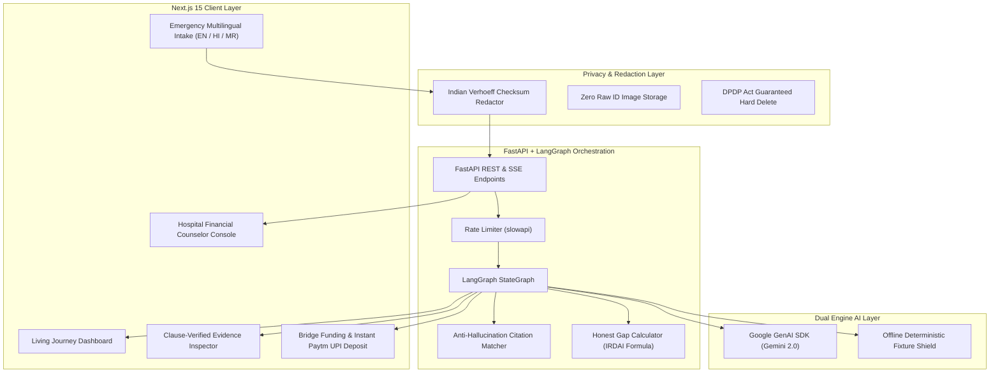

# Tech Stack & Architecture

**Product:** LifeEvent AI · **Version:** 1.0

---

## 1. Stack at a Glance

| Layer | Technology | Version | Why it's here |
| :--- | :--- | :--- | :--- |
| Frontend framework | Next.js (App Router) | 15.1.7 | Server routing, RSC, fast demo UX |
| UI runtime | React | 19 | Latest concurrent features |
| Language (FE) | TypeScript / TSX | — | Type-safe routes and API contracts |
| Styling | CSS (design tokens in `design-system/`) | — | Bespoke, non-templated visual system |
| Voice input | Web Speech API | browser-native | Zero-dependency multilingual dictation |
| Backend framework | FastAPI | 0.115 | Async REST + SSE, Pydantic validation |
| Agent orchestration | LangGraph StateGraph | — | Deterministic, inspectable multi-step pipeline |
| LLM | Google Gemini 2.0 via `google-genai` SDK | v3.3.0 | Multimodal document understanding |
| PDF parsing | PyMuPDF | — | Page-level text extraction for citation matching |
| Rate limiting | slowapi | — | 30/min intake limit, keyed by remote address |
| Persistence | In-memory dict + Supabase (optional) | — | Zero-friction demo; Supabase as durable fallback |
| Transport | REST + Server-Sent Events (SSE) | — | Live agent progress streaming |
| Testing | pytest | 8.3.4 | 12/12 suites: aadhaar, citation, gap, graph, hard-delete |
| E2E / QA | Playwright | 1.65.1 | Multi-viewport screenshot verification |

## 2. Runtime Requirements

- Python 3.11+ (developed on 3.13.7)
- Node.js 18+
- No external services are mandatory to run the demo (fixtures + in-memory store).

## 3. Architecture



### 3.1 The LangGraph Pipeline (`backend/app/agents/graph.py`)

The `StateGraph` executes these stages over a typed state dict
(`backend/app/models/schemas.py`):

`intake → document → coverage → gap → checklist → funding → complete`

Key invariants:
- The **coverage** node attaches `evidence_doc`, `evidence_page`, `evidence_passage`,
  `clause_ref` to every claim.
- The **gap** node applies the IRDAI-honest math (see §4).
- The **funding** node sizes bridge options to the computed gap range.

### 3.2 Honest Gap Calculator (`backend/app/core/gap_calculator.py`)

Money math is **deterministic Python, never LLM output**:

```
rent_penalty   = max(0, (actual_room_rent − allowed_room_rent) × stay_days)
non_payables   = 0.10 × total_estimate          # Clause 4.8 consumables
room_covered   = allowed_room_rent × stay_days
gap            = Low / Expected / High range with co-pay applied
```

### 3.3 Security Layer (`backend/app/core/security.py`)

- **Verhoeff checksum validation** — only genuine 12-digit Aadhaar numbers are recognized and
  masked to `XXXX-XXXX-1234` (phone numbers, policy codes pass through untouched).
- **`sanitize_logs()`** — applied to *every* API response before it leaves the server.
- **No raw ID image retention** — uploaded previews are used transiently and discarded.
- **Hard delete** — `DELETE /api/journey/{id}` for DPDP Act data sovereignty.

## 4. Backend Project Structure

```
backend/
├── app/
│   ├── main.py                  # FastAPI app, routes, in-memory store, CORS, rate limit
│   ├── agents/graph.py          # LangGraph StateGraph builder
│   ├── core/
│   │   ├── security.py          # Verhoeff masking, sanitize_logs
│   │   ├── gap_calculator.py    # IRDAI honest-range math
│   │   └── citation_validator.py# Anti-hallucination passage matcher
│   ├── models/schemas.py        # Pydantic: LifeEventIntake, LivingJourney
│   └── sample_data/fixtures.py  # Cardiac/Orthopedic scenarios + TPA query fixture
└── tests/                       # 12 pytest suites
    ├── test_aadhaar.py   (4)
    ├── test_citation.py  (3)
    ├── test_gap.py       (2)
    ├── test_graph.py     (1)
    └── test_hard_delete.py (2)
```

## 5. Frontend Project Structure

```
frontend/src/app/
├── page.tsx                     # Landing: hospital-counter story
├── intake/page.tsx              # Voice + form intake, sample loaders
├── journey/[id]/page.tsx        # Living Journey dashboard (gap range, timeline)
├── journey/[id]/coverage/       # Clause inspector
├── journey/[id]/funding/        # Bridge funding + simulated UPI deposit
├── documents/page.tsx           # Verhoeff playground, document list
├── counselor/page.tsx           # B2B counselor console
├── for-hospitals/page.tsx       # SaaS pilot landing + trial form
├── how-it-works/page.tsx        # 5-step flow, dual engine explainer
├── privacy/page.tsx             # DPDP charter + hard-delete tool
├── layout.tsx / error.tsx / not-found.tsx
```

## 6. API Reference

Base URL: `http://localhost:8000`

| Method | Path | Rate limit | Purpose |
| :--- | :--- | :--- | :--- |
| GET | `/api/health` | — | Health, timestamp, active journey count |
| POST | `/api/journey/intake` | 30/min | Create journey. If `is_demo` + "sample" in name → fixture path; otherwise runs the real intake pipeline (masking, doc pages synthesis, coverage claims). Returns sanitized journey |
| GET | `/api/journey/{id}` | — | Fetch journey; falls back to cardiac demo when id contains "cardiac"/"sample"; 404 otherwise |
| POST | `/api/journey/{id}/replan` | — | Simulates TPA Pre-Auth Query: appends doc, prepends urgent checklist items, appends timeline event, sets stage `tpa_query_pending` |
| DELETE | `/api/journey/{id}` | — | Hard delete of all journey data (DPDP) |
| GET | `/api/journey/{id}/stream` | — | SSE stream of 7 agent steps (~0.4s apart) |
| GET | `/api/counselor/journeys` | — | B2B summary: patient, gap, readiness, next action |
| POST | `/api/pilot-request` | — | B2B lead capture with `created_at` |

### Core Pydantic Schemas (`backend/app/models/schemas.py`)

- `LifeEventIntake` — patient info, language, urgency, optional policy fields (sum insured,
  co-pay %, room rent cap/actual, stay days), Aadhaar, doc previews, `is_demo` flag.
- `LivingJourney` — intake, documents, document_pages, coverage_findings, gap, checklist,
  funding_options, timeline_events, current_stage, next_best_action.

### Known Persistence Note

`JOURNEY_STORE` and `PILOT_REQUESTS` are **in-memory**; all journeys reset on backend restart.
Demo journeys (`demo-journey-cardiac-01`, orthopedic) are re-seeded at startup via
`init_demo_journeys()`. Supabase is the planned durable fallback.

## 7. Run Commands

```bash
# One-click (Windows)
.\run_demo.bat

# Backend
python -m pip install fastapi uvicorn langgraph langchain-core supabase python-multipart google-genai PyMuPDF slowapi pytest
python -m pytest backend/tests
python -m uvicorn backend.app.main:app --port 8000

# Frontend
cd frontend && npm install && npm run build && npm run start -- -p 3000
```
