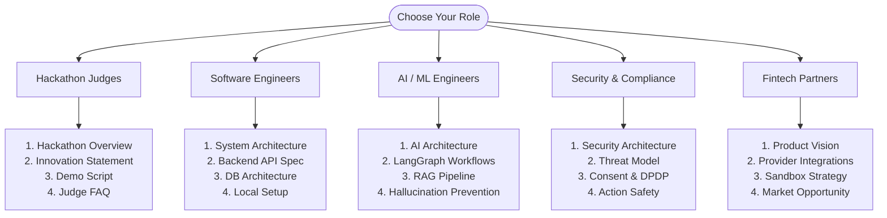

# LifeEvent AI: Master Documentation Portal

Welcome to the central technical and architectural documentation portal for **LifeEvent AI**.

LifeEvent AI is an **AI-Powered Financial Journey Operating System** developed for the **Paytm AI Hackathon (Build for India)**, addressing Problem Statement PS-2: *AI-Powered Financial Journeys*.

---

## 1. Role-Based Reading Pathways

To assist different stakeholders in navigating this documentation suite quickly and effectively, use the tailored reading paths below:



### 1.1 For Hackathon Judges & Evaluators
1. [`docs/hackathon/HACKATHON_OVERVIEW.md`](hackathon/HACKATHON_OVERVIEW.md) — Problem statement alignment, innovation, and key differentiators.
2. [`docs/hackathon/INNOVATION_STATEMENT.md`](hackathon/INNOVATION_STATEMENT.md) — Why LifeEvent AI is not a generic chatbot or prompt wrapper.
3. [`docs/hackathon/DEMO_SCRIPT.md`](hackathon/DEMO_SCRIPT.md) — Step-by-step 3-minute judging walkthrough covering cardiac emergency and live TPA replanning.
4. [`docs/hackathon/JUDGE_FAQ.md`](hackathon/JUDGE_FAQ.md) — Defending architecture, moat, fraud protection, and regulatory boundaries.

### 1.2 For Software Engineers & Contributors
1. [`docs/architecture/SYSTEM_ARCHITECTURE.md`](architecture/SYSTEM_ARCHITECTURE.md) — End-to-end component topology and runtime boundaries.
2. [`docs/architecture/FINANCIAL_JOURNEY_GRAPH.md`](architecture/FINANCIAL_JOURNEY_GRAPH.md) — State machine mechanics, DAG resolution, and transition validation.
3. [`docs/backend/API_SPECIFICATION.md`](backend/API_SPECIFICATION.md) — REST endpoints, Server-Sent Events, schemas, and RFC 7807 error formats.
4. [`docs/backend/DATABASE_SCHEMA.md`](backend/DATABASE_SCHEMA.md) — PostgreSQL DDL, foreign keys, indexes, and Row Level Security.
5. [`docs/deployment/LOCAL_SETUP.md`](deployment/LOCAL_SETUP.md) — Setting up local dev environment, environment variables, and Docker.

### 1.3 For AI / ML Engineers
1. [`docs/ai/AI_ARCHITECTURE.md`](ai/AI_ARCHITECTURE.md) — Dual-engine intelligence layer (Gemini 2.0 + Deterministic Fixture Shield).
2. [`docs/ai/DOCUMENT_INTELLIGENCE.md`](ai/DOCUMENT_INTELLIGENCE.md) — Multi-modal parsing of medical bills, discharge summaries, and policy schedules.
3. [`docs/ai/LANGGRAPH_WORKFLOWS.md`](ai/LANGGRAPH_WORKFLOWS.md) — Deterministic LangGraph StateGraph nodes, edges, and state transitions.
4. [`docs/ai/RAG_PIPELINE.md`](ai/RAG_PIPELINE.md) — Hybrid `pgvector` semantic retrieval + BM25 keyword matching for policy clauses.
5. [`docs/ai/HALLUCINATION_PREVENTION.md`](ai/HALLUCINATION_PREVENTION.md) — Strict citation validation rules; unverified claims forced to ₹0.

### 1.4 For Security Reviewers & Compliance Officers
1. [`docs/security/SECURITY_ARCHITECTURE.md`](security/SECURITY_ARCHITECTURE.md) — Defense-in-depth model across transport, compute, DB, and AI.
2. [`docs/security/THREAT_MODEL.md`](security/THREAT_MODEL.md) — STRIDE threat analysis covering prompt injection, PII leakage, and IDOR.
3. [`docs/security/CONSENT_MANAGEMENT.md`](security/CONSENT_MANAGEMENT.md) — DPDP Act 2023 compliance, digital consent receipts, and erasure workflows.
4. [`docs/security/FINANCIAL_ACTION_SAFETY.md`](security/FINANCIAL_ACTION_SAFETY.md) — Customer Approval Gateway, approval expiration, and idempotency.

### 1.5 For Fintech & Healthcare Partners (Insurers, TPAs, NBFCs)
1. [`docs/product/PRODUCT_VISION.md`](product/PRODUCT_VISION.md) — Operating system vision across life events.
2. [`docs/integrations/INSURANCE_INTEGRATION.md`](integrations/INSURANCE_INTEGRATION.md) — TPA pre-authorization, query handling, and claim exchange.
3. [`docs/integrations/LENDING_INTEGRATION.md`](integrations/LENDING_INTEGRATION.md) — LSP interface, Digital Lending Guidelines (DLG), and credit pre-qualification.
4. [`docs/integrations/PAYMENT_INTEGRATION.md`](integrations/PAYMENT_INTEGRATION.md) — Paytm UPI intent, caution deposit escrow, and mandate flows.
5. [`docs/integrations/SANDBOX_STRATEGY.md`](integrations/SANDBOX_STRATEGY.md) — Progression from simulated mocks to live regulatory sandboxes.

---

## 2. Master Documentation Directory Index

```
docs/
│
├── README.md                               # This master documentation index
│
├── audit/                                  # Repository and architectural audits
│   ├── DOCUMENTATION_INVENTORY.md          # Complete inventory of original documents
│   ├── ARCHITECTURE_GAP_ANALYSIS.md        # Prototype vs target baseline gap analysis
│   ├── INCONSISTENCY_REPORT.md             # Contradiction log and authoritative resolutions
│   ├── IMPROVEMENT_PLAN.md                 # Strategic documentation execution plan
│   ├── CHANGELOG.md                        # Documentation audit and overhaul changelog
│   └── FINAL_DOCUMENTATION_AUDIT.md        # Post-overhaul verification & quality scoring
│
├── product/                                # Product specifications & business domain
│   ├── PRODUCT_REQUIREMENTS.md             # Functional and non-functional requirements
│   ├── PRODUCT_VISION.md                   # Long-term operating system vision
│   ├── PROBLEM_STATEMENT.md                # Triage counter problem & Paytm PS-2 alignment
│   ├── USER_PERSONAS.md                    # Detailed user personas across B2C and B2B
│   ├── USER_JOURNEYS.md                    # Comprehensive user journeys & edge cases
│   ├── FEATURE_SPECIFICATION.md            # Deep feature-by-feature specification
│   ├── MVP_SCOPE.md                        # Hackathon MVP boundary definition
│   └── ROADMAP.md                          # Multi-phase post-hackathon product roadmap
│
├── architecture/                           # Technical architecture & design specifications
│   ├── SYSTEM_ARCHITECTURE.md              # System context, component architecture & runtime
│   ├── ARCHITECTURE_DECISIONS.md           # Architecture Decision Records (ADRs)
│   ├── FINANCIAL_JOURNEY_GRAPH.md          # State machine, DAG engine, task dependencies
│   ├── AI_ARCHITECTURE.md                  # Dual-engine AI topology & model responsibilities
│   ├── BACKEND_ARCHITECTURE.md             # FastAPI modular service architecture
│   ├── FRONTEND_ARCHITECTURE.md            # Next.js App Router, RSC, and streaming UI
│   ├── DATABASE_ARCHITECTURE.md            # Supabase PostgreSQL, pgvector, and RLS design
│   ├── INTEGRATION_ARCHITECTURE.md         # Provider abstraction interfaces & adapter pattern
│   └── DATA_FLOW.md                        # End-to-end data flow specifications
│
├── ai/                                     # AI engineering, prompt design, and RAG
│   ├── MULTIMODAL_AI.md                    # Gemini 2.0 multimodal ingestion for docs/voice
│   ├── DOCUMENT_INTELLIGENCE.md            # Document classification and structured extraction
│   ├── POLICY_REASONING.md                 # Policy clause reasoning and deduction models
│   ├── LANGGRAPH_WORKFLOWS.md              # StateGraph node definitions and edge transitions
│   ├── PROMPT_ENGINEERING.md               # System prompts, few-shot examples, JSON schemas
│   ├── RAG_PIPELINE.md                     # pgvector embedding retrieval and reranking
│   ├── AI_EVALUATION.md                    # RAG Triad, faithfulness, and answer relevance
│   ├── HALLUCINATION_PREVENTION.md         # Deterministic citation gate and guardrails
│   └── HUMAN_IN_THE_LOOP.md                # Human oversight, review flags, and escalation
│
├── backend/                                # Backend engineering & API contracts
│   ├── API_SPECIFICATION.md                # Complete REST & SSE API reference
│   ├── API_ERROR_HANDLING.md               # RFC 7807 problem details and error taxonomy
│   ├── AUTHENTICATION.md                   # Supabase Auth, JWT validation, and token lifecycle
│   ├── AUTHORIZATION.md                    # Role-based access control and tenant isolation
│   ├── DATABASE_SCHEMA.md                  # PostgreSQL DDL, relationships, and constraints
│   ├── STATE_MANAGEMENT.md                 # State transition validator and mutation rules
│   └── BACKGROUND_PROCESSING.md            # Asynchronous tasks, Celery/Redis, and SSE push
│
├── integrations/                           # External fintech & health integrations
│   ├── INSURANCE_INTEGRATION.md            # TPA pre-authorization and claim exchange
│   ├── LENDING_INTEGRATION.md              # Digital lending guidelines (DLG) & LSP adapter
│   ├── PAYMENT_INTEGRATION.md              # Paytm UPI intent, deposit escrow, and mandates
│   ├── ACCOUNT_AGGREGATOR.md               # Sahamati AA framework & financial data retrieval
│   ├── DIGILOCKER.md                       # DigiLocker / API Setu document verification
│   ├── ABDM.md                             # Ayushman Bharat Digital Mission (ABHA & FHIR)
│   └── SANDBOX_STRATEGY.md                 # Mock vs Sandbox vs Production transition plan
│
├── security/                               # Security, privacy, and compliance
│   ├── SECURITY_ARCHITECTURE.md            # Defense-in-depth security blueprint
│   ├── THREAT_MODEL.md                     # STRIDE threat model & mitigations
│   ├── DATA_PRIVACY.md                     # DPDP Act 2023 compliance charter & zero retention
│   ├── CONSENT_MANAGEMENT.md               # Consent lifecycle, artifacts, and revoking
│   ├── AUDIT_LOGGING.md                    # Tamper-evident audit logs and sanitization
│   ├── SECURE_FILE_HANDLING.md             # Presigned upload URLs and encrypted storage
│   └── FINANCIAL_ACTION_SAFETY.md          # Customer Approval Gateway & idempotency
│
├── testing/                                # Quality assurance and verification
│   ├── TEST_STRATEGY.md                    # Multi-tiered testing philosophy and CI gates
│   ├── UNIT_TESTING.md                     # Unit test specifications (Aadhaar, gap, citation)
│   ├── INTEGRATION_TESTING.md              # Backend service and provider adapter test suites
│   ├── END_TO_END_TESTING.md               # Playwright E2E scenarios and route validation
│   ├── AI_EVALUATION_TESTS.md              # Automated evaluation tests for RAG and extraction
│   └── TEST_SCENARIOS.md                   # Synthetic test fixtures (cardiac, orthopedic)
│
├── deployment/                             # DevOps, infrastructure, and deployment
│   ├── LOCAL_SETUP.md                      # Developer environment setup runbook
│   ├── ENVIRONMENT_CONFIGURATION.md        # Environment variables schema and secret mgmt
│   ├── FRONTEND_DEPLOYMENT.md              # Vercel deployment, edge routing, and caching
│   ├── BACKEND_DEPLOYMENT.md               # Render / Container deployment and health probes
│   ├── DATABASE_MIGRATIONS.md              # Supabase migration sequence and rollback steps
│   └── PRODUCTION_READINESS.md             # Production launch checklist and SLA targets
│
├── research/                               # Domain research, market, and regulations
│   ├── MARKET_OPPORTUNITY.md               # Indian out-of-pocket healthcare market analysis
│   ├── COMPETITIVE_ANALYSIS.md             # Competitive landscape (TPAs, insurtechs, fintechs)
│   ├── DIFFERENTIATION.md                  # Core technical and architectural differentiators
│   ├── TECHNICAL_FEASIBILITY.md            # Feasibility assessment of AI models and APIs
│   ├── LIMITATIONS.md                      # Known edge cases, limitations, and boundaries
│   └── FUTURE_RESEARCH.md                  # Future life event domains (education, bereavement)
│
└── hackathon/                              # Hackathon presentation and judging assets
    ├── HACKATHON_OVERVIEW.md               # Executive pitch, problem statement, team roles
    ├── INNOVATION_STATEMENT.md             # Core innovation narrative
    ├── TECHNICAL_DIFFERENTIATION.md        # Architectural defense for technical judges
    ├── DEMO_SCRIPT.md                      # Time-stamped live presentation demo script
    ├── PITCH_STRUCTURE.md                  # 5-minute slide-by-slide pitch deck structure
    ├── IMPACT_METRICS.md                   # Real-world impact projections and KPIs
    └── JUDGE_FAQ.md                        # Tough technical and regulatory judge Q&A
```

---

## 3. Strict Status Classification Standard

To maintain absolute transparency with evaluators and technical partners, all components and features documented throughout this repository adhere to the following status taxonomy:

- `[Implemented]`: Fully developed, tested, and verifiable in the codebase.
- `[Partially Implemented]`: Functional core exists; secondary features or edge cases undergoing development.
- `[Demonstrated]`: Visual or interactive capability operating on synthetic/fixture data for evaluation.
- `[Simulated]`: Mock service reproducing real-world API behaviors (e.g., Paytm UPI deposit, TPA queries).
- `[Planned]`: Formally architected, scheduled for implementation in immediate roadmap phases.
- `[Proposed]`: Conceptual design under partner or regulatory exploration.
- `[Not Yet Verified]`: Requires live test harness or partner sandbox credentials to confirm.

