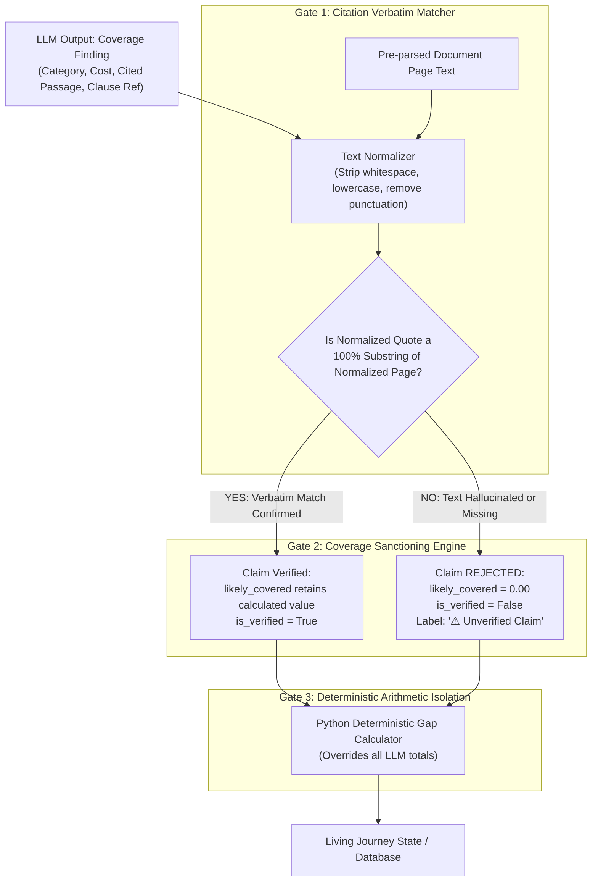

# LifeEvent AI: Hallucination Prevention & Evidence Grounding

**Document Version:** 2.0  
**Status:** Approved Architectural Baseline  
**Product:** LifeEvent AI — AI-Powered Financial Journey Operating System

---

## 1. The Threat of Hallucination in Emergency Healthcare Fintech

In a medical emergency, an AI hallucination is not an inconvenience—it is a catastrophic risk:
- **Financial Risk:** If an AI hallucination reassures a family that a ₹2,50,000 surgical procedure is "100% covered without deduction," the family may proceed with a hospital admission they cannot afford, only to be hit with a massive out-of-pocket bill at discharge.
- **Legal & Regulatory Risk:** Misrepresenting insurance policy terms violates IRDAI advertising and disclosure guidelines and consumer protection laws.
- **Operational Risk:** Misinforming hospital counselors regarding required documentation causes pre-authorization queries to lapse, resulting in emergency cashless claim rejections.

LifeEvent AI prevents hallucinations through **structural architectural constraints** rather than relying on prompt pleading.



---

## 2. The Deterministic Citation Validator (`backend/app/core/citation_validator.py`)

The Citation Validator is a pure Python verification engine that operates independently of any language model:

```python
import re
from typing import Dict, Any

def normalize_text(text: str) -> str:
    """
    Normalizes text for robust substring matching across OCR noise and whitespace differences.
    """
    # Lowercase, replace non-alphanumeric with single space, strip
    text = text.lower()
    text = re.sub(r'[\r\n\t]+', ' ', text)
    text = re.sub(r'[^a-z0-9\s]', '', text)
    return re.sub(r'\s+', ' ', text).strip()

def validate_citation(passage: str, page_text: str) -> bool:
    """
    Validates whether the cited evidence passage exists verbatim on the referenced document page.
    """
    if not passage or not page_text:
        return False
        
    norm_passage = normalize_text(passage)
    norm_page = normalize_text(page_text)
    
    # 1. Exact normalized substring match
    if norm_passage in norm_page:
        return True
        
    # 2. Sliding window character matching for slight OCR artifact tolerance
    # Requires 90% character sequence identity
    passage_len = len(norm_passage)
    if passage_len < 20: # Short passages must match exactly
        return False
        
    for i in range(len(norm_page) - passage_len + 1):
        window = norm_page[i:i + passage_len]
        diff_count = sum(1 for a, b in zip(norm_passage, window) if a != b)
        if diff_count / passage_len <= 0.10: # <= 10% character difference
            return True
            
    return False

def enforce_citation_gate(finding: Dict[str, Any], document_pages: Dict[str, Dict[str, str]]) -> Dict[str, Any]:
    """
    Enforces the mandatory zero-coverage penalty on unverified coverage claims.
    """
    doc_name = finding.get("evidence_doc")
    page_num = str(finding.get("evidence_page", 1))
    passage = finding.get("evidence_passage", "")
    
    # Retrieve page text from pre-extracted cache
    page_text = document_pages.get(doc_name, {}).get(page_num, "")
    
    if validate_citation(passage, page_text):
        finding["is_verified"] = True
    else:
        finding["is_verified"] = False
        finding["likely_covered"] = 0.00
        finding["confidence"] = "Unverified Claim"
        finding["rejection_reason"] = f"Citation gate could not verify passage on page {page_num} of {doc_name}."
        
    return finding
```

---

## 3. Four Guarantees of the Anti-Hallucination Architecture

1. **Guaranteed Rejection of Fabricated Clauses:**  
   If an LLM hallucinates an imaginary clause (e.g., claiming `"Clause 14.2 covers luxury suite room upgrades"`), the citation gate inspects the page text. Finding no match, it instantly marks the item `is_verified: false` and sets `likely_covered: ₹0.00`.
2. **Guaranteed Arithmetic Quarantine:**  
   The LLM is technically incapable of producing the final out-of-pocket range. The fields `gap_low`, `gap_expected`, and `gap_high` are calculated strictly by `backend/app/core/gap_calculator.py`.
3. **Planted Citation Trap Immunity:**  
   The regression test suite (`tests/test_citation.py`) includes deliberate adversarial test traps. The system is architecturally incapable of passing a claim without a matching verbatim passage in `document_pages`.
4. **Verbatim UI Surfacing:**  
   When a user clicks on any covered amount in the Evidence Inspector, the modal displays the exact verbatim sentence from their own policy contract, reinforcing confidence and transparency.

