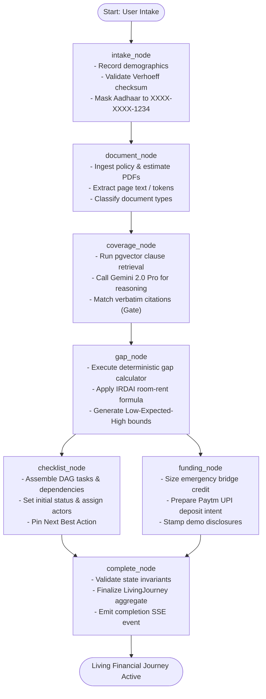

# LifeEvent AI: LangGraph Workflow Architecture

**Document Version:** 2.0  
**Status:** Approved Architectural Baseline  
**Product:** LifeEvent AI — AI-Powered Financial Journey Operating System  
**Framework:** LangGraph (`langgraph.graph.StateGraph`) & Pydantic v2

---

## 1. Pipeline Topology & Design

LifeEvent AI implements its multi-step financial journey pipeline using **LangGraph StateGraph**. Rather than an uncontrolled agentic loop, the pipeline enforces a **deterministic sequence of typed functional transformations** over a shared state dictionary.



---

## 2. Typed State Schema (`LivingJourneyState`)

The pipeline executes over a strictly typed state dictionary matching the aggregate root schema:

```python
from typing import TypedDict, List, Dict, Any, Optional
from backend.app.models.schemas import (
    LifeEventIntake,
    DocumentRecord,
    CoverageClaim,
    GapBreakdown,
    ChecklistItem,
    FundingOffer,
    TimelineEvent
)

class LivingJourneyState(TypedDict):
    id: str
    created_at: str
    updated_at: str
    intake: LifeEventIntake
    documents: List[DocumentRecord]
    document_pages: Dict[str, Dict[str, str]] # {doc_name: {page_num: text}}
    coverage_findings: List[CoverageClaim]
    gap: GapBreakdown
    checklist: List[ChecklistItem]
    funding_options: List[FundingOffer]
    timeline_events: List[TimelineEvent]
    current_stage: str
    next_best_action: str
    is_demo: bool
    error: Optional[str]
```

---

## 3. Node Specifications & Implementation

### 3.1 `intake_node`
- **Responsibility:** Sanitizes user inputs, applies Verhoeff Aadhaar validation, and masks `aadhaar_number` before downstream processing.
- **Invariant:** After this node executes, no 12-digit unmasked sequence exists anywhere in `state["intake"]`.

### 3.2 `document_node`
- **Responsibility:** Ingests document binaries or sample fixtures, runs PyMuPDF / Gemini Vision extraction, and populates `state["document_pages"]`.

### 3.3 `coverage_node`
- **Responsibility:** Maps estimate items to policy clauses. Invokes `citation_validator.py`.
- **Invariant:** Any claim lacking a verbatim match in `state["document_pages"]` has its `is_verified` set to `False` and `likely_covered` set to `0.0`.

### 3.4 `gap_node`
- **Responsibility:** Invokes `calculate_honest_gap()` from `core/gap_calculator.py`.
- **Invariant:** Math is 100% deterministic Python. Outputs `gap_low`, `gap_expected`, and `gap_high`.

### 3.5 `checklist_node`
- **Responsibility:** Generates the task DAG. Sets the initial pinned `next_best_action`.

### 3.6 `funding_node`
- **Responsibility:** Synthesizes emergency funding offers sized to `gap.gap_expected` and attaches demo partner disclosures.

### 3.7 `complete_node`
- **Responsibility:** Runs final invariant checks, registers audit log, and sets `current_stage = "living_journey_active"`.

---

## 4. Building the StateGraph (`backend/app/agents/graph.py`)

```python
from langgraph.graph import StateGraph, END

def build_living_journey_graph() -> StateGraph:
    """
    Constructs and compiles the deterministic LangGraph pipeline.
    """
    workflow = StateGraph(LivingJourneyState)

    # 1. Register Nodes
    workflow.add_node("intake", intake_node)
    workflow.add_node("document", document_node)
    workflow.add_node("coverage", coverage_node)
    workflow.add_node("gap", gap_node)
    workflow.add_node("checklist", checklist_node)
    workflow.add_node("funding", funding_node)
    workflow.add_node("complete", complete_node)

    # 2. Register Edges
    workflow.set_entry_point("intake")
    workflow.add_edge("intake", "document")
    workflow.add_edge("document", "coverage")
    workflow.add_edge("coverage", "gap")
    workflow.add_edge("gap", "checklist")
    workflow.add_edge("checklist", "funding")
    workflow.add_edge("funding", "complete")
    workflow.add_edge("complete", END)

    return workflow.compile()
```

---

## 5. Streaming Progress over SSE

As each node in the LangGraph finishes, a background listener emits a JSON chunk to the Server-Sent Events stream (`/api/journey/{id}/stream`), updating the user's browser with real-time status:

```json
{"step": "coverage", "message": "Matching policy clauses with verified citation quotes...", "timestamp": "2026-11-14T10:00:01.200Z"}
```
This guarantees an engaging, transparent user experience during AI processing.

