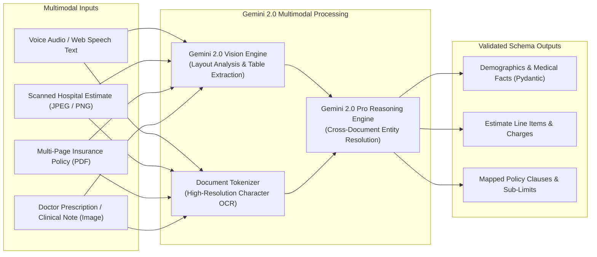

# LifeEvent AI: Multimodal AI Architecture & Processing

**Document Version:** 2.0  
**Status:** Approved Architectural Baseline  
**Product:** LifeEvent AI — AI-Powered Financial Journey Operating System  
**Models:** Google Gemini 2.0 (Flash & Pro) via `google-genai` SDK

---

## 1. Multimodal Architecture Overview

LifeEvent AI leverages the native multimodal capabilities of Google Gemini 2.0 to ingest, analyze, and synthesize heterogeneous document formats and spoken voice data during acute emergencies.



---

## 2. Ingestion Modalities & Technical Pipelines

### 2.1 Spoken Voice Input (English, Hindi, Marathi)
- **Engine:** Browser Native Web Speech API (`SpeechRecognition`).
- **Processing:**
  - Client-side streaming speech-to-text with zero external network overhead.
  - Dynamically configured language models: `en-IN` (Indian English), `hi-IN` (Hindi), `mr-IN` (Marathi).
  - Handles code-switching (e.g., Hinglish / Marathi-English blends common in urban hospital settings).
  - Transcript is packaged into the `condition_description` field of `LifeEventIntake`.

### 2.2 Scanned Medical Bills & Admission Estimates (Vision / OCR)
- **Engine:** Google Gemini 2.0 Flash (`gemini-2.0-flash`).
- **Processing:**
  - Ingests scanned receipts, photos taken on mobile phones, or digital PDF estimates.
  - Performs 2D layout analysis to accurately parse multi-column tabular fee schedules:
    - Doctor Consultation Fees
    - ICU / Room Rent Charges per Day
    - OT & Surgical Consumables
    - Pharmacy & Implant Costs (e.g., Drug-Eluting Stents)
  - Extracts line items into a structured array of expense objects with confidence scores.

### 2.3 Complex Multi-Page Insurance Policies (PDF / RAG)
- **Engine:** PyMuPDF text tokenization + Gemini 2.0 Pro (`gemini-2.0-pro`).
- **Processing:**
  - Extracts page-level text, preserving paragraph boundaries and section titles (`Section 2.1`, `Clause 4.8`).
  - Chunks text into 1,000-token blocks with 15% sliding window overlap.
  - Employs Gemini 2.0 Pro's deep reasoning to cross-reference hospital expense categories against policy exclusions, co-pay rules, and sub-limits.

---

## 3. Gemini 2.0 SDK Implementation (`backend/app/agents/gemini_client.py`)

```python
from google import genai
from google.genai import types
from pydantic import BaseModel
from typing import List, Optional

class ExtractedEstimateItem(BaseModel):
    category: str
    description: str
    estimated_amount: float
    is_consumable: bool

class HospitalEstimateExtraction(BaseModel):
    hospital_name: str
    patient_name: str
    room_category: str
    room_rent_per_day: float
    expected_stay_days: int
    total_estimated_cost: float
    line_items: List[ExtractedEstimateItem]

class GeminiMultimodalClient:
    def __init__(self, api_key: str):
        self.client = genai.Client(api_key=api_key)

    async def extract_estimate_from_image(self, image_bytes: bytes, mime_type: str) -> HospitalEstimateExtraction:
        """
        Uses Gemini 2.0 Flash with Structured Outputs to parse scanned estimate slips.
        """
        prompt = (
            "You are a medical billing expert. Analyze the attached hospital admission estimate. "
            "Extract the hospital name, patient name, room category, daily room rent, stay days, "
            "and all itemized costs. Return strictly conforming to the requested JSON schema."
        )

        response = await self.client.aio.models.generate_content(
            model='gemini-2.0-flash',
            contents=[
                types.Part.from_bytes(data=image_bytes, mime_type=mime_type),
                prompt
            ],
            config=types.GenerateContentConfig(
                response_mime_type="application/json",
                response_schema=HospitalEstimateExtraction,
                temperature=0.1 # Low temperature for factual consistency
            )
        )

        return HospitalEstimateExtraction.model_validate_json(response.text)
```

