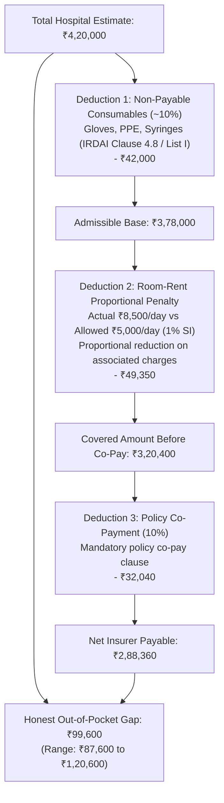

# LifeEvent AI: Policy Reasoning & Insurance Deduction Modeling

**Document Version:** 2.0  
**Status:** Approved Architectural Baseline  
**Product:** LifeEvent AI — AI-Powered Financial Journey Operating System  
**Regulatory Standards:** IRDAI Health Insurance Regulations & Master Circulars

---

## 1. Domain Complexity: Why Indian Insurance Confuses Families

Health insurance policies in India are not simple indemnity contracts. They are complex legal schedules governed by sub-limits, proportional penalties, non-payable lists, and co-pay clauses.

When a family is handed a ₹4,20,000 estimate for an angioplasty under a ₹5,00,000 policy, they expect ₹0 out-of-pocket costs. Instead, they frequently face ₹1,00,000+ in unexpected deductions at discharge.



---

## 2. Mathematical Formalization of Indian Health Insurance Clauses

### 2.1 Room Rent Proportional Deduction (IRDAI Master Circular)
Most retail health policies cap daily room rent at **1% of Sum Insured** (and ICU at 2% of Sum Insured). 

If a patient selects a room category whose daily rent exceeds the cap:
$$\text{Excess Rate} = \max(0, \text{Actual Room Rent} - \text{Allowed Room Rent})$$

Insurers do not simply deduct the excess daily room rent. Under standard policy terms, they apply a **proportional deduction across all "associated medical expenses"** (surgeon fees, nursing charges, anesthetist fees, operation theatre charges):

$$\text{Direct Room Excess} = \text{Excess Rate} \times \text{Stay Days}$$

$$\text{Associated Expense Penalty} = \text{Associated Expenses} \times \left(1 - \frac{\text{Allowed Room Rent}}{\text{Actual Room Rent}}\right)$$

In LifeEvent AI's deterministic calculator (`backend/app/core/gap_calculator.py`):
```python
if actual_room_rent > allowed_room_rent and allowed_room_rent > 0:
    excess_rent_per_day = actual_room_rent - allowed_room_rent
    direct_room_excess = excess_rent_per_day * stay_days
    
    # Associated expenses modeled at 50% of admissible base excluding direct room rent
    associated_expenses = max(0.0, (admissible_base - (actual_room_rent * stay_days)) * 0.50)
    associated_penalty = associated_expenses * (excess_rent_per_day / actual_room_rent)
    room_rent_deduction = direct_room_excess + associated_penalty
```

---

### 2.2 Non-Payable Consumables (List I / Clause 4.8)
Under IRDAI Guidelines, standard health policies exclude over 190 items categorized under "List I - Non-Medical Expenses":
- PPE kits, gloves, masks, sanitizers, thermometer.
- Admission kits, registration charges, medical records fees.
- Food, luxury amenities, diapers, attendant charges.

In hospital estimates, these consumables typically comprise **8% to 12%** of the total bill. LifeEvent AI models this as a default **10% non-payable deduction**:
$$\text{Non-Payables} = 0.10 \times \text{Total Estimate}$$

---

### 2.3 Co-Payment Clauses
Many policies (especially corporate plans, senior citizen policies, or zonal plans) mandate a co-pay:
$$\text{Co-Pay Amount} = \frac{\text{Co-Pay \%}}{100} \times \text{Covered Amount Before Co-Pay}$$

---

## 3. Honest Gap Range Bounds (Low–Expected–High)

Because final claim settlement depends on TPA medical auditor discretion, LifeEvent AI **never provides a single fake number**. It presents an **honest range**:

1. **Expected Gap ($\text{Gap}_{\text{expected}}$):**  
   Strict application of standard room-rent penalty, 10% non-payables, and co-pay.
2. **Low Gap ($\text{Gap}_{\text{low}}$) [Optimistic TPA Scenario]:**  
   Assumes the hospital billing desk reclassifies some consumables into procedure charges and the TPA exercises lenient discretion on associated room fees:
   $$\text{Gap}_{\text{low}} = \max\left(0, \text{Gap}_{\text{expected}} - (0.30 \times \text{Non-Payables}) - (0.20 \times \text{Room Penalty})\right)$$
3. **High Gap ($\text{Gap}_{\text{high}}$) [Strict Audit Scenario]:**  
   Assumes the TPA disallows additional pharmacy lines and applies strict administrative deductions:
   $$\text{Gap}_{\text{high}} = \text{Gap}_{\text{expected}} + (0.05 \times \text{Total Estimate})$$

This transparency protects families from catastrophic financial shock when settling final bills.

