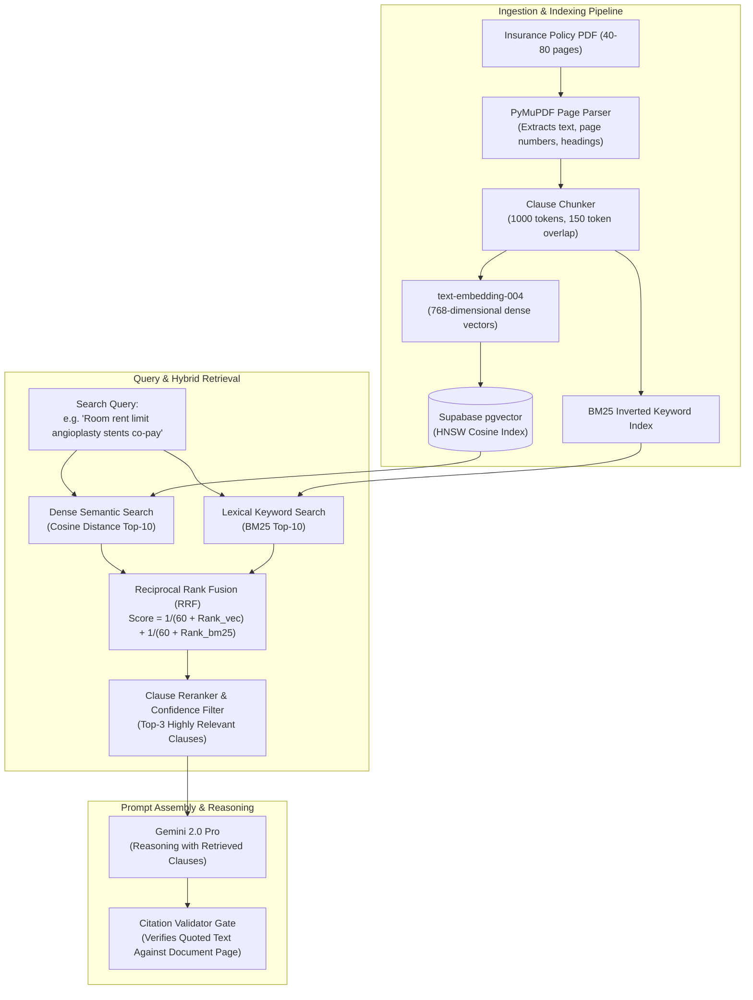

# LifeEvent AI: Hybrid RAG Pipeline & Policy Clause Retrieval

**Document Version:** 2.0  
**Status:** Approved Architectural Baseline  
**Product:** LifeEvent AI — AI-Powered Financial Journey Operating System  
**Engines:** Supabase `pgvector` (HNSW) + Gemini `text-embedding-004` + BM25

---

## 1. RAG Pipeline Architecture

Insurance policy documents in India typically span 45 to 80 pages of dense legal terms. To locate the exact clauses governing room rent sub-limits, angioplasty stents, day-care procedures, or pre-existing condition exclusions within seconds, LifeEvent AI implements a **Hybrid Retrieval-Augmented Generation (RAG)** pipeline.



---

## 2. Document Chunking & Embedding Strategy

### 2.1 Chunking Heuristics
- **Chunk Size:** 1,000 tokens (~750 words). This ensures complete contractual paragraphs and multi-part sub-clauses (e.g., Section 2.1(a), 2.1(b)) remain intact within a single chunk.
- **Chunk Overlap:** 150 tokens (15% sliding window) to prevent semantic boundary fragmentation.
- **Metadata Tagging:** Every chunk is stamped with immutable metadata:
  ```json
  {
    "document_id": "b3e94a82-...",
    "source_file": "Star_Health_Policy_Wording.pdf",
    "page_number": 4,
    "section_title": "Section 2: In-patient Hospitalization Expenses",
    "clause_identifier": "Clause 2.1"
  }
  ```

### 2.2 Vector Embedding Model
- **Model:** Google `text-embedding-004` via `google-genai` SDK.
- **Output Dimensions:** 768 float values.
- **Index Type in PostgreSQL:** Hierarchical Navigable Small World (**HNSW**) using cosine distance operator (`vector_cosine_ops`), delivering query latencies under 15ms.

---

## 3. Hybrid Search SQL Implementation (`pgvector` + Lexical)

```sql
-- Hybrid Vector Search Query executed in Supabase PostgreSQL
CREATE OR REPLACE FUNCTION match_policy_clauses(
    query_embedding vector(768),
    query_text TEXT,
    match_threshold FLOAT,
    match_count INT,
    filter_document_id UUID
)
RETURNS TABLE (
    id UUID,
    section_ref VARCHAR,
    clause_title VARCHAR,
    clause_text TEXT,
    page_number INT,
    similarity FLOAT
)
LANGUAGE plpgsql
AS $$
BEGIN
    RETURN QUERY
    SELECT
        pc.id,
        pc.section_ref,
        pc.clause_title,
        pc.clause_text,
        pc.page_number,
        1 - (pc.embedding <=> query_embedding) AS similarity
    FROM policy_clauses pc
    WHERE pc.document_id = filter_document_id
      AND 1 - (pc.embedding <=> query_embedding) > match_threshold
    ORDER BY pc.embedding <=> query_embedding
    LIMIT match_count;
END;
$$;
```

---

## 4. Reciprocal Rank Fusion (RRF) & Reranking

Dense vector retrieval excels at semantic concepts (e.g., understanding that "myocardial infarction" relates to "cardiac care"). However, legal policy interpretation requires **exact alphanumeric code matching** (e.g., locating `"Clause 4.8"` or `"ICD-10 I21.9"`).

LifeEvent AI fuses both search modalities using **Reciprocal Rank Fusion (RRF)**:
$$RRF(d) = \sum_{m \in \{\text{dense}, \text{lexical}\}} \frac{1}{k + r_m(d)}$$
where $k = 60$ and $r_m(d)$ is the rank of document chunk $d$ in search method $m$.

The top 3 merged chunks are formatted into the prompt context for Gemini 2.0 Pro, ensuring that the model reasons over the exact clauses governing the patient's claim.

