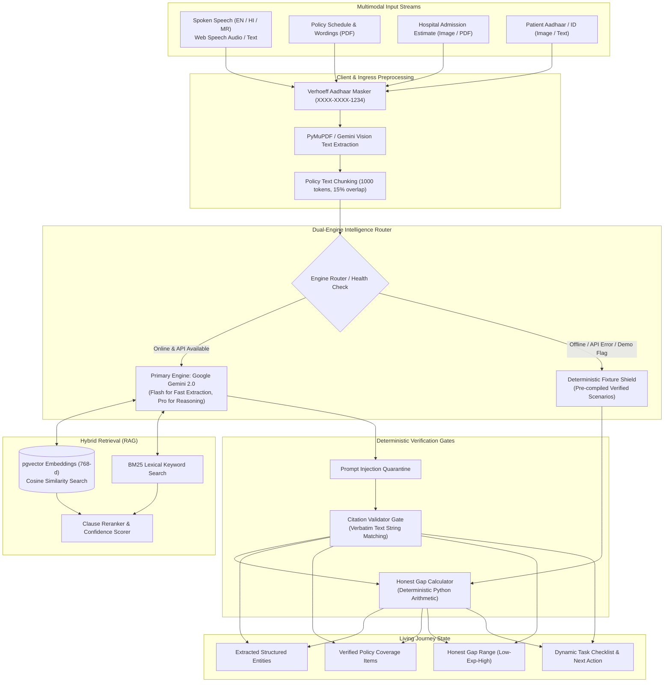

# LifeEvent AI: AI Architecture & Intelligence Pipeline

**Document Version:** 2.0  
**Status:** Approved Architectural Baseline  
**Product:** LifeEvent AI — AI-Powered Financial Journey Operating System

---

## 1. High-Level AI Architecture

LifeEvent AI deploys a **hybrid intelligence architecture** that pairs the reasoning and multimodal extraction power of Google Gemini 2.0 with deterministic verification gates, semantic vector retrieval via `pgvector`, and a fail-safe offline fixture shield.



---

## 2. Model Roles & Responsibilities

| Subsystem | Model | Role & Output | Latency Profile | Fallback Strategy |
| :--- | :--- | :--- | :--- | :--- |
| **Multilingual Voice Intake** | Browser Native Web Speech API | Transcribes spoken Hindi, Marathi, and English client-side into text | < 500ms (streaming) | Standard HTML5 form inputs |
| **Document Classification & OCR** | Gemini 2.0 Flash (`gemini-2.0-flash`) | Ingests multi-page PDFs and images; classifies document types (`health_policy`, `hospital_estimate`, `id_proof`) | ~1.2s per 5-page doc | PyMuPDF text parser |
| **Structured Fact Extraction** | Gemini 2.0 Flash | Extracts demographic, medical, and financial fields adhering to Pydantic schemas | ~1.5s | Pre-compiled fixture dictionaries |
| **Policy Clause Reasoning & RAG**| Gemini 2.0 Pro (`gemini-2.0-pro`) | Cross-examines hospital estimate against policy wording clauses to determine coverage eligibility | ~3.0s | Policy clause lookup table + deterministic rule matrix |
| **Text Embedding** | `text-embedding-004` | Generates 768-dimensional dense vectors for policy clause chunks stored in `pgvector` | ~200ms per batch | Exact keyword matching (BM25) |
| **Financial Out-of-Pocket Math** | Deterministic Python Engine | Computes room-rent penalty, non-payables, co-pay, and Low-Exp-High gap range | < 1ms | Native execution (no fallback needed) |
| **Citation Verification** | Deterministic String Matcher | Validates that LLM coverage quotes exist verbatim on the cited document page | < 5ms | Marks claim `Unverified` and sets `likely_covered: 0` |

---

## 3. The Dual-Engine Architecture & Fixture Shield

To ensure 100% availability during high-stakes presentations, network instability, or external LLM quota limitations, LifeEvent AI operates a **Dual-Engine Router**:

```python
class DualEngineRouter:
    """
    Routes intelligence workloads between Google Gemini 2.0 and the Offline Fixture Shield.
    """
    def __init__(self, gemini_client, fixture_shield, is_demo_mode: bool = False):
        self.gemini = gemini_client
        self.fixture_shield = fixture_shield
        self.is_demo_mode = is_demo_mode

    async def analyze_journey_intake(self, intake: LifeEventIntake) -> LivingJourney:
        # 1. Deterministic fixture route for demo journeys
        if self.is_demo_mode or intake.is_demo or "sample" in intake.hospital_name.lower():
            logger.info("Routing request to Deterministic Offline Fixture Shield.")
            return self.fixture_shield.get_scenario(intake)

        # 2. Live Gemini 2.0 execution with fault-tolerant shield fallback
        try:
            return await self._execute_gemini_pipeline(intake)
        except Exception as err:
            logger.error(f"Gemini 2.0 invocation failed: {err}. Falling back to Fixture Shield.")
            return self.fixture_shield.get_fallback_scenario(intake)
```

---

## 4. Anti-Hallucination Evidence Grounding

A fundamental design principle of LifeEvent AI is: **Never trust an LLM with money or legal commitments.**

### The Three Anti-Hallucination Gates:
1. **Mathematical Isolation:**  
   The LLM is strictly prohibited from doing arithmetic. Prompts explicitly forbid generating final out-of-pocket totals. The model extracts variables (`allowed_room_rent`, `actual_room_rent`, `stay_days`, `copay_percent`), which are fed into `gap_calculator.py`.
2. **Verbatim Citation Matching:**  
   Every coverage claim produced by Gemini must contain:
   - `evidence_doc`: The filename of the source contract.
   - `evidence_page`: The exact integer page number.
   - `clause_ref`: The section or clause identifier (e.g., `Section 2.1`).
   - `evidence_passage`: A verbatim string quote from the document text.
   
   The backend Citation Validator executes a character-level normalized substring search against the pre-parsed text of that specific page. If the passage does not match within an 85% normalized Levenshtein threshold, the claim is flagged as `Unverified` and its `likely_covered` amount is forced to ₹0.
3. **Planted Hallucination Resistance:**  
   The system is regression-tested against synthetic hallucination traps (e.g., a fabricated `"Clause 9.9: Hospital Five-Star Luxury Living Claim"`). The citation gate consistently catches and flags these items, ensuring that users and counselors never see false coverage numbers.

---

## 5. LangGraph StateGraph Pipeline

The LangGraph orchestration pipeline coordinates the journey lifecycle through explicit typed state transitions:

```mermaid
flowchart LR
    NODE_INTAKE["1. intake_node\n(Demographics & Masking)"]
    NODE_DOC["2. document_node\n(Multimodal Parsing)"]
    NODE_COV["3. coverage_node\n(RAG Clause Matching)"]
    NODE_GAP["4. gap_node\n(Deterministic Math)"]
    NODE_CHECK["5. checklist_node\n(Task DAG Generation)"]
    NODE_FUND["6. funding_node\n(Bridge Credit Sizing)"]
    NODE_COMPLETE["7. complete_node\n(Living Journey Ready)"]

    NODE_INTAKE --> NODE_DOC --> NODE_COV --> NODE_GAP --> NODE_CHECK --> NODE_FUND --> NODE_COMPLETE
```



Every node updates an immutable Pydantic state dict. Progress events are pushed to the client via Server-Sent Events (`/api/journey/{id}/stream`), giving the user immediate visual reassurance that their emergency is being actively coordinated.

