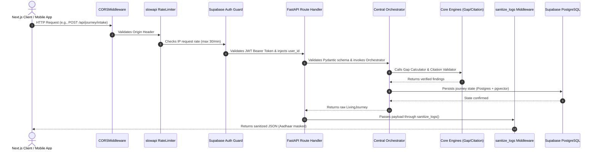

# LifeEvent AI: Backend Architecture Specification

**Document Version:** 2.0  
**Status:** Approved Architectural Baseline  
**Product:** LifeEvent AI — AI-Powered Financial Journey Operating System

---

## 1. Backend Design Philosophy & Principles

The LifeEvent AI backend is built on **FastAPI** and **Python 3.11+**, designed as an asynchronous, modular service architecture adhering to four core engineering principles:

1. **Deterministic Financial Safety:** Core business logic (money math, state transitions, validation) is decoupled from AI models and executed deterministically.
2. **Strict Schema Contracts:** Pydantic v2 models define all ingress, internal state, and egress payloads, providing runtime type safety and automatic OpenAPI schema generation.
3. **Defense-in-Depth Middleware:** Authentication, rate limiting, Aadhaar PII masking, and audit logging operate as non-bypassable middleware layers.
4. **Provider Pluggability:** External fintech, insurance, and government services are isolated behind abstract provider interfaces.

---

## 2. Modular Backend Directory Structure

```
backend/
├── app/
│   ├── main.py                      # FastAPI application, lifespan, CORS, middleware assembly
│   ├── config.py                    # Pydantic BaseSettings (env vars, API keys, thresholds)
│   │
│   ├── api/                         # REST & SSE Route Handlers
│   │   ├── deps.py                  # FastAPI dependency injection (DB sessions, auth users)
│   │   ├── v1/
│   │   │   ├── health.py            # Liveness, readiness, journey counters
│   │   │   ├── journeys.py          # Journey CRUD, intake, re-plan, hard delete
│   │   │   ├── stream.py            # Server-Sent Events (SSE) streaming progress
│   │   │   ├── counselor.py         # B2B Counselor queue summary endpoints
│   │   │   ├── documents.py         # Presigned upload URLs, document metadata
│   │   │   ├── approvals.py         # Customer Approval Gateway endpoints
│   │   │   └── pilot.py             # B2B hospital pilot lead capture
│   │
│   ├── core/                        # Deterministic Business Engines
│   │   ├── security.py              # Verhoeff Aadhaar validation, masking, sanitize_logs
│   │   ├── gap_calculator.py        # IRDAI honest gap range formula
│   │   ├── citation_validator.py    # String-level anti-hallucination quote validator
│   │   ├── state_machine.py         # Financial Journey Graph task state validator
│   │   └── exceptions.py            # RFC 7807 structured domain exceptions
│   │
│   ├── agents/                      # AI & Orchestration Engines
│   │   ├── orchestrator.py          # Central Journey Orchestrator
│   │   ├── graph.py                 # LangGraph StateGraph pipeline builder
│   │   ├── gemini_client.py         # Google GenAI SDK wrapper (Flash & Pro)
│   │   └── prompts.py               # Versioned prompt templates and schemas
│   │
│   ├── db/                          # Persistence Tier (Supabase PostgreSQL)
│   │   ├── session.py               # Async SQLAlchemy / Supabase client factory
│   │   ├── models.py                # SQLAlchemy ORM table definitions
│   │   └── init_db.py               # Database migration & schema initialization script
│   │
│   ├── integrations/                # Provider Abstraction Layer
│   │   ├── base.py                  # Abstract Base Classes (Insurance, Lending, Payment)
│   │   ├── insurance/               # TPA / NHCX adapters (simulated & sandbox)
│   │   ├── lending/                 # RBI DLG lending adapters (simulated & sandbox)
│   │   ├── payments/                # Paytm UPI intent & escrow adapters
│   │   └── government/              # Account Aggregator, DigiLocker, ABDM adapters
│   │
│   └── sample_data/                 # Deterministic Fixture Shield
│       ├── fixtures.py              # Cardiac, orthopedic, and TPA query scenarios
│       └── sample_documents/        # Verified synthetic PDF text chunks
│
└── tests/                           # Pytest Test Suites
    ├── test_aadhaar.py              # Verhoeff checksum & masking unit tests
    ├── test_citation.py             # Citation validator & hallucination trap tests
    ├── test_gap.py                  # IRDAI room-rent & gap math unit tests
    ├── test_graph.py                # LangGraph end-to-end execution test
    ├── test_state_machine.py        # Task state transition validation tests
    ├── test_hard_delete.py          # DPDP erasure compliance tests
    └── test_api_routes.py           # FastAPI HTTP endpoint regression tests
```

---

## 3. Request-Response Lifecycle & Middleware Pipeline



---

## 4. Key Middleware Implementations

### 4.1 CORS Security Policy
```python
# backend/app/main.py
from fastapi.middleware.cors import CORSMiddleware

# Strict origin whitelisting — resolves Security Audit Finding A1
ALLOWED_ORIGINS = [
    "http://localhost:3000",
    "http://127.0.0.1:3000",
    "https://lifeevent.ai",
    "https://staging.lifeevent.ai",
]

app.add_middleware(
    CORSMiddleware,
    allow_origins=ALLOWED_ORIGINS,
    allow_credentials=True,
    allow_methods=["GET", "POST", "PUT", "DELETE", "OPTIONS"],
    allow_headers=["Authorization", "Content-Type", "Idempotency-Key", "X-Client-Version"],
)
```

### 4.2 Rate Limiting Middleware (`slowapi`)
```python
# backend/app/core/rate_limit.py
from slowapi import Limiter
from slowapi.util import get_remote_address

limiter = Limiter(key_func=get_remote_address)

# Applied to critical mutating routes:
# @router.post("/intake")
# @limiter.limit("30/minute")
```

### 4.3 Output Sanitization Guard (`sanitize_logs`)
Every response payload containing journey data passes through a recursive sanitizer that scrubs any 12-digit sequence passing the Verhoeff checksum before bytes leave the server boundary.

