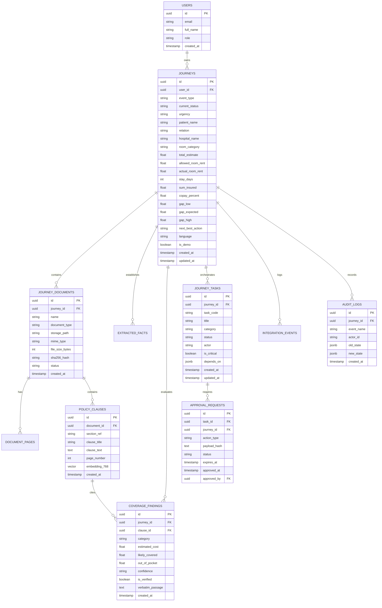

# LifeEvent AI: Database Architecture & Relational Schema

**Document Version:** 2.0  
**Status:** Approved Architectural Baseline  
**Product:** LifeEvent AI — AI-Powered Financial Journey Operating System  
**Engine:** Supabase PostgreSQL 15+ with `pgvector` & Row Level Security

---

## 1. Database Architecture & Design Principles

LifeEvent AI utilizes **Supabase PostgreSQL** as its primary persistent store. The data architecture satisfies four mandatory fintech standards:

1. **Relational Integrity & ACID Guarantees:** Financial states, approvals, and journey dependencies are stored in strict relational tables with foreign keys and cascade rules.
2. **Tenant Isolation via Row Level Security (RLS):** Data access is locked down at the database engine level based on the authenticated Supabase user (`auth.uid()`).
3. **Integrated Vector Search (`pgvector`):** High-dimensional policy clause embeddings are stored alongside relational entities, enabling hybrid SQL queries combining metadata filters with vector similarity.
4. **Immutable Audit Trails:** State transitions, approvals, and DPDP consent actions are recorded in append-only audit tables.

---

## 2. Entity-Relationship (ER) Diagram



---

## 3. PostgreSQL DDL & Schema Definitions

```sql
-- Enable necessary extensions
CREATE EXTENSION IF NOT EXISTS "uuid-ossp";
CREATE EXTENSION IF NOT EXISTS "vector";

-- 1. JOURNEYS TABLE
CREATE TABLE journeys (
    id UUID PRIMARY KEY DEFAULT uuid_generate_v4(),
    user_id UUID NOT NULL REFERENCES auth.users(id) ON DELETE CASCADE,
    event_type VARCHAR(50) NOT NULL DEFAULT 'medical_emergency',
    current_status VARCHAR(50) NOT NULL DEFAULT 'intake',
    urgency VARCHAR(20) NOT NULL DEFAULT 'urgent',
    patient_name VARCHAR(150) NOT NULL,
    relation VARCHAR(50) DEFAULT 'self',
    age INT,
    gender VARCHAR(20),
    hospital_name VARCHAR(255) NOT NULL,
    city VARCHAR(100) DEFAULT 'Pune',
    room_category VARCHAR(100) DEFAULT 'ICU',
    condition_description TEXT,
    language VARCHAR(10) DEFAULT 'en',
    total_estimate NUMERIC(12, 2) DEFAULT 0.00,
    allowed_room_rent NUMERIC(10, 2) DEFAULT 5000.00,
    actual_room_rent NUMERIC(10, 2) DEFAULT 8500.00,
    stay_days INT DEFAULT 4,
    sum_insured NUMERIC(12, 2) DEFAULT 500000.00,
    copay_percent NUMERIC(5, 2) DEFAULT 0.00,
    gap_low NUMERIC(12, 2) DEFAULT 0.00,
    gap_expected NUMERIC(12, 2) DEFAULT 0.00,
    gap_high NUMERIC(12, 2) DEFAULT 0.00,
    next_best_action TEXT,
    is_demo BOOLEAN DEFAULT FALSE,
    created_at TIMESTAMPTZ DEFAULT NOW(),
    updated_at TIMESTAMPTZ DEFAULT NOW()
);

-- Index for user lookups
CREATE INDEX idx_journeys_user_id ON journeys(user_id);
CREATE INDEX idx_journeys_status ON journeys(current_status);

-- 2. JOURNEY_DOCUMENTS TABLE
CREATE TABLE journey_documents (
    id UUID PRIMARY KEY DEFAULT uuid_generate_v4(),
    journey_id UUID NOT NULL REFERENCES journeys(id) ON DELETE CASCADE,
    name VARCHAR(255) NOT NULL,
    document_type VARCHAR(50) NOT NULL, -- 'health_policy', 'hospital_estimate', 'id_proof', 'tpa_query'
    storage_path VARCHAR(500) NOT NULL,
    mime_type VARCHAR(100) NOT NULL,
    file_size_bytes BIGINT,
    sha256_hash VARCHAR(64),
    status VARCHAR(50) DEFAULT 'uploaded', -- 'uploaded', 'analyzed', 'redacted', 'error'
    created_at TIMESTAMPTZ DEFAULT NOW()
);

CREATE INDEX idx_documents_journey_id ON journey_documents(journey_id);

-- 3. POLICY_CLAUSES TABLE (WITH PGVECTOR)
CREATE TABLE policy_clauses (
    id UUID PRIMARY KEY DEFAULT uuid_generate_v4(),
    document_id UUID NOT NULL REFERENCES journey_documents(id) ON DELETE CASCADE,
    section_ref VARCHAR(100) NOT NULL, -- e.g. 'Section 2.1'
    clause_title VARCHAR(255),
    clause_text TEXT NOT NULL,
    page_number INT NOT NULL,
    embedding vector(768), -- Gemini text-embedding-004
    created_at TIMESTAMPTZ DEFAULT NOW()
);

-- HNSW Vector Index for sub-second similarity search
CREATE INDEX idx_policy_clauses_embedding ON policy_clauses USING hnsw (embedding vector_cosine_ops);
CREATE INDEX idx_policy_clauses_doc_id ON policy_clauses(document_id);

-- 4. COVERAGE_FINDINGS TABLE
CREATE TABLE coverage_findings (
    id UUID PRIMARY KEY DEFAULT uuid_generate_v4(),
    journey_id UUID NOT NULL REFERENCES journeys(id) ON DELETE CASCADE,
    clause_id UUID REFERENCES policy_clauses(id) ON DELETE SET NULL,
    category VARCHAR(100) NOT NULL, -- 'Room Rent', 'Surgeon Fee', 'Consumables'
    estimated_cost NUMERIC(12, 2) NOT NULL DEFAULT 0.00,
    likely_covered NUMERIC(12, 2) NOT NULL DEFAULT 0.00,
    out_of_pocket NUMERIC(12, 2) NOT NULL DEFAULT 0.00,
    confidence VARCHAR(30) DEFAULT 'High', -- 'High', 'Medium', 'Needs TPA Confirmation'
    is_verified BOOLEAN DEFAULT TRUE,
    verbatim_passage TEXT NOT NULL,
    created_at TIMESTAMPTZ DEFAULT NOW()
);

CREATE INDEX idx_coverage_journey_id ON coverage_findings(journey_id);

-- 5. JOURNEY_TASKS TABLE (DAG State Engine)
CREATE TABLE journey_tasks (
    id UUID PRIMARY KEY DEFAULT uuid_generate_v4(),
    journey_id UUID NOT NULL REFERENCES journeys(id) ON DELETE CASCADE,
    task_code VARCHAR(100) NOT NULL,
    title VARCHAR(255) NOT NULL,
    category VARCHAR(50) NOT NULL, -- 'document_required', 'pre_auth', 'hospital_task', 'funding_step'
    status VARCHAR(30) NOT NULL DEFAULT 'pending', -- 'pending', 'in_progress', 'blocked', 'needs_review', 'awaiting_approval', 'completed', 'failed', 'cancelled'
    actor VARCHAR(50) DEFAULT 'Family', -- 'Family', 'Hospital TPA Desk', 'Insurer', 'LifeEvent AI'
    is_critical BOOLEAN DEFAULT FALSE,
    depends_on JSONB DEFAULT '[]'::jsonb, -- Array of task IDs required as prerequisites
    created_at TIMESTAMPTZ DEFAULT NOW(),
    updated_at TIMESTAMPTZ DEFAULT NOW()
);

CREATE INDEX idx_tasks_journey_id ON journey_tasks(journey_id);
CREATE INDEX idx_tasks_status ON journey_tasks(status);

-- 6. APPROVAL_REQUESTS TABLE (HITL Consequential Action Safety)
CREATE TABLE approval_requests (
    id UUID PRIMARY KEY DEFAULT uuid_generate_v4(),
    journey_id UUID NOT NULL REFERENCES journeys(id) ON DELETE CASCADE,
    task_id UUID NOT NULL REFERENCES journey_tasks(id) ON DELETE CASCADE,
    action_type VARCHAR(100) NOT NULL, -- 'caution_deposit_upi', 'emergency_loan_apply', 'claim_submit'
    payload_hash VARCHAR(64) NOT NULL, -- SHA-256 of action parameters
    status VARCHAR(30) NOT NULL DEFAULT 'pending', -- 'pending', 'granted', 'rejected', 'expired'
    expires_at TIMESTAMPTZ NOT NULL,
    approved_at TIMESTAMPTZ,
    approved_by UUID REFERENCES auth.users(id),
    created_at TIMESTAMPTZ DEFAULT NOW()
);

CREATE INDEX idx_approvals_journey_id ON approval_requests(journey_id);
CREATE INDEX idx_approvals_status ON approval_requests(status);

-- 7. AUDIT_LOGS TABLE (DPDP & Regulatory Compliance)
CREATE TABLE audit_logs (
    id UUID PRIMARY KEY DEFAULT uuid_generate_v4(),
    journey_id UUID REFERENCES journeys(id) ON DELETE CASCADE,
    event_name VARCHAR(100) NOT NULL,
    actor_id VARCHAR(100) NOT NULL,
    old_state JSONB,
    new_state JSONB,
    ip_address_hash VARCHAR(64),
    created_at TIMESTAMPTZ DEFAULT NOW()
);

CREATE INDEX idx_audit_journey_id ON audit_logs(journey_id);
```

---

## 4. Row Level Security (RLS) Policies

```sql
-- Enable RLS on all tables
ALTER TABLE journeys ENABLE ROW LEVEL SECURITY;
ALTER TABLE journey_documents ENABLE ROW LEVEL SECURITY;
ALTER TABLE policy_clauses ENABLE ROW LEVEL SECURITY;
ALTER TABLE coverage_findings ENABLE ROW LEVEL SECURITY;
ALTER TABLE journey_tasks ENABLE ROW LEVEL SECURITY;
ALTER TABLE approval_requests ENABLE ROW LEVEL SECURITY;
ALTER TABLE audit_logs ENABLE ROW LEVEL SECURITY;

-- Policy 1: Users can read and update only their own journeys
CREATE POLICY "Users can manage own journeys"
ON journeys
FOR ALL
USING (auth.uid() = user_id)
WITH CHECK (auth.uid() = user_id);

-- Policy 2: Hospital Counselors can view journeys matching their tenant hospital
CREATE POLICY "Counselors can view hospital journeys"
ON journeys
FOR SELECT
USING (
    EXISTS (
        SELECT 1 FROM auth.users u
        WHERE u.id = auth.uid()
        AND u.raw_app_meta_data->>'role' = 'counselor'
        AND u.raw_app_meta_data->>'hospital_name' = journeys.hospital_name
    )
);

-- Policy 3: Cascade RLS to documents
CREATE POLICY "Users can view own journey documents"
ON journey_documents
FOR ALL
USING (
    EXISTS (
        SELECT 1 FROM journeys j
        WHERE j.id = journey_documents.journey_id
        AND j.user_id = auth.uid()
    )
);

-- Policy 4: Cascade RLS to tasks
CREATE POLICY "Users can view and manage own journey tasks"
ON journey_tasks
FOR ALL
USING (
    EXISTS (
        SELECT 1 FROM journeys j
        WHERE j.id = journey_tasks.journey_id
        AND j.user_id = auth.uid()
    )
);
```

