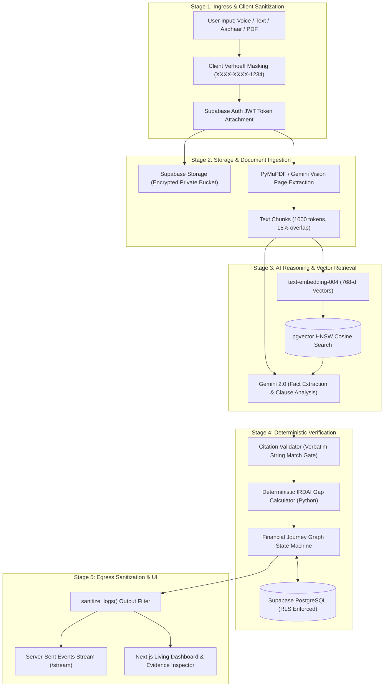

# LifeEvent AI: End-to-End Data Flow Specification

**Document Version:** 2.0  
**Status:** Approved Architectural Baseline  
**Product:** LifeEvent AI — AI-Powered Financial Journey Operating System

---

## 1. End-to-End Data Lifecycle

Data in LifeEvent AI flows through five strictly isolated processing stages:
1. **Stage 1: Ingress & Client Sanitization** (Browser / Client Gateway)
2. **Stage 2: Multimodal Ingestion & Chunking** (Storage & Parsing)
3. **Stage 3: AI Reasoning & Vector Retrieval** (Dual Engine & `pgvector`)
4. **Stage 4: Deterministic Verification & State Mutation** (Calculators & DAG State Engine)
5. **Stage 5: Egress Sanitization & Client Presentation** (REST / SSE)

---

## 2. Detailed Data Transformation Matrix

| Processing Stage | Input Data Format | Output Data Format | Transformation Logic | Privacy & Security Action |
| :--- | :--- | :--- | :--- | :--- |
| **1. Client Intake** | Raw audio or text string; 12-digit Aadhaar | Masked text string (`XXXX-XXXX-1234`) | Client-side Verhoeff $D_5$ algorithm | Raw 12-digit sequence wiped from DOM immediately |
| **2. Document Upload** | Binary PDF / JPEG file | Supabase `storage_path` + SHA-256 hash | Direct presigned S3 upload | File encrypted at rest with AES-256; signed URL expires in 15 mins |
| **3. Page Extraction** | Binary PDF stream | Page-keyed string dictionary (`{"1": "...", "2": "..."}`) | PyMuPDF text tokenization | Memory cleared after chunking; no disk caching |
| **4. Clause Embedding**| Policy text chunk (500–1000 tokens) | 768-dimensional float array | Gemini `text-embedding-004` | Embeddings contain semantic representations only, no PII |
| **5. Clause Retrieval** | Hospital estimate text items | Top-3 relevant policy clause records | Cosine similarity query on `policy_clauses` | Scoped strictly to documents linked to current `journey_id` |
| **6. Citation Gate** | LLM `evidence_passage` string | Boolean `is_verified` flag | Exact substring match against cited page string | If match fails, `likely_covered` forced to ₹0.00 |
| **7. Gap Calculation** | Numerical inputs (room rents, days, SI) | Low, Expected, High gap ranges (INR) | Deterministic IRDAI arithmetic formula | Pure Python arithmetic; zero LLM hallucination risk |
| **8. Egress Filter** | Internal `LivingJourney` dictionary | Serialized JSON response | Recursive regex + Verhoeff pass | Final check guarantees no unmasked Aadhaar leaves server |

---

## 3. Data Retention & Destruction Lifecycle

Under Section 8 of India's Digital Personal Data Protection (DPDP) Act 2023, data must not be retained beyond the time necessary for specified purposes:
1. **Active Journey:** Retained in Supabase PostgreSQL under active status.
2. **Immediate Erasure:** When a user clicks "Erase My Data" (`DELETE /api/journey/{id}`):
   - All rows in `journeys`, `journey_documents`, `coverage_findings`, `journey_tasks`, and `approval_requests` are deleted via `ON DELETE CASCADE`.
   - All uploaded files in Supabase Storage private bucket are deleted via S3 API calls.
   - The deletion is recorded in an immutable, anonymized audit log entry (recording only the `journey_id` hash and timestamp, with zero personal data).
   - Subsequent `GET /api/journey/{id}` queries immediately return `404 Not Found`.

