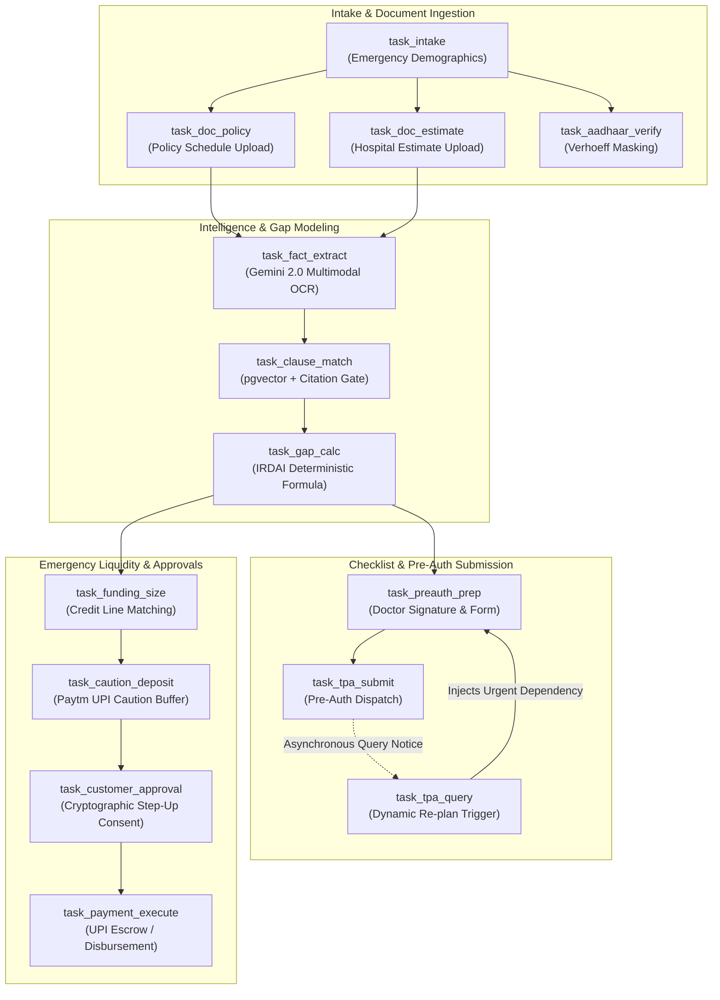
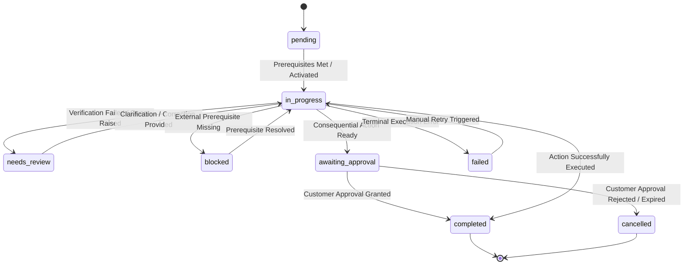

# LifeEvent AI: Financial Journey Graph Specification

**Document Version:** 2.0  
**Status:** Approved Architectural Baseline  
**Product:** LifeEvent AI — AI-Powered Financial Journey Operating System

---

## 1. Concept & Architectural Rationale

Traditional fintech applications model user journeys as rigid, linear forms (Step 1 → Step 2 → Step 3). However, real-life emergencies are inherently non-linear and event-driven. A family at an admission desk may upload an insurance policy, receive an estimate, face an immediate caution deposit demand, encounter a missing doctor's signature, and receive an asynchronous TPA pre-authorization query hours later.

To model this reality safely, LifeEvent AI introduces the **Financial Journey Graph (FJG)**: a directed acyclic graph (DAG) of interdependent financial, medical, and administrative tasks governed by a deterministic backend state engine.



---

## 2. Core Entities of a Financial Journey

Every active journey record encapsulates eleven structural components:
1. **Journey Metadata:** `journey_id` (UUID), `user_id`, `created_at`, `updated_at`, `current_status`.
2. **Event Type:** `medical_emergency` (extensible to `education_overseas`, `bereavement`).
3. **Customer Context:** Patient name, relation, age, gender, language (`en`, `hi`, `mr`), contact phone.
4. **Financial Context:** Estimated bill, allowed room rent, actual room rent, stay days, sum insured, co-pay %, calculated gap range (`gap_low`, `gap_expected`, `gap_high`).
5. **Documents:** Collection of uploaded files, MIME types, Supabase storage paths, and SHA-256 hashes.
6. **Extracted Facts:** Structured entity key-values extracted by Gemini (e.g., diagnosis, room category, policy number) with source page and confidence grade.
7. **Policy Clauses:** Verbatim contractual clauses retrieved via vector/lexical search with citation validation flags.
8. **Tasks (The Graph):** Set of interdependent workflow nodes with dependencies, categories, and assigned actors.
9. **Approvals:** Customer consent artifacts, expiration timestamps, payload hashes, and authorization statuses.
10. **Integration Events:** Append-only log of external provider requests, webhooks, and responses.
11. **Audit History:** Immutable chronological record of all state transitions and user actions.

---

## 3. Task State Machine & Transition Rules

To guarantee financial safety and regulatory compliance, tasks within the Journey Graph can only occupy one of eight strictly defined states:



### State Definitions:
- `pending`: The task is defined in the graph but its prerequisites (`depends_on`) are not yet completed.
- `in_progress`: Prerequisites are satisfied; the task is actively being processed by the user, hospital, or system.
- `blocked`: An external blocking event prevents progress (e.g., waiting for an emergency doctor's signature or physical lab report).
- `needs_review`: Data extracted or provided has low confidence or conflicting information requiring human clarification.
- `awaiting_approval`: The task represents a consequential financial action (e.g., loan commitment, payment execution) requiring explicit customer authorization via the Approval Gateway.
- `completed`: The task's completion criteria have been validated deterministically.
- `failed`: The task encountered a terminal error (e.g., bank server rejected transfer, insurer rejected claim).
- `cancelled`: The task was explicitly revoked by the customer or superseded by a graph re-plan.

---

## 4. State Transition Validation Rules

The backend state engine validates all task mutations against these invariant rules:

1. **Dependency Invariant:**  
   A task cannot transition from `pending` to `in_progress` until all tasks listed in its `depends_on` array have reached `completed`.
2. **Approval Gateway Invariant:**  
   A task categorized as `consequential_financial_action` (e.g., `execute_caution_deposit`, `accept_loan_offer`) cannot transition directly from `in_progress` to `completed`. It **must** transition through `awaiting_approval` and require a valid, non-expired `ApprovalRequest` record.
3. **LLM Mutation Prohibition:**  
   Language models are **strictly prohibited from directly mutating task statuses or financial figures**. The LLM emits suggested actions or extracted facts as unstructured recommendations. The deterministic backend orchestrator evaluates these suggestions against validation schemas and updates graph states.
4. **Idempotency Invariant:**  
   State transition requests must supply an `Idempotency-Key` header. Duplicate transition calls within a 15-minute window return the existing state without re-executing downstream actions.

---

## 5. Dynamic Re-planning Engine (TPA Query Handling)

When an external event occurs out-of-order—such as a hospital counselor logging a TPA Query or an amended hospital estimate slip—the graph engine executes a dynamic re-plan:

```python
def handle_tpa_query_event(journey: LivingJourney, tpa_query_data: TPAQueryPayload) -> LivingJourney:
    """
    Dynamically injects urgent dependencies into the active Journey Graph.
    """
    # 1. Instantiate the urgent query resolution task
    urgent_task = JourneyTask(
        id=f"task-tpa-query-{int(time.time())}",
        title=f"URGENT: Submit {tpa_query_data.requested_document} to Insurance Desk",
        category="document_required",
        status="in_progress",
        is_critical=True,
        actor="Family",
        depends_on=[]
    )
    
    # 2. Block downstream pre-authorization completion until query is resolved
    for task in journey.checklist:
        if task.id == "task-preauth-approval":
            task.status = "blocked"
            task.depends_on.append(urgent_task.id)
            
    # 3. Prepend urgent task to checklist
    journey.checklist.insert(0, urgent_task)
    
    # 4. Update living journey metadata
    journey.current_stage = "tpa_query_pending"
    journey.next_best_action = urgent_task.title
    journey.updated_at = datetime.utcnow()
    
    return journey
```

This guarantees that the patient's family is never left with an outdated action plan when hospital or insurance circumstances change.

