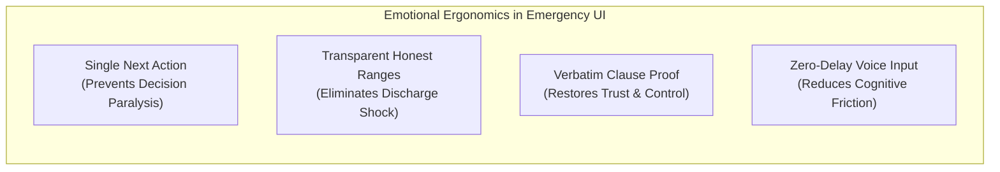

# LifeEvent AI: Frontend Architecture Specification

**Document Version:** 2.0  
**Status:** Approved Architectural Baseline  
**Product:** LifeEvent AI — AI-Powered Financial Journey Operating System

---

## 1. Frontend Architecture & Technology Stack

The LifeEvent AI user interface is engineered with **Next.js 15 (App Router)** and **React 19**, designed to deliver instantaneous, calm, and accessible guidance to users facing extreme cognitive stress during hospital emergencies.

| Component | Technology | Version | Purpose |
| :--- | :--- | :--- | :--- |
| **Framework** | Next.js (App Router) | 15.1.7 | Server-side rendering (SSR), React Server Components (RSC), route handlers |
| **UI Runtime** | React | 19.0.0 | Concurrent rendering, `useActionState`, optimistic UI updates |
| **Styling** | Tailwind CSS v4 & Custom Tokens | — | Bespoke emergency-calm palette; zero generic template styling |
| **Components** | Radix UI / shadcn/ui | Latest | Accessible, headless primitives (dialogs, tooltips, accordions) |
| **Voice Input** | Web Speech API | Browser Native | Multilingual client-side voice dictation (English, Hindi, Marathi) |
| **Streaming** | Server-Sent Events (SSE) | EventSource | Real-time progress updates during AI ingestion and re-planning |
| **State** | React Query / Zustand | — | Client-side cache synchronization for journey state |

---

## 2. Directory Structure & Route Hierarchy

```
frontend/src/
├── app/
│   ├── layout.tsx                   # Root layout (fonts, theme provider, global nav)
│   ├── page.tsx                     # Landing page: hospital-counter crisis story & 5 questions
│   ├── error.tsx                    # Error boundary with user-friendly recovery
│   ├── not-found.tsx                # Custom 404 page with navigation fallbacks
│   │
│   ├── intake/
│   │   └── page.tsx                 # Multilingual voice & form intake, demo loaders
│   │
│   ├── journey/
│   │   └── [id]/
│   │       ├── page.tsx             # Living Journey Dashboard (gap range, pinned action, timeline)
│   │       ├── coverage/
│   │       │   └── page.tsx         # Clause-Verified Evidence Inspector
│   │       └── funding/
│   │           └── page.tsx         # Emergency funding & simulated Paytm UPI caution deposit
│   │
│   ├── documents/
│   │   └── page.tsx                 # Document hub & interactive Verhoeff redactor playground
│   │
│   ├── counselor/
│   │   └── page.tsx                 # B2B Hospital Counselor queue console
│   │
│   ├── for-hospitals/
│   │   └── page.tsx                 # B2B SaaS pilot landing & trial request form
│   │
│   ├── how-it-works/
│   │   └── page.tsx                 # 5-step journey explainer & dual-engine architecture
│   │
│   └── privacy/
│       └── page.tsx                 # DPDP Act privacy charter & one-click hard delete tool
│
├── components/
│   ├── ui/                          # Button, Card, Badge, Progress, Dialog (shadcn/Radix)
│   ├── intake/                      # VoiceMicButton, ScenarioLoader, AadhaarInput
│   ├── journey/                     # HonestGapCard, NextActionButton, JourneyTimeline, TaskChecklist
│   ├── coverage/                    # ClauseCitationModal, CoverageTable, ConfidenceBadge
│   └── counselor/                   # CounselorQueueTable, ReadinessPill, TPAQueryBadge
│
├── lib/
│   ├── api.ts                       # Typed Fetch client for FastAPI endpoints
│   ├── verhoeff.ts                  # Client-side Verhoeff checksum & masking engine
│   ├── speech.ts                    # Web Speech API recognition controller (EN/HI/MR)
│   └── sse.ts                       # Resilient Server-Sent Events listener with auto-reconnect
│
└── design-system/
    ├── tokens.css                   # Color tokens, typography scales, spacing
    └── typography.css               # Devanagari font optimizations (Noto Sans Devanagari)
```

---

## 3. Key Client-Side Subsystems

### 3.1 Multilingual Voice Dictation (`lib/speech.ts`)
The voice dictation engine utilizes the browser's native `SpeechRecognition` API:
- Zero external speech API dependencies or API keys required on the client.
- Language switching binds dynamically to the selected locale:
  - English: `en-IN`
  - Hindi: `hi-IN`
  - Marathi: `mr-IN`
- Provides visual audio feedback and streams recognized interim phrases directly into the medical condition input field.

### 3.2 Client-Side Verhoeff Masking (`lib/verhoeff.ts`)
To protect user privacy before network transmission:
1. As the user types in the Aadhaar input field, numbers are sanitized of spaces and hyphens.
2. Once 12 digits are reached, the Verhoeff multiplication ($d$) and permutation ($p$) tables validate the checksum.
3. If valid, the input display is instantly formatted to `XXXX-XXXX-1234`.
4. If invalid, the attendant is notified that the Aadhaar number contains a typographical error, preventing downstream claim rejection.

### 3.3 Resilient Server-Sent Events (`lib/sse.ts`)
During the intake pipeline, FastAPI emits seven progress events. The frontend maintains an `EventSource` connection:
- Displays an animated multi-step progress stepper:
  1. *Recording life event details & masking Aadhaar identifiers...*
  2. *Parsing hospital admission estimate line-by-line...*
  3. *Matching policy clauses with verified citation quotes...*
  4. *Modeling room-rent proportional deduction & out-of-pocket range...*
  5. *Generating generic pre-authorization action plan...*
  6. *Compiling emergency medical credit & payment options...*
  7. *Living financial journey active.*
- Automatically reconnects with exponential backoff if the network drops in the hospital basement.

---

## 4. UI/UX & Emotional Ergonomics

Users of LifeEvent AI are often experiencing acute emotional trauma. The UI is designed according to **calm fintech principles**:



### Design Standards:
- **High-Contrast Palette:** Slate, Deep Navy (`#002e6e`), Emerald Green (`#059669`), and Alert Amber (`#d97706`).
- **Devanagari Font Hierarchy:** Optimized rendering using `Noto Sans Devanagari` to prevent glyph clipping.
- **Accessibility:** Fully operable via keyboard; WCAG 2.1 AA compliant; strictly respects `prefers-reduced-motion` by disabling CSS animations for sensitive users.

