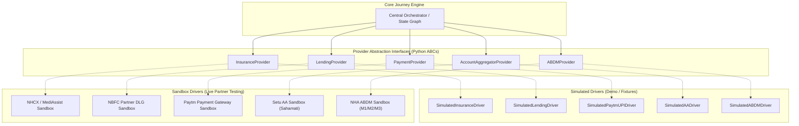

# LifeEvent AI: Integration Architecture & Provider Abstraction Layer

**Document Version:** 2.0  
**Status:** Approved Architectural Baseline  
**Product:** LifeEvent AI — AI-Powered Financial Journey Operating System

---

## 1. Architectural Strategy & Design Pattern

In fintech and healthtech ecosystems, direct coupling to specific third-party APIs (e.g., a specific bank's loan API or a specific TPA's claim portal) creates fragile monoliths that break when partner specifications change.

LifeEvent AI establishes a **Provider Abstraction Layer** based on the **Adapter Pattern**:
1. **Core Business Isolation:** Core financial journey orchestration interacts exclusively with domain-level Python Abstract Base Classes.
2. **Pluggable Drivers:** Each integration supports multiple interchangeable implementations:
   - `SimulatedDriver`: Pre-loaded deterministic behavior for hackathon judging and offline testing.
   - `SandboxDriver`: Staging environment communicating with live partner sandboxes (e.g., Setu AA Sandbox, NHA ABDM Sandbox).
   - `ProductionDriver`: Hardened drivers connected to licensed Regulated Entities (REs).
3. **Environment-Driven Dispatch:** Switching between simulation and live sandboxes requires only changing an environment variable (`PROVIDER_MODE=simulated` or `sandbox`), without altering a single line of business logic.



---

## 2. Abstract Provider Interfaces (Python ABCs)

### 2.1 Insurance Provider Interface (`backend/app/integrations/base.py`)
```python
from abc import ABC, abstractmethod
from typing import Dict, Any, List
from pydantic import BaseModel

class PreAuthRequest(BaseModel):
    journey_id: str
    hospital_id: str
    patient_name: str
    policy_number: str
    diagnosis_code: str
    estimated_cost: float
    documents: List[str]

class PreAuthResponse(BaseModel):
    preauth_ref: str
    status: str # 'admissible', 'query_raised', 'rejected'
    approved_amount: float
    query_details: Dict[str, Any] | None

class InsuranceProvider(ABC):
    @abstractmethod
    async def verify_policy(self, policy_number: str, insurer_id: str) -> Dict[str, Any]:
        """Validates active coverage status and sum insured with the TPA/Insurer."""
        pass

    @abstractmethod
    async def submit_preauth(self, request: PreAuthRequest) -> PreAuthResponse:
        """Submits cashless pre-authorization documentation to the TPA exchange."""
        pass

    @abstractmethod
    async def poll_tpa_status(self, preauth_ref: str) -> PreAuthResponse:
        """Checks for incoming TPA queries or pre-authorization approval letters."""
        pass
```

---

### 2.2 Lending Provider Interface (RBI DLG Compliant)
```python
class LoanPreQualRequest(BaseModel):
    journey_id: str
    applicant_name: str
    pan_masked: str
    required_gap_amount: float
    hospital_name: str

class LoanOffer(BaseModel):
    offer_id: str
    provider_name: str
    sanctioned_amount: float
    interest_rate_apr: float
    tenure_months: int
    monthly_emi: float
    key_fact_statement_url: str

class LendingProvider(ABC):
    @abstractmethod
    async def pre_qualify_emergency_credit(self, request: LoanPreQualRequest) -> List[LoanOffer]:
        """Retrieves pre-approved emergency medical credit offers from partner REs."""
        pass

    @abstractmethod
    async def execute_disbursement(self, offer_id: str, approval_token: str, hospital_escrow: str) -> Dict[str, Any]:
        """Disburses emergency credit directly to the hospital billing escrow account."""
        pass
```

---

### 2.3 Payment Provider Interface (Paytm UPI & Caution Deposits)
```python
class UPIIntentRequest(BaseModel):
    journey_id: str
    amount: float
    payee_vpa: str
    payee_name: str
    reference_note: str

class UPIIntentResponse(BaseModel):
    txn_id: str
    intent_url: str # 'upi://pay?pa=hospital@paytm&pn=RubyHall&am=50000...'
    qr_data: str
    status: str # 'created', 'paid', 'failed'

class PaymentProvider(ABC):
    @abstractmethod
    async def create_caution_deposit_intent(self, request: UPIIntentRequest) -> UPIIntentResponse:
        """Generates a deep-link UPI intent for instant caution deposit payment."""
        pass

    @abstractmethod
    async def verify_payment_status(self, txn_id: str) -> Dict[str, Any]:
        """Verifies final settlement with the Paytm Payment Gateway."""
        pass
```

---

## 3. Reliability & Boundary Safety Protocols

1. **Idempotency Keys:**  
   Every mutating call to external payment or lending endpoints requires an `Idempotency-Key: <UUID>` header. The provider adapter caches keys for 24 hours to prevent duplicate transactions.
2. **Exponential Backoff & Circuit Breakers:**  
   External calls implement a circuit breaker (tripping after 5 consecutive failures) with exponential jitter backoff (`retry_after` header parsing).
3. **Audit Logging:**  
   Every outgoing request payload and incoming response is logged in the `integration_events` table with PII scrubbed via `sanitize_logs()`.

