# LifeEvent AI: System Architecture Specification

**Document Version:** 2.0  
**Status:** Approved Architectural Baseline  
**Product:** LifeEvent AI — AI-Powered Financial Journey Operating System

---

## 1. High-Level System Architecture

LifeEvent AI is architected as an asynchronous, event-driven, multimodal financial journey operating system. It decouples customer experience, stateful journey orchestration, AI intelligence, and external provider integration behind clean boundaries.

```mermaid
flowchart TD
    subgraph ClientTier ["Client Experience Layer (Next.js 15 / React 19)"]
        UI_INTAKE["Multilingual Voice & Form Intake\n(Web Speech API: EN, HI, MR)"]
        UI_DASH["Living Journey Dashboard\n(Timeline, Next Best Action, SSE)"]
        UI_EVID["Evidence Inspector\n(Clause Citation Verifier)"]
        UI_FUND["Emergency Funding Gateway\n(Simulated Paytm UPI & Credit)"]
        UI_COUNSEL["Hospital Counselor B2B Console\n(Queue Management & Readiness)"]
    end

    subgraph IngressGateway ["Ingress, Security & Boundary Control"]
        GATE_CORS["Strict CORS & Security Headers"]
        GATE_RATE["slowapi Rate Limiter\n(30 req/min intake, burst controls)"]
        GATE_AUTH["Supabase Auth JWT Validator"]
        GATE_MASK["Verhoeff Aadhaar Redactor & Log Sanitizer"]
    end

    subgraph BackendCore ["Backend Orchestration Layer (FastAPI)"]
        ORCH_MAIN["Central Journey Orchestrator"]
        ORCH_GRAPH["Financial Journey Graph Engine\n(DAG Task Dependency Machine)"]
        ORCH_LANG["LangGraph StateGraph Engine"]
        CALC_GAP["Honest Gap Calculator\n(Deterministic IRDAI Formula)"]
        VAL_CITE["Citation Validator Gate\n(Verbatim String Matching)"]
    end

    subgraph IntelligenceTier ["Multimodal AI & Retrieval Layer"]
        AI_ROUTER["Dual Engine Router / Fallback Shield"]
        AI_GEMINI["Google Gemini 2.0 Flash / Pro\n(Vision, Multimodal Extraction)"]
        AI_FIXTURE["Deterministic Offline Fixture Shield\n(100% Hackathon Availability)"]
        RAG_ENGINE["Hybrid RAG Retriever\n(pgvector + BM25 Lexical)"]
    end

    subgraph PersistenceTier ["Persistence & Cloud Infrastructure (Supabase)"]
        DB_POSTGRES[("Supabase PostgreSQL DB\n(Row Level Security Enabled)")]
        DB_VECTOR[("pgvector Embeddings\n(HNSW Index for Policy Clauses)")]
        STORAGE_BUCKET["Supabase Private Storage\n(AES-256, 15-min Signed URLs)"]
    end

    subgraph IntegrationTier ["Provider Abstraction Layer"]
        AD_INS["InsuranceProvider Adapter\n(Pre-Auth, TPA Query Exchange)"]
        AD_LEND["LendingProvider Adapter\n(DLG Pre-Qualification)"]
        AD_PAY["PaymentProvider Adapter\n(Paytm UPI Intent & Escrow)"]
        AD_AA["AccountAggregator Adapter\n(Sahamati / Setu FIU)"]
        AD_ABDM["ABDMProvider Adapter\n(ABHA & HL7 FHIR Records)"]
    end

    ClientTier --> IngressGateway
    IngressGateway --> BackendCore
    BackendCore <--> IntelligenceTier
    IntelligenceTier <--> PersistenceTier
    BackendCore <--> PersistenceTier
    BackendCore <--> IntegrationTier
```

---

## 2. Core Architectural Subsystems

### 2.1 Client Experience Layer (Next.js 15)
- **Framework:** Next.js 15 (App Router) with React 19 server components and Tailwind CSS design tokens.
- **Voice Ingestion:** Browser-native Web Speech API providing zero-dependency client-side transcription for Indian languages (English, Hindi, Marathi).
- **Live Updates:** Server-Sent Events (SSE) listener (`/api/journey/{id}/stream`) providing reactive UI updates without aggressive client polling.
- **Client-Side Privacy:** Immediate client-side Verhoeff validation and masking before data leaves the form.

### 2.2 Security & Ingress Gateway
- **Authentication:** Supabase Auth JWT verification validating caller identity and populating `request.state.user`.
- **Tenant Isolation:** Enforced via PostgreSQL Row Level Security (RLS) where every row is filtered by `auth.uid()`.
- **Abuse Mitigation:** `slowapi` rate limiting keyed by client IP (30 requests/min for intake; 60 requests/min for general reads).
- **Aadhaar Masking:** Verhoeff checksum algorithm evaluates every 12-digit number; valid Aadhaar numbers are masked to `XXXX-XXXX-1234`. Invalid numbers, phone numbers, and policy codes pass through untouched.
- **Log Sanitizer:** `sanitize_logs()` runs on every response payload and log string before dispatch.

### 2.3 Backend Orchestration Layer (FastAPI)
- **Framework:** FastAPI 0.115+ running on Python 3.11+, providing async endpoints, strict Pydantic v2 schemas, and dependency injection.
- **Central Orchestrator:** Implements a single central coordinator pattern rather than uncoordinated autonomous agents. It evaluates event context, invokes the Financial Journey Graph, calls specialized services, and manages state.
- **Financial Journey Graph:** A directed acyclic graph (DAG) of interdependent tasks validating state transitions (`pending` → `in_progress` → `needs_review` → `awaiting_approval` → `completed`).
- **Honest Gap Calculator:** Deterministic Python engine computing IRDAI room-rent proportional deduction, 10% non-payable consumables, and co-pay amounts. LLMs are never permitted to produce rupee numbers.

### 2.4 Multimodal AI & Dual-Engine Intelligence
- **Primary Engine:** Google Gemini 2.0 (Flash for fast parsing, Pro for deep policy clause reasoning) via `google-genai` SDK.
- **Offline Fixture Shield:** A deterministic fallback engine pre-loaded with validated scenario fixtures. If the Gemini API is unreachable, rate-limited, or disabled, the fixture shield instantly takes over, guaranteeing 100% demo availability.
- **Citation Gate:** A deterministic verification gate that checks LLM coverage claims against verbatim source text. Claims without verified source citations are marked `Unverified` and assigned ₹0 covered.

### 2.5 Persistence & Storage Tier (Supabase)
- **Database:** Supabase PostgreSQL 15+ hosting relational tables for journeys, documents, tasks, approvals, and audit logs.
- **Vector Search:** `pgvector` extension storing 768-dimensional embeddings of policy wording chunks.
- **Object Storage:** Supabase Storage private buckets storing encrypted PDFs; files are accessed strictly via 15-minute expiring signed URLs.

### 2.6 Provider Abstraction Layer
- **Pattern:** Domain-driven Adapter Pattern with standardized abstract base classes:
  - `InsuranceProvider`
  - `LendingProvider`
  - `PaymentProvider`
  - `AccountAggregatorProvider`
  - `ABDMProvider`
- **Execution Mode:** Configurable via environment variables (`PROVIDER_MODE=simulated` or `sandbox`). Allows switching between demo fixtures, staging sandboxes, and production APIs without touching business logic.

---

## 3. Trust & Safety Boundaries

```mermaid
flowchart LR
    subgraph UntrustedZone ["Untrusted Zone"]
        DOC["Uploaded Policy PDFs & Bills\n(Untrusted Input)"]
        VOICE["User Voice / Text\n(Untrusted Input)"]
    end

    subgraph SanitizationZone ["Sanitization & Boundary Gate"]
        OCR["Multimodal Vision OCR"]
        VERH["Verhoeff Aadhaar Masker"]
        QUOT["Prompt Injection Quarantine"]
    end

    subgraph ReasoningZone ["AI Reasoning & RAG"]
        GEM["Gemini 2.0 Reasoning"]
        VEC["pgvector Clause Matching"]
    end

    subgraph VerificationZone ["Deterministic Verification Gates"]
        GATE_CITE["Citation Validator (Verbatim Match)"]
        GATE_MATH["Deterministic Gap Calculator (Python)"]
        GATE_HITL["Customer Approval Gateway (Cryptographic Consent)"]
    end

    subgraph TrustedZone ["Trusted Financial Ledger"]
        LEDGER[("PostgreSQL Database / State Graph")]
        ACTION["Provider Dispatch / Payment Execution"]
    end

    DOC & VOICE --> OCR --> VERH --> QUOT
    QUOT --> GEM & VEC
    GEM --> GATE_CITE
    GATE_CITE --> GATE_MATH
    GATE_MATH --> GATE_HITL
    GATE_HITL --> LEDGER --> ACTION
```

### Key Safety Invariants:
1. **Untrusted Document Quarantine:** Policy text extracted from uploaded PDFs is treated as untrusted data. Prompts quote document text within strict delimiters, instructing the model never to execute instructions found within user documents.
2. **Deterministic Financial Calculation:** Financial numbers are generated exclusively by `gap_calculator.py`. No LLM-generated monetary estimate is ever committed to the database.
3. **Customer Approval Gateway:** No consequential financial action (loan acceptance, payment transfer, claim submission) can execute without an explicit, time-limited customer approval token.

