# LifeEvent AI: Architecture Gap Analysis

**Date:** 2026-11-14  
**Author:** Principal Software Architect & Fintech Systems Lead  
**Scope:** Comparative Analysis between Existing Prototype Documentation and Target Baseline Architecture  
**Product:** LifeEvent AI — AI-Powered Financial Journey Operating System

---

## 1. Overview & Context

This document performs an exhaustive gap analysis between the existing documentation suite (which describes a hackathon prototype focused on emergency triage at a hospital counter) and the finalized target baseline architecture for **LifeEvent AI**: an enterprise-ready, AI-powered financial journey operating system.

Each identified gap is assigned a severity level:
- 🔴 **CRITICAL:** Fundamental architectural defect or security vulnerability that impedes core system safety, trust, or compliance.
- 🟠 **HIGH:** Missing structural component, unmodeled state transition, or unbacked integration assumption that compromises system reliability.
- 🟡 **MEDIUM:** Incomplete operational specification, missing validation rules, or deficient testing/monitoring strategy.
- 🔵 **LOW:** Cosmetic discrepancy, documentation navigation issue, or minor developer experience friction.

---

## 2. Summary Gap Matrix

| Domain | Gap ID | Severity | Description | Target Baseline Architecture Resolution |
| :--- | :---: | :---: | :--- | :--- |
| **State Machine** | GAP-01 | 🔴 CRITICAL | Lack of formal Financial Journey Graph state machine; states are free-form strings (`current_stage`) | Implement formal deterministic task state machine: `pending`, `in_progress`, `blocked`, `needs_review`, `awaiting_approval`, `completed`, `failed`, `cancelled` with transition validation |
| **Security & Auth** | GAP-02 | 🔴 CRITICAL | Zero authentication or authorization; API routes vulnerable to IDOR; CORS wildcard with credentials | Supabase Auth (JWT Bearer tokens), PostgreSQL Row Level Security (RLS) scoped to `auth.uid()`, strict CORS origins |
| **Persistence** | GAP-03 | 🔴 CRITICAL | Primary persistence relies on ephemeral in-memory dict (`JOURNEY_STORE`); Supabase documented only as optional | Supabase PostgreSQL as mandatory primary persistence with structured relational schema and audit history |
| **Document Storage** | GAP-04 | 🔴 CRITICAL | Documents stored as transient base64 payloads; no secure private bucket or signed URL strategy | Supabase Storage private buckets, AES-256 server-side encryption, time-limited signed URLs (max 15-min expiry) |
| **AI Orchestration** | GAP-05 | 🟠 HIGH | LangGraph modeled as a static linear 7-stage pipeline (`intake → doc → coverage → gap → checklist → funding → complete`) | Central orchestrator with dynamic dependency graph; non-linear task replanning based on asynchronous events |
| **RAG & Clause Matching**| GAP-06 | 🟠 HIGH | Policy text extraction relies on PyMuPDF string matching against synthesized pages; no vector search | Hybrid retrieval: `pgvector` semantic embedding search combined with BM25 keyword matching and deterministic citation validator |
| **Human-in-the-Loop** | GAP-07 | 🔴 CRITICAL | Consequential financial actions (e.g., simulated UPI caution deposit, loan requests) lack cryptographic consent & idempotency | Mandatory Customer Approval Gateway: explicit consent artifacts, idempotency keys, digital signatures, and approval expiration |
| **Integration Layer** | GAP-08 | 🟠 HIGH | External integrations are ad-hoc or simulated in frontend components without provider abstraction interfaces | Domain-driven Provider Abstraction Interfaces for Insurance, Lending, Payments, Account Aggregator, DigiLocker, and ABDM |
| **Database Design** | GAP-09 | 🟠 HIGH | No formal relational database schema, indexes, foreign keys, or migration sequences documented | Complete relational PostgreSQL schema covering 9 core entities with DDL, foreign key constraints, indexes, and RLS |
| **Error Handling** | GAP-10 | 🟡 MEDIUM | Ad-hoc HTTP exception returns; no standardized error format across REST and SSE streams | RFC 7807 Problem Details implementation with structured error codes, retryable flags, and sanitization guarantees |
| **Testing & Eval** | GAP-11 | 🟡 MEDIUM | Test documentation assumes existing 12 pytest suites; lacks RAG evaluation framework (faithfulness, hallucination metrics) | RAG Triad evaluation metrics (Context Relevance, Groundedness, Answer Relevance), sandbox integration test harnesses |
| **Deployment & Ops** | GAP-12 | 🟡 MEDIUM | Setup commands limited to a local Windows batch file; no cloud infrastructure-as-code or deployment runbooks | Next.js on Vercel, FastAPI on Render/Container, Supabase Cloud, complete environment variable schemas and health probes |

---

## 3. Deep-Dive Gap Analysis by Architectural Domain

### 3.1 Financial Journey Graph & State Management
- **Existing State:** The prototype uses an arbitrary string `current_stage` (e.g., `"funding"`, `"tpa_query_pending"`) in `backend/app/models/schemas.py`. Tasks in the checklist have statuses (`pending`, `ready`, `submitted`, `approved`), but transitions are not validated by a state engine.
- **Architectural Risk:** In a financial and medical context, allowing state transitions without validating prerequisites (e.g., moving a claim to "submitted" before KYC or policy verification) creates severe legal and financial exposure.
- **Target Resolution:**
  - Introduce the `Financial Journey Graph`: a directed acyclic graph (DAG) of interdependent tasks.
  - Formally enforce task states: `pending`, `in_progress`, `blocked`, `needs_review`, `awaiting_approval`, `completed`, `failed`, `cancelled`.
  - The backend state machine validates all transitions. LLMs are strictly forbidden from directly mutating task statuses or financial ledger figures.

---

### 3.2 Security, Identity & Row Level Security
- **Existing State:** As documented in `SECURITY_AUDIT.md` (Findings A1 and A2), the prototype has no authentication on any route and enables a CORS wildcard with credentials. Anyone can read, modify, or delete any journey.
- **Architectural Risk:** Exposure of protected health information (PHI) and personally identifiable information (PII) violates India's Digital Personal Data Protection (DPDP) Act 2023 and healthcare data privacy norms.
- **Target Resolution:**
  - Integrate Supabase Auth. Every request must present a valid `Authorization: Bearer <JWT>` header.
  - Implement PostgreSQL Row Level Security (RLS) on all tables, ensuring users can only read and mutate journeys owned by their `auth.uid()`, with role-based policies for hospital financial counselors and administrators.
  - Restrict CORS headers to explicitly whitelisted origin domains.

---

### 3.3 Document Intelligence & Anti-Hallucination RAG
- **Existing State:** The prototype matches exact strings across document pages using PyMuPDF. If Gemini is unavailable, it falls back to a static fixture dictionary.
- **Architectural Risk:** Real-world insurance policy contracts are 40–80 pages of complex legal jargon, riders, and exclusions. Exact string matching fails on OCR variations, scans, and multi-clause cross-references.
- **Target Resolution:**
  - Build a multi-modal ingestion pipeline using Gemini 2.0 Flash / Pro multimodal capabilities for scans, PDFs, and images.
  - Ingest documents into Supabase Storage private buckets.
  - Chunk policy schedules and wordings into structured clauses, generating vector embeddings stored in PostgreSQL via `pgvector`.
  - Implement a dual-gate verification pipeline:
    1. Vector + BM25 hybrid retrieval to locate relevant clauses.
    2. Deterministic Citation Validator that matches LLM claims against verbatim source passages with exact page numbers and clause references.
    3. Mandatory fallback: Any claim lacking a verified citation is rendered as unverified with `likely_covered: 0`.

---

### 3.4 Consequential Action Safety & Human-in-the-Loop (HITL)
- **Existing State:** The prototype has a simulated UPI deposit button and partner offers. While transparently labeled as a demo partner, there is no formal approval request, expiration, or idempotency mechanism.
- **Architectural Risk:** Uncontrolled execution of financial actions or claims submission without customer consent creates regulatory non-compliance with RBI Digital Lending Guidelines and IRDAI regulations.
- **Target Resolution:**
  - Every consequential action (claim filing, emergency credit pre-qualification, caution deposit transfer) must generate an `ApprovalRequest` record.
  - Required fields: `approval_id`, `journey_id`, `task_id`, `action_type`, `payload_hash`, `expires_at`, `status` (`pending`, `granted`, `rejected`, `expired`).
  - Require user authorization via step-up authentication (PIN / OTP).
  - Enforce idempotency using unique `Idempotency-Key` headers on all mutating execution endpoints.

---

### 3.5 Provider Integration Abstraction
- **Existing State:** External systems (insurers, lenders, UPI) are simulated with ad-hoc frontend JSON payloads.
- **Architectural Risk:** Hardcoding mocks directly into UI components makes it impossible to integrate live sandboxes without extensive refactoring.
- **Target Resolution:**
  - Define strict provider abstraction interfaces in the backend:
    - `InsuranceProvider` (pre-auth submission, query tracking, claim status).
    - `LendingProvider` (credit assessment, sanction letter generation, disbursement tracking).
    - `PaymentProvider` (UPI intent creation, mandate setup, payment verification).
    - `AccountAggregatorProvider` (consent creation, encrypted financial data retrieval).
    - `DigiLockerProvider` (document pull for Aadhaar and driving license).
    - `ABDMProvider` (ABHA creation, health record linking via FHIR/M1/M2/M3).
  - Provide both `SimulatedProvider` and `SandboxProvider` implementations for each interface.

---

### 3.6 Data Architecture & Relational Schema
- **Existing State:** Data is kept in Python memory as `JOURNEY_STORE = {}`.
- **Architectural Risk:** Complete data loss on process restart; impossible to run multi-worker backend services; no transactional guarantees.
- **Target Resolution:**
  - Design and document a normalized PostgreSQL schema:
    1. `users` (synced with Supabase Auth)
    2. `journeys` (core journey metadata, status, urgency, language)
    3. `journey_documents` (uploaded files, storage paths, encryption hashes)
    4. `document_pages` (extracted page text, OCR tokens)
    5. `policy_clauses` (chunked clauses with `pgvector` embeddings)
    6. `extracted_facts` (facts verified with confidence scores)
    7. `coverage_findings` (line items, estimated costs, covered amounts, clause citations)
    8. `journey_tasks` (DAG tasks with dependency pointers and status)
    9. `approval_requests` (HITL approval requests with expiration and hashes)
    10. `integration_events` (audit log of external calls and webhooks)
    11. `audit_logs` (immutable event log for DPDP and compliance)

---

## 4. Prioritized Resolution Roadmap

```mermaid
flowchart LR
    subgraph Phase1 ["Phase 1: Foundation (Days 1-2)"]
        G02["GAP-02: Auth & RLS"]
        G03["GAP-03: Supabase Schema"]
        G04["GAP-04: Secure Storage"]
    end

    subgraph Phase2 ["Phase 2: Core Journey (Days 3-4)"]
        G01["GAP-01: Journey Graph Engine"]
        G05["GAP-05: LangGraph Orchestrator"]
        G07["GAP-07: HITL Approval Gateway"]
    end

    subgraph Phase3 ["Phase 3: Intelligence & Adapters (Days 5-6)"]
        G06["GAP-06: RAG + pgvector Pipeline"]
        G08["GAP-08: Provider Interfaces"]
        G10["GAP-10: RFC 7807 Error Handling"]
    end

    subgraph Phase4 ["Phase 4: Hardening & Deploy (Day 7)"]
        G11["GAP-11: AI Evaluation Suite"]
        G12["GAP-12: Cloud CI/CD & Deploy"]
    end

    Phase1 --> Phase2 --> Phase3 --> Phase4
```

This gap analysis establishes the direct requirements for the new documentation suite to be created in `docs/`.

