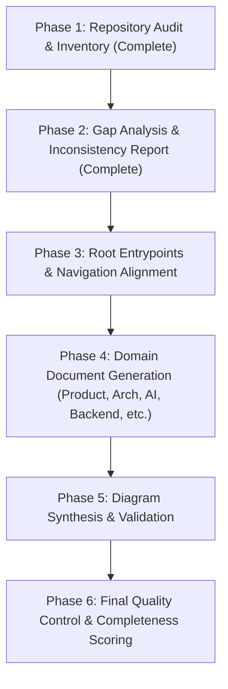

# LifeEvent AI: Documentation Improvement & Generation Plan

**Date:** 2026-11-14  
**Author:** Technical Documentation Lead & Principal Systems Architect  
**Version:** 1.0  
**Product:** LifeEvent AI — AI-Powered Financial Journey Operating System

---

## 1. Strategic Objective

The objective of this plan is to transform the existing 8-document prototype documentation into an enterprise-grade, comprehensive documentation ecosystem suitable for hackathon judges, technical architects, AI/ML engineers, security reviewers, fintech partners, and open-source contributors.

The finished documentation must represent **one coherent, technically defensible LifeEvent AI product**, eliminating all contradictions, standardizing terminology, detailing the full target baseline architecture (Next.js, FastAPI, LangGraph, Gemini 2.0, Supabase PostgreSQL with `pgvector`, and provider abstraction interfaces), and clearly categorizing all capabilities (Implemented, Partially Implemented, Demonstrated, Simulated, Planned, Proposed, Not Yet Verified).

---

## 2. Directory Structure Blueprint

All documentation will be organized under the canonical `docs/` hierarchy, alongside a clean root entrypoint:

```
LifeEvent/
├── README.md                               # Canonical root entrypoint & quick start
├── README(1).md                            # Preserved original document map
├── PRD.md                                  # Preserved original PRD
├── TECH_STACK.md                           # Preserved original tech stack
├── API_REFERENCE.md                        # Preserved original API reference
├── SECURITY_AUDIT.md                       # Preserved original security audit
├── TESTING_QA.md                           # Preserved original testing guide
├── CONTRIBUTING.md                         # Preserved & updated contributing rules
├── CHANGELOG.md                            # Preserved original changelog
├── OPEN_QUESTIONS.md                       # Unresolved project questions & validation needs
│
└── docs/
    ├── README.md                           # Documentation master index & reading guide
    │
    ├── audit/                              # Phase 1 & 2 Audit deliverables
    │   ├── DOCUMENTATION_INVENTORY.md
    │   ├── ARCHITECTURE_GAP_ANALYSIS.md
    │   ├── INCONSISTENCY_REPORT.md
    │   ├── IMPROVEMENT_PLAN.md
    │   ├── CHANGELOG.md
    │   └── FINAL_DOCUMENTATION_AUDIT.md    # Phase 6 final audit & quality matrix
    │
    ├── product/                            # Product specifications & business domain
    │   ├── PRODUCT_REQUIREMENTS.md
    │   ├── PRODUCT_VISION.md
    │   ├── PROBLEM_STATEMENT.md
    │   ├── USER_PERSONAS.md
    │   ├── USER_JOURNEYS.md
    │   ├── FEATURE_SPECIFICATION.md
    │   ├── MVP_SCOPE.md
    │   └── ROADMAP.md
    │
    ├── architecture/                       # Deep architectural specifications & diagrams
    │   ├── SYSTEM_ARCHITECTURE.md
    │   ├── ARCHITECTURE_DECISIONS.md
    │   ├── FINANCIAL_JOURNEY_GRAPH.md
    │   ├── AI_ARCHITECTURE.md
    │   ├── BACKEND_ARCHITECTURE.md
    │   ├── FRONTEND_ARCHITECTURE.md
    │   ├── DATABASE_ARCHITECTURE.md
    │   ├── INTEGRATION_ARCHITECTURE.md
    │   └── DATA_FLOW.md
    │
    ├── ai/                                 # AI models, LangGraph, prompts, RAG, safety
    │   ├── MULTIMODAL_AI.md
    │   ├── DOCUMENT_INTELLIGENCE.md
    │   ├── POLICY_REASONING.md
    │   ├── LANGGRAPH_WORKFLOWS.md
    │   ├── PROMPT_ENGINEERING.md
    │   ├── RAG_PIPELINE.md
    │   ├── AI_EVALUATION.md
    │   ├── HALLUCINATION_PREVENTION.md
    │   └── HUMAN_IN_THE_LOOP.md
    │
    ├── backend/                            # FastAPI, schemas, state machine, auth
    │   ├── API_SPECIFICATION.md
    │   ├── API_ERROR_HANDLING.md
    │   ├── AUTHENTICATION.md
    │   ├── AUTHORIZATION.md
    │   ├── DATABASE_SCHEMA.md
    │   ├── STATE_MANAGEMENT.md
    │   └── BACKGROUND_PROCESSING.md
    │
    ├── integrations/                       # External fintech/health provider adapters
    │   ├── INSURANCE_INTEGRATION.md
    │   ├── LENDING_INTEGRATION.md
    │   ├── PAYMENT_INTEGRATION.md
    │   ├── ACCOUNT_AGGREGATOR.md
    │   ├── DIGILOCKER.md
    │   ├── ABDM.md
    │   └── SANDBOX_STRATEGY.md
    │
    ├── security/                           # Trust, safety, DPDP compliance, threats
    │   ├── SECURITY_ARCHITECTURE.md
    │   ├── THREAT_MODEL.md
    │   ├── DATA_PRIVACY.md
    │   ├── CONSENT_MANAGEMENT.md
    │   ├── AUDIT_LOGGING.md
    │   ├── SECURE_FILE_HANDLING.md
    │   └── FINANCIAL_ACTION_SAFETY.md
    │
    ├── testing/                            # Quality assurance, test plans, AI evals
    │   ├── TEST_STRATEGY.md
    │   ├── UNIT_TESTING.md
    │   ├── INTEGRATION_TESTING.md
    │   ├── END_TO_END_TESTING.md
    │   ├── AI_EVALUATION_TESTS.md
    │   └── TEST_SCENARIOS.md
    │
    ├── deployment/                         # DevOps, local run, cloud hosting, migrations
    │   ├── LOCAL_SETUP.md
    │   ├── ENVIRONMENT_CONFIGURATION.md
    │   ├── FRONTEND_DEPLOYMENT.md
    │   ├── BACKEND_DEPLOYMENT.md
    │   ├── DATABASE_MIGRATIONS.md
    │   └── PRODUCTION_READINESS.md
    │
    ├── research/                           # Market analysis, regulations, competitors
    │   ├── MARKET_OPPORTUNITY.md
    │   ├── COMPETITIVE_ANALYSIS.md
    │   ├── DIFFERENTIATION.md
    │   ├── TECHNICAL_FEASIBILITY.md
    │   ├── LIMITATIONS.md
    │   └── FUTURE_RESEARCH.md
    │
    └── hackathon/                          # Judging criteria, pitch, demo flow, FAQ
        ├── HACKATHON_OVERVIEW.md
        ├── INNOVATION_STATEMENT.md
        ├── TECHNICAL_DIFFERENTIATION.md
        ├── DEMO_SCRIPT.md
        ├── PITCH_STRUCTURE.md
        ├── IMPACT_METRICS.md
        └── JUDGE_FAQ.md
```

---

## 3. Phased Execution Sequence



### Detailed Phase Milestones:

- **Stage 1: Foundation & Audit Documentation** (Complete)
  - Create `docs/audit/DOCUMENTATION_INVENTORY.md`
  - Create `docs/audit/ARCHITECTURE_GAP_ANALYSIS.md`
  - Create `docs/audit/INCONSISTENCY_REPORT.md`
  - Create `docs/audit/IMPROVEMENT_PLAN.md`
  - Create `docs/audit/CHANGELOG.md`

- **Stage 2: Root & Master Navigation**
  - Create canonical root `README.md`
  - Create `docs/README.md` master document index
  - Update `CONTRIBUTING.md` to remove `FreindSHare` references and align with canonical paths
  - Create `OPEN_QUESTIONS.md` for unverified items and partner integration gaps

- **Stage 3: Product & Research Suites (`docs/product/` & `docs/research/`)**
  - Synthesize product vision, requirements, problem statement, user personas, user journeys, feature specs, MVP scope, and roadmap.
  - Synthesize domain research: IRDAI regulations, DPDP Act 2023, market opportunity, competitive analysis, technical feasibility, and limitations.

- **Stage 4: Architecture & AI Suites (`docs/architecture/` & `docs/ai/`)**
  - System architecture with full component Mermaid diagrams.
  - Financial Journey Graph state machine, DAG dependency resolution, and state transition validation.
  - Multimodal AI pipeline (Gemini 2.0), LangGraph StateGraph, prompt engineering, RAG with `pgvector`, hallucination prevention, and human-in-the-loop controls.

- **Stage 5: Backend, Integrations & Security Suites (`docs/backend/`, `docs/integrations/`, `docs/security/`)**
  - Complete REST & SSE API specifications with RFC 7807 error formats.
  - Relational database schema with DDL, indexes, foreign keys, and PostgreSQL RLS policies.
  - Provider abstraction interfaces: Insurance, Lending, Payments, Account Aggregator, DigiLocker, ABDM.
  - Security architecture: STRIDE threat model, Verhoeff Aadhaar masking, signed URLs, consent receipts, and idempotency.

- **Stage 6: Testing, Deployment & Hackathon Suites (`docs/testing/`, `docs/deployment/`, `docs/hackathon/`)**
  - Test strategy, unit test specs, integration tests, E2E Playwright tests, and RAG evaluation tests.
  - Local setup runbook, environment configuration schema, Vercel/Render deployment, and database migration sequences.
  - Hackathon pitch structure, demo script, innovation statement, impact metrics, and judge FAQ.

- **Stage 7: Final Audit & Quality Matrix (`docs/audit/FINAL_DOCUMENTATION_AUDIT.md`)**
  - Completeness matrix scoring every document (0–5 scale) on Accuracy, Completeness, Consistency, Technical Usefulness, and Implementation Traceability.

---

## 4. Technical Quality Standards

1. **Precision over Fluff:** No generic filler text or buzzwords. Every document must contain actionable technical content: code snippets, schemas, formulas, DDL, or Mermaid diagrams.
2. **Implementation Status Transparency:** Every component must be explicitly stamped with its status:
   - `[Implemented]`
   - `[Partially Implemented]`
   - `[Demonstrated]`
   - `[Simulated]`
   - `[Planned]`
   - `[Proposed]`
   - `[Not Yet Verified]`
3. **Traceability:** File links must use proper Markdown format. Technical decisions must reference regulatory statutes (IRDAI Health Regulations, DPDP Act 2023, RBI Digital Lending Guidelines) or architectural drivers.
4. **No Code Modification Without Prior Approval:** Existing files remain untouched except for non-destructive updates to documentation paths and examples.

