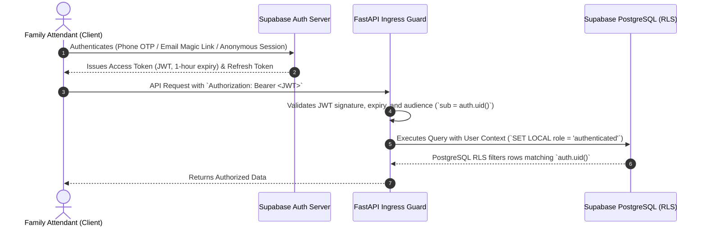

# LifeEvent AI: Authentication Architecture & Token Lifecycle

**Document Version:** 2.0  
**Status:** Approved Architectural Baseline  
**Provider:** Supabase Auth (OAuth2 / JWT Standard)  
**Product:** LifeEvent AI — AI-Powered Financial Journey Operating System

---

## 1. Authentication Architecture Overview

LifeEvent AI integrates **Supabase Auth** for identity management. The architecture balances rapid emergency intake (minimizing friction when an attendant is rushing into a hospital) with cryptographic security for downstream financial operations.



---

## 2. Authentication Modes

### 2.1 Emergency Anonymous / Guest Intake (Low Friction)
- **Problem:** Requiring a family attendant to complete an account sign-up flow while standing in emergency triage causes unacceptable friction and delay.
- **Solution:** Next.js initializes an **Anonymous Supabase Session** upon landing. An anonymous user ID is created, and an initial JWT is issued.
- **Security:** The anonymous JWT permits creating and reading their own `journey_id`. 

### 2.2 Account Elevation & Linkage
- Prior to executing consequential financial actions (e.g., sanctioning a credit line or scheduling post-discharge claim tracking), the user elevates their account by providing a phone number and verifying a 6-digit SMS OTP.
- Supabase Auth links the anonymous session to the verified phone identity without resetting the active `journey_id`.

### 2.3 Step-Up Authentication (Consequential Action Gateway)
- Any task requiring customer authorization (e.g., ₹50,000 caution deposit or loan sanction) requires **Step-Up Authentication**:
  - WebAuthn / Biometric (Fingerprint/FaceID via browser native Credential Management API) OR
  - Time-based 6-digit SMS OTP.
- Generates a short-lived (5-minute) cryptographic approval token sent in the `auth_token` field of `POST /api/journey/{id}/tasks/{task_id}/approve`.

---

## 3. JWT Verification in FastAPI (`backend/app/api/deps.py`)

```python
from fastapi import Depends, HTTPException, status
from fastapi.security import HTTPBearer, HTTPAuthorizationCredentials
import jwt
from jwt import PyJWKClient
import os

security = HTTPBearer()

SUPABASE_URL = os.getenv("SUPABASE_URL", "https://your-project.supabase.co")
JWT_SECRET = os.getenv("SUPABASE_JWT_SECRET")
ALGORITHM = "HS256"

async def get_current_user(credentials: HTTPAuthorizationCredentials = Depends(security)) -> dict:
    """
    Validates the Supabase JWT Bearer token and returns user claims.
    """
    token = credentials.credentials
    try:
        payload = jwt.decode(
            token,
            JWT_SECRET,
            algorithms=[ALGORITHM],
            audience="authenticated"
        )
        user_id = payload.get("sub")
        if not user_id:
            raise HTTPException(
                status_code=status.HTTP_401_UNAUTHORIZED,
                detail="Invalid token: missing subject claim"
            )
        return {
            "id": user_id,
            "email": payload.get("email"),
            "role": payload.get("app_metadata", {}).get("role", "authenticated"),
            "hospital_name": payload.get("app_metadata", {}).get("hospital_name")
        }
    except jwt.ExpiredSignatureError:
        raise HTTPException(
            status_code=status.HTTP_401_UNAUTHORIZED,
            detail="Token has expired. Re-authentication required."
        )
    except jwt.InvalidTokenError as err:
        raise HTTPException(
            status_code=status.HTTP_401_UNAUTHORIZED,
            detail=f"Token validation error: {str(err)}"
        )
```

This guarantees that all API requests are strictly authenticated and traceable to a specific citizen or counselor account.

