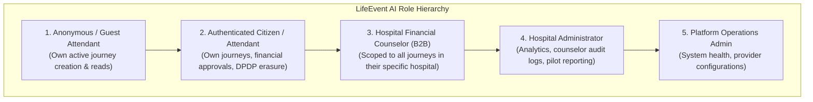

# LifeEvent AI: Authorization & Multi-Tenant Access Control

**Document Version:** 2.0  
**Status:** Approved Architectural Baseline  
**Security Standard:** Role-Based Access Control (RBAC) & PostgreSQL Row Level Security (RLS)  
**Product:** LifeEvent AI — AI-Powered Financial Journey Operating System

---

## 1. Authorization Philosophy & IDOR Elimination

In the early hackathon prototype, all routes were open and IDs were sequential/timestamp-based, creating a critical **Insecure Direct Object Reference (IDOR)** vulnerability (documented as Finding A2 in `SECURITY_AUDIT.md`). Anyone could read, replan, or delete another patient's medical and financial records by guessing a journey ID.

LifeEvent AI eliminates IDOR by enforcing **multi-tenant authorization at two non-bypassable layers**:
1. **Application Gateway Layer (FastAPI Dependencies):** Validates caller permissions before route handlers execute.
2. **Database Engine Layer (PostgreSQL RLS):** Enforces data boundary rules inside SQL queries, ensuring that even if application logic is compromised, the database engine refuses to return unauthorized rows.

---

## 2. Role-Based Access Control (RBAC) Hierarchy



---

## 3. Role & Endpoint Permissions Matrix

| Endpoint | Guest Attendant | Authenticated Citizen | Hospital Counselor | Hospital Admin | Platform Admin |
| :--- | :---: | :---: | :---: | :---: | :---: |
| `POST /api/journey/intake` | ✅ Allowed | ✅ Allowed | ✅ Allowed (Assisted) | ❌ Denied | ❌ Denied |
| `GET /api/journey/{id}` | ✅ (Own Only) | ✅ (Own Only) | ✅ (Tenant Hospital) | ✅ (Tenant Hospital) | ✅ All |
| `POST /api/journey/{id}/replan` | ✅ (Own Only) | ✅ (Own Only) | ✅ (Tenant Hospital) | ❌ Denied | ✅ All |
| `DELETE /api/journey/{id}` | ✅ (Own Only) | ✅ (Own Only) | ❌ Denied | ❌ Denied | ✅ All |
| `POST /api/journey/{id}/approve` | ❌ (Elevate first)| ✅ (Own Only) | ❌ Denied | ❌ Denied | ❌ Denied |
| `GET /api/counselor/journeys` | ❌ Denied | ❌ Denied | ✅ (Tenant Hospital) | ✅ (Tenant Hospital) | ✅ All |
| `POST /api/pilot-request` | ✅ Allowed | ✅ Allowed | ✅ Allowed | ✅ Allowed | ✅ All |

---

## 4. PostgreSQL Row Level Security (RLS) Rules

All tables enforce PostgreSQL RLS. Every query executed by FastAPI sets the user context:

```sql
-- 1. Helper function to extract user hospital metadata
CREATE OR REPLACE FUNCTION get_user_hospital() RETURNS VARCHAR AS $$
    SELECT (auth.jwt()->'app_metadata'->>'hospital_name')::VARCHAR;
$$ LANGUAGE SQL STABLE;

-- 2. Helper function to extract user role
CREATE OR REPLACE FUNCTION get_user_role() RETURNS VARCHAR AS $$
    SELECT (auth.jwt()->'app_metadata'->>'role')::VARCHAR;
$$ LANGUAGE SQL STABLE;

-- 3. Comprehensive RLS on JOURNEYS Table
ALTER TABLE journeys ENABLE ROW LEVEL SECURITY;

-- Rule A: Patients can read and update ONLY their own journeys
CREATE POLICY "Patients manage own journeys"
ON journeys
FOR ALL
TO authenticated
USING (user_id = auth.uid())
WITH CHECK (user_id = auth.uid());

-- Rule B: Hospital Counselors can SELECT journeys within their hospital
CREATE POLICY "Counselors view hospital journeys"
ON journeys
FOR SELECT
TO authenticated
USING (
    get_user_role() = 'counselor' 
    AND hospital_name = get_user_hospital()
);

-- Rule C: Counselors can UPDATE tasks/replans within their hospital
CREATE POLICY "Counselors update hospital journeys"
ON journeys
FOR UPDATE
TO authenticated
USING (
    get_user_role() = 'counselor' 
    AND hospital_name = get_user_hospital()
)
WITH CHECK (
    hospital_name = get_user_hospital()
);

-- Rule D: Hard delete strictly restricted to journey owner or root admin
CREATE POLICY "Only owner can delete journey"
ON journeys
FOR DELETE
TO authenticated
USING (
    user_id = auth.uid() OR get_user_role() = 'platform_admin'
);
```

This guarantees 100% tenant isolation, completely eliminating IDOR vulnerabilities across all environments.

