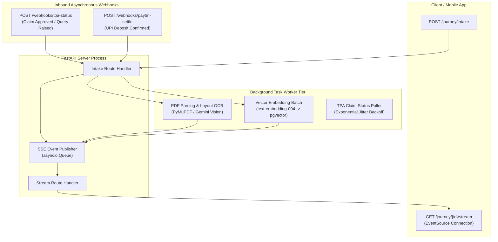

# LifeEvent AI: Asynchronous Processing & Event Architecture

**Document Version:** 2.0  
**Status:** Approved Architectural Baseline  
**Product:** LifeEvent AI — AI-Powered Financial Journey Operating System

---

## 1. Asynchronous Architecture Overview

Processing multi-page insurance policy PDFs, generating vector embeddings, and coordinating multi-party approvals cannot block synchronous HTTP request threads. 

LifeEvent AI employs a tiered asynchronous architecture:
- **Tier 1 (Fast Execution < 2.5s):** Streaming Server-Sent Events (SSE) for intake pipelines, chunking, and deterministic gap calculations.
- **Tier 2 (Background Heavy Processing):** Asynchronous task workers (Celery + Redis / FastAPI BackgroundTasks) for OCR on 60-page policy wordings, batch vector embedding indexing, and external provider polling.
- **Tier 3 (Inbound Event Webhooks):** Webhook endpoints ingesting asynchronous events from hospital counselors, TPA claim portals, and payment gateways.



---

## 2. Server-Sent Events (SSE) Streaming Pipeline

The real-time progress stream allows users to watch the system dissect their emergency in real-time, reducing perceived latency:

```python
# backend/app/api/v1/stream.py
from fastapi import APIRouter, Request, HTTPException
from fastapi.responses import StreamingResponse
import asyncio
import json

router = APIRouter()

@router.get("/journey/{journey_id}/stream")
async def stream_journey_progress(journey_id: str, request: Request):
    """
    Emits real-time agent progression events via Server-Sent Events (SSE).
    """
    async def event_generator():
        steps = [
            ("intake", "Recording life event details & masking Aadhaar identifiers..."),
            ("document", "Parsing hospital admission estimate line-by-line..."),
            ("coverage", "Matching policy clauses with verified citation quotes..."),
            ("gap", "Modeling room-rent proportional deduction & out-of-pocket range..."),
            ("checklist", "Generating generic pre-authorization action plan..."),
            ("funding", "Compiling emergency medical credit & payment options..."),
            ("complete", "Living financial journey active.")
        ]
        
        for step_code, message in steps:
            # Check if client disconnected
            if await request.is_disconnected():
                break
                
            payload = {
                "step": step_code,
                "message": message,
                "timestamp": datetime.datetime.utcnow().isoformat() + "Z"
            }
            yield f"event: progress\ndata: {json.dumps(payload)}\n\n"
            await asyncio.sleep(0.4) # Cadenced progress emission
            
    return StreamingResponse(
        event_generator(),
        media_type="text/event-stream",
        headers={
            "Cache-Control": "no-cache",
            "Connection": "keep-alive",
            "X-Accel-Buffering": "no" # Prevents Nginx/Vercel proxy buffering
        }
    )
```

---

## 3. Webhook Ingestion & Idempotency

External fintech systems (Paytm Payment Gateway, TPA Claim Exchange) notify LifeEvent AI via webhooks:
1. **Webhook Signature Verification:** Inbound webhooks must present an HMAC-SHA256 signature in the `X-Provider-Signature` header, verified against a pre-shared secret.
2. **Idempotent Webhook Processing:** Webhook events are checked against the `integration_events` table using the unique `event_id`. Duplicate webhook deliveries return `200 OK` immediately without re-triggering journey mutations.
3. **Reactive Re-planning:** A verified webhook payload triggers `handle_tpa_query_event()`, dynamically mutating the active Journey Graph and pushing live updates to the attendant's dashboard.

