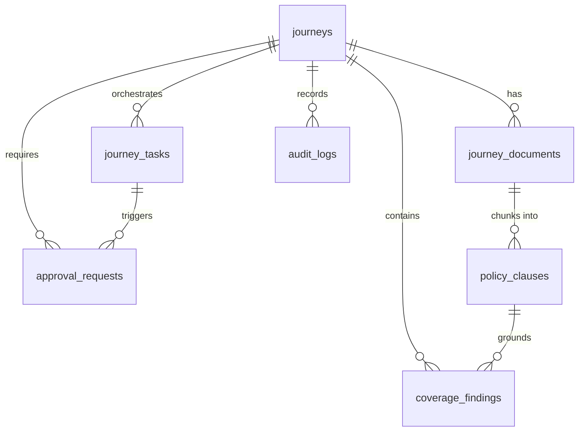

# LifeEvent AI: Database Schema Reference

**Document Version:** 2.0  
**Status:** Approved Architectural Baseline  
**Engine:** Supabase PostgreSQL 15+ with `pgvector` & Row Level Security (RLS)  
**Product:** LifeEvent AI — AI-Powered Financial Journey Operating System

---

## 1. Schema Overview

The LifeEvent AI database architecture organizes data into eleven normalized tables supporting relational integrity, vector similarity search, audit logging, and cryptographic approval workflows.

---

## 2. Table Specifications

### 2.1 `journeys`
The aggregate root table tracking the active life event journey.

| Column | Type | Nullable | Default | Constraints / Description |
| :--- | :--- | :---: | :--- | :--- |
| `id` | `UUID` | No | `uuid_generate_v4()` | Primary Key |
| `user_id` | `UUID` | No | — | Foreign Key → `auth.users(id)` ON DELETE CASCADE |
| `event_type` | `VARCHAR(50)` | No | `'medical_emergency'` | Enum: `medical_emergency`, `education_overseas` |
| `current_status`| `VARCHAR(50)` | No | `'intake'` | Status: `intake`, `living_journey_active`, `tpa_query_pending`, `settled` |
| `urgency` | `VARCHAR(20)` | No | `'urgent'` | Enum: `critical`, `urgent`, `standard` |
| `patient_name` | `VARCHAR(150)`| No | — | Name of admitted patient |
| `relation` | `VARCHAR(50)` | Yes | `'father'` | Attendant relationship to patient |
| `age` | `INT` | Yes | `55` | Age (1–120) |
| `gender` | `VARCHAR(20)` | Yes | `'Male'` | Gender string |
| `hospital_name`| `VARCHAR(255)`| No | — | Name of admitting hospital |
| `city` | `VARCHAR(100)`| Yes | `'Pune'` | Hospital city |
| `room_category`| `VARCHAR(100)`| Yes | `'ICU'` | Selected room category |
| `condition_description`| `TEXT` | No | — | Medical diagnosis / chief complaints |
| `language` | `VARCHAR(10)` | Yes | `'en'` | `en`, `hi`, `mr` |
| `total_estimate`| `NUMERIC(12,2)`| Yes | `0.00` | Hospital bill estimate (INR) |
| `allowed_room_rent`| `NUMERIC(10,2)`| Yes | `5000.00` | Policy room rent cap (INR/day) |
| `actual_room_rent` | `NUMERIC(10,2)`| Yes | `8500.00` | Actual room rent charged (INR/day) |
| `stay_days` | `INT` | Yes | `4` | Projected hospital stay duration |
| `sum_insured` | `NUMERIC(12,2)`| Yes | `500000.00`| Total active policy sum insured (INR) |
| `copay_percent`| `NUMERIC(5,2)` | Yes | `0.00` | Policy co-pay % (0.00 to 100.00) |
| `gap_low` | `NUMERIC(12,2)`| Yes | `0.00` | Optimistic out-of-pocket shortfall |
| `gap_expected` | `NUMERIC(12,2)`| Yes | `0.00` | Expected out-of-pocket shortfall |
| `gap_high` | `NUMERIC(12,2)`| Yes | `0.00` | Strict audit out-of-pocket shortfall |
| `next_best_action`| `TEXT` | Yes | — | Dynamic single next step |
| `is_demo` | `BOOLEAN` | Yes | `FALSE` | Flag for synthetic demo scenarios |
| `created_at` | `TIMESTAMPTZ` | No | `NOW()` | Creation timestamp |
| `updated_at` | `TIMESTAMPTZ` | No | `NOW()` | Last state update timestamp |

---

### 2.2 `journey_documents`
Uploaded and synthesized PDF and image documents.

| Column | Type | Nullable | Default | Description |
| :--- | :--- | :---: | :--- | :--- |
| `id` | `UUID` | No | `uuid_generate_v4()` | Primary Key |
| `journey_id` | `UUID` | No | — | FK → `journeys(id)` ON DELETE CASCADE |
| `name` | `VARCHAR(255)`| No | — | Document filename |
| `document_type`| `VARCHAR(50)` | No | — | `health_policy`, `hospital_estimate`, `id_proof`, `tpa_query` |
| `storage_path` | `VARCHAR(500)`| No | — | Private Supabase Storage object key |
| `mime_type` | `VARCHAR(100)`| No | — | `application/pdf`, `image/jpeg`, etc. |
| `file_size_bytes`| `BIGINT` | Yes | — | Byte size |
| `sha256_hash` | `VARCHAR(64)` | Yes | — | SHA-256 binary hash for integrity |
| `status` | `VARCHAR(50)` | Yes | `'uploaded'` | `uploaded`, `analyzed`, `redacted`, `error` |
| `created_at` | `TIMESTAMPTZ` | No | `NOW()` | Timestamp |

---

### 2.3 `policy_clauses` (with `pgvector`)
Chunked contractual policy clauses with 768-dimensional embeddings.

| Column | Type | Nullable | Default | Description |
| :--- | :--- | :---: | :--- | :--- |
| `id` | `UUID` | No | `uuid_generate_v4()` | Primary Key |
| `document_id` | `UUID` | No | — | FK → `journey_documents(id)` ON DELETE CASCADE |
| `section_ref` | `VARCHAR(100)`| No | — | e.g. `'Section 2.1'`, `'Clause 4.8'` |
| `clause_title` | `VARCHAR(255)`| Yes | — | e.g. `'Room Rent and Nursing Expenses'` |
| `clause_text` | `TEXT` | No | — | Full verbatim chunk text |
| `page_number` | `INT` | No | — | Page in source PDF |
| `embedding` | `vector(768)` | Yes | — | Dense vector generated by `text-embedding-004` |
| `created_at` | `TIMESTAMPTZ` | No | `NOW()` | Timestamp |

**Index:** HNSW index on `embedding` (`vector_cosine_ops`) for sub-15ms vector retrieval.

---

### 2.4 `coverage_findings`
Line-item coverage evaluation with anti-hallucination citations.

| Column | Type | Nullable | Default | Description |
| :--- | :--- | :---: | :--- | :--- |
| `id` | `UUID` | No | `uuid_generate_v4()` | Primary Key |
| `journey_id` | `UUID` | No | — | FK → `journeys(id)` ON DELETE CASCADE |
| `clause_id` | `UUID` | Yes | — | FK → `policy_clauses(id)` ON DELETE SET NULL |
| `category` | `VARCHAR(100)`| No | — | Expense category name |
| `estimated_cost`| `NUMERIC(12,2)`| No | `0.00` | Hospital estimate line total |
| `likely_covered`| `NUMERIC(12,2)`| No | `0.00` | Projected insurance payout |
| `out_of_pocket`| `NUMERIC(12,2)`| No | `0.00` | Patient liability |
| `confidence` | `VARCHAR(30)` | Yes | `'High'` | `'High'`, `'Medium'`, `'Needs TPA Confirmation'` |
| `is_verified` | `BOOLEAN` | No | `TRUE` | Deterministic Citation Gate verification flag |
| `verbatim_passage`| `TEXT` | No | — | Exact quotation cited from policy |
| `created_at` | `TIMESTAMPTZ` | No | `NOW()` | Timestamp |

---

### 2.5 `journey_tasks`
The directed acyclic graph (DAG) tasks governing the financial journey.

| Column | Type | Nullable | Default | Description |
| :--- | :--- | :---: | :--- | :--- |
| `id` | `UUID` | No | `uuid_generate_v4()` | Primary Key |
| `journey_id` | `UUID` | No | — | FK → `journeys(id)` ON DELETE CASCADE |
| `task_code` | `VARCHAR(100)`| No | — | Stable identifier (e.g., `'task_doc_aadhaar'`) |
| `title` | `VARCHAR(255)`| No | — | Imperative action title |
| `category` | `VARCHAR(50)` | No | — | `document_required`, `pre_auth`, `funding_step` |
| `status` | `VARCHAR(30)` | No | `'pending'` | Task state (see `STATE_MANAGEMENT.md`) |
| `actor` | `VARCHAR(50)` | Yes | `'Family'` | `'Family'`, `'Hospital TPA Desk'`, `'Insurer'` |
| `is_critical` | `BOOLEAN` | No | `FALSE` | Critical path indicator |
| `depends_on` | `JSONB` | Yes | `'[]'::jsonb`| Array of prerequisite task IDs |
| `created_at` | `TIMESTAMPTZ` | No | `NOW()` | Timestamp |
| `updated_at` | `TIMESTAMPTZ` | No | `NOW()` | Last state transition timestamp |

---

### 2.6 `approval_requests`
Customer Approval Gateway records for consequential actions.

| Column | Type | Nullable | Default | Description |
| :--- | :--- | :---: | :--- | :--- |
| `id` | `UUID` | No | `uuid_generate_v4()` | Primary Key |
| `journey_id` | `UUID` | No | — | FK → `journeys(id)` ON DELETE CASCADE |
| `task_id` | `UUID` | No | — | FK → `journey_tasks(id)` ON DELETE CASCADE |
| `action_type` | `VARCHAR(100)`| No | — | `'caution_deposit_upi'`, `'emergency_credit_sanction'` |
| `payload_hash` | `VARCHAR(64)` | No | — | SHA-256 of parameters at consent time |
| `status` | `VARCHAR(30)` | No | `'pending'` | `'pending'`, `'granted'`, `'rejected'`, `'expired'` |
| `expires_at` | `TIMESTAMPTZ` | No | — | Expiration timestamp (typically +15 mins) |
| `approved_at` | `TIMESTAMPTZ` | Yes | — | Authorization execution timestamp |
| `approved_by` | `UUID` | Yes | — | FK → `auth.users(id)` |
| `created_at` | `TIMESTAMPTZ` | No | `NOW()` | Timestamp |

