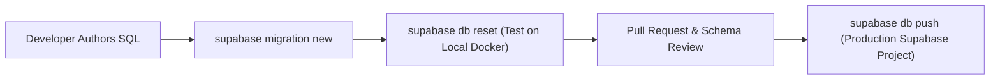

# LifeEvent AI: Database Migration Sequence & Version Control

**Document Version:** 2.0  
**Status:** Approved Architectural Baseline  
**Tooling:** Supabase CLI / PostgreSQL Migration Scripts  
**Product:** LifeEvent AI — AI-Powered Financial Journey Operating System

---

## 1. Migration Management Workflow

Database changes in LifeEvent AI are managed via version-controlled SQL migration scripts stored in `backend/migrations/`. 



---

## 2. Chronological Migration Sequence

### Migration 001: Initial Core Schema (`001_core_schema.sql`)
```sql
-- Extensions
CREATE EXTENSION IF NOT EXISTS "uuid-ossp";

-- Core Journeys Table
CREATE TABLE journeys (
    id UUID PRIMARY KEY DEFAULT uuid_generate_v4(),
    user_id UUID NOT NULL REFERENCES auth.users(id) ON DELETE CASCADE,
    event_type VARCHAR(50) NOT NULL DEFAULT 'medical_emergency',
    current_status VARCHAR(50) NOT NULL DEFAULT 'intake',
    urgency VARCHAR(20) NOT NULL DEFAULT 'urgent',
    patient_name VARCHAR(150) NOT NULL,
    relation VARCHAR(50) DEFAULT 'self',
    age INT,
    gender VARCHAR(20),
    hospital_name VARCHAR(255) NOT NULL,
    city VARCHAR(100) DEFAULT 'Pune',
    room_category VARCHAR(100) DEFAULT 'ICU',
    condition_description TEXT,
    language VARCHAR(10) DEFAULT 'en',
    total_estimate NUMERIC(12, 2) DEFAULT 0.00,
    allowed_room_rent NUMERIC(10, 2) DEFAULT 5000.00,
    actual_room_rent NUMERIC(10, 2) DEFAULT 8500.00,
    stay_days INT DEFAULT 4,
    sum_insured NUMERIC(12, 2) DEFAULT 500000.00,
    copay_percent NUMERIC(5, 2) DEFAULT 0.00,
    gap_low NUMERIC(12, 2) DEFAULT 0.00,
    gap_expected NUMERIC(12, 2) DEFAULT 0.00,
    gap_high NUMERIC(12, 2) DEFAULT 0.00,
    next_best_action TEXT,
    is_demo BOOLEAN DEFAULT FALSE,
    created_at TIMESTAMPTZ DEFAULT NOW(),
    updated_at TIMESTAMPTZ DEFAULT NOW()
);

-- Documents Table
CREATE TABLE journey_documents (
    id UUID PRIMARY KEY DEFAULT uuid_generate_v4(),
    journey_id UUID NOT NULL REFERENCES journeys(id) ON DELETE CASCADE,
    name VARCHAR(255) NOT NULL,
    document_type VARCHAR(50) NOT NULL,
    storage_path VARCHAR(500) NOT NULL,
    mime_type VARCHAR(100) NOT NULL,
    file_size_bytes BIGINT,
    sha256_hash VARCHAR(64),
    status VARCHAR(50) DEFAULT 'uploaded',
    created_at TIMESTAMPTZ DEFAULT NOW()
);
```

---

### Migration 002: Vector Search & Policy Clauses (`002_vector_and_clauses.sql`)
```sql
CREATE EXTENSION IF NOT EXISTS "vector";

CREATE TABLE policy_clauses (
    id UUID PRIMARY KEY DEFAULT uuid_generate_v4(),
    document_id UUID NOT NULL REFERENCES journey_documents(id) ON DELETE CASCADE,
    section_ref VARCHAR(100) NOT NULL,
    clause_title VARCHAR(255),
    clause_text TEXT NOT NULL,
    page_number INT NOT NULL,
    embedding vector(768),
    created_at TIMESTAMPTZ DEFAULT NOW()
);

CREATE INDEX idx_policy_clauses_embedding ON policy_clauses USING hnsw (embedding vector_cosine_ops);
```

---

### Migration 003: Tasks, Approvals & Audit Ledger (`003_tasks_approvals_audit.sql`)
```sql
CREATE TABLE journey_tasks (
    id UUID PRIMARY KEY DEFAULT uuid_generate_v4(),
    journey_id UUID NOT NULL REFERENCES journeys(id) ON DELETE CASCADE,
    task_code VARCHAR(100) NOT NULL,
    title VARCHAR(255) NOT NULL,
    category VARCHAR(50) NOT NULL,
    status VARCHAR(30) NOT NULL DEFAULT 'pending',
    actor VARCHAR(50) DEFAULT 'Family',
    is_critical BOOLEAN DEFAULT FALSE,
    depends_on JSONB DEFAULT '[]'::jsonb,
    created_at TIMESTAMPTZ DEFAULT NOW(),
    updated_at TIMESTAMPTZ DEFAULT NOW()
);

CREATE TABLE approval_requests (
    id UUID PRIMARY KEY DEFAULT uuid_generate_v4(),
    journey_id UUID NOT NULL REFERENCES journeys(id) ON DELETE CASCADE,
    task_id UUID NOT NULL REFERENCES journey_tasks(id) ON DELETE CASCADE,
    action_type VARCHAR(100) NOT NULL,
    payload_hash VARCHAR(64) NOT NULL,
    status VARCHAR(30) NOT NULL DEFAULT 'pending',
    expires_at TIMESTAMPTZ NOT NULL,
    approved_at TIMESTAMPTZ,
    approved_by UUID REFERENCES auth.users(id),
    created_at TIMESTAMPTZ DEFAULT NOW()
);

CREATE TABLE audit_logs (
    id UUID PRIMARY KEY DEFAULT uuid_generate_v4(),
    journey_id UUID REFERENCES journeys(id) ON DELETE SET NULL,
    event_name VARCHAR(100) NOT NULL,
    actor_id VARCHAR(100) NOT NULL,
    old_state JSONB,
    new_state JSONB,
    ip_address_hash VARCHAR(64),
    created_at TIMESTAMPTZ DEFAULT NOW()
);
```

---

### Migration 004: Row Level Security Policies (`004_rls_policies.sql`)
```sql
ALTER TABLE journeys ENABLE ROW LEVEL SECURITY;
ALTER TABLE journey_documents ENABLE ROW LEVEL SECURITY;
ALTER TABLE policy_clauses ENABLE ROW LEVEL SECURITY;
ALTER TABLE journey_tasks ENABLE ROW LEVEL SECURITY;
ALTER TABLE approval_requests ENABLE ROW LEVEL SECURITY;
ALTER TABLE audit_logs ENABLE ROW LEVEL SECURITY;

CREATE POLICY "Users can manage own journeys"
ON journeys FOR ALL TO authenticated
USING (auth.uid() = user_id)
WITH CHECK (auth.uid() = user_id);
```

---

## 3. Rollback & Disaster Recovery Protocol

1. **Transactional Migrations:** Every migration script runs inside an explicit `BEGIN ... COMMIT` block. If any statement fails, the entire transaction rolls back automatically.
2. **Point-in-Time Recovery (PITR):** Supabase PostgreSQL PITR is enabled in production, allowing restoration to any minute within the last 7 days in the event of catastrophic data corruption.

