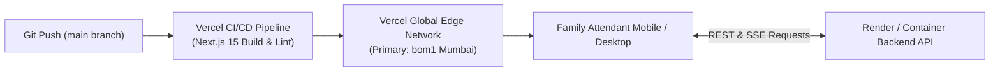

# LifeEvent AI: Frontend Deployment Specification (Vercel)

**Document Version:** 2.0  
**Status:** Approved Architectural Baseline  
**Hosting Platform:** Vercel Edge Network  
**Product:** LifeEvent AI — AI-Powered Financial Journey Operating System

---

## 1. Vercel Deployment Architecture

The Next.js 15 frontend deploys to **Vercel**, taking advantage of regional edge nodes (Mumbai / `bom1`), automatic SSL termination, and native Server-Sent Events (SSE) streaming support.



---

## 2. Vercel Configuration (`frontend/vercel.json`)

```json
{
  "buildCommand": "npm run build",
  "framework": "nextjs",
  "regions": ["bom1"],
  "headers": [
    {
      "source": "/(.*)",
      "headers": [
        { "key": "X-Content-Type-Options", "value": "nosniff" },
        { "key": "X-Frame-Options", "value": "DENY" },
        { "key": "Referrer-Policy", "value": "strict-origin-when-cross-origin" },
        { "key": "Permissions-Policy", "value": "camera=(), microphone=(self), geolocation=()" },
        {
          "key": "Content-Security-Policy",
          "value": "default-src 'self'; script-src 'self' 'unsafe-eval' 'unsafe-inline'; style-src 'self' 'unsafe-inline'; img-src 'self' data: https:; font-src 'self' data:; connect-src 'self' http://localhost:8000 https://api.lifeevent.ai https://*.supabase.co;"
        }
      ]
    }
  ]
}
```

---

## 3. Production Deployment Commands (Vercel CLI)

```bash
# 1. Install Vercel CLI
npm install -g vercel

# 2. Login to Vercel account
vercel login

# 3. Deploy to Staging (Preview)
cd frontend
vercel

# 4. Deploy to Production
vercel --prod
```

### Environment Variable Checklist in Vercel Dashboard:
- `NEXT_PUBLIC_API_URL`: Set to production backend URL (`https://api.lifeevent.ai`).
- `NEXT_PUBLIC_SUPABASE_URL`: Production Supabase project URL.
- `NEXT_PUBLIC_SUPABASE_ANON_KEY`: Production Supabase public anon key.

