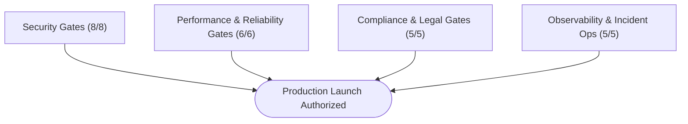

# LifeEvent AI: Production Readiness Checklist & Operational Runbook

**Document Version:** 2.0  
**Status:** Approved Architectural Baseline  
**SLA Targets:** 99.9% Availability / Sub-3s Journey Processing  
**Product:** LifeEvent AI — AI-Powered Financial Journey Operating System

---

## 1. Production Launch Checklist

Before opening the platform to real hospitals or citizens, all 24 gates must be signed off by engineering and security leads:

### 1.1 Security & Access Gates
- [ ] **SEC-1:** CORS wildcard eliminated; strict domain whitelisting active.
- [ ] **SEC-2:** Supabase Auth JWT Bearer token validation enforced on all protected routes.
- [ ] **SEC-3:** PostgreSQL Row Level Security (RLS) active on 100% of tables.
- [ ] **SEC-4:** Verhoeff checksum algorithm masks all valid Aadhaar numbers to `XXXX-XXXX-1234`.
- [ ] **SEC-5:** `sanitize_logs()` intercepts and cleanses 100% of outgoing response payloads and logs.
- [ ] **SEC-6:** Supabase Storage buckets set to Private; presigned URLs capped at 15-minute expiry.
- [ ] **SEC-7:** Customer Approval Gateway active; parameter hash verification and 15-minute timers enforced.
- [ ] **SEC-8:** Dependency vulnerabilities reviewed via `npm audit` and `pip-audit` with zero critical CVEs.

### 1.2 Performance & Reliability Gates
- [ ] **PERF-1:** `slowapi` rate limiting active on intake (30 req/min) and mutating routes.
- [ ] **PERF-2:** Dual-engine fallback verified under simulated Gemini API outages.
- [ ] **PERF-3:** Database connections pooled via Supabase PgBouncer (max 100 connections).
- [ ] **PERF-4:** Pytest suite passes 100% (Aadhaar, gap math, citation gate, graph state).
- [ ] **PERF-5:** Next.js production build passes with zero TypeScript warnings or errors.
- [ ] **PERF-6:** Multi-viewport visual QA verified across 390px, 768px, 1280px, and 1440px widths.

### 1.3 Regulatory & Compliance Gates
- [ ] **COMP-1:** One-click hard delete (`DELETE /api/journey/{id}`) operational under DPDP Act 2023.
- [ ] **COMP-2:** Multilingual consent notices rendered in English, Hindi, and Marathi.
- [ ] **COMP-3:** Zero raw citizen identity card photos retained on disk or cloud storage.
- [ ] **COMP-4:** All lending offers display standardized Key Fact Statements (KFS) under RBI guidelines.
- [ ] **COMP-5:** All demo financial partners and simulated UPI flows stamped with explicit disclosures.

### 1.4 Observability & Incident Response
- [ ] **OPS-1:** Health check probe (`/api/health`) wired to uptime monitor (UptimeRobot / BetterUptime).
- [ ] **OPS-2:** Structured JSON error logging active with zero stack trace leakage to clients.
- [ ] **OPS-3:** Alert notifications routed to engineering Slack/PagerDuty for API error rate $> 1.0\%$.
- [ ] **OPS-4:** Daily automated database backups enabled with 7-day Point-in-Time Recovery (PITR).
- [ ] **OPS-5:** Incident response runbook established for TPA query timeouts and cloud failover.

