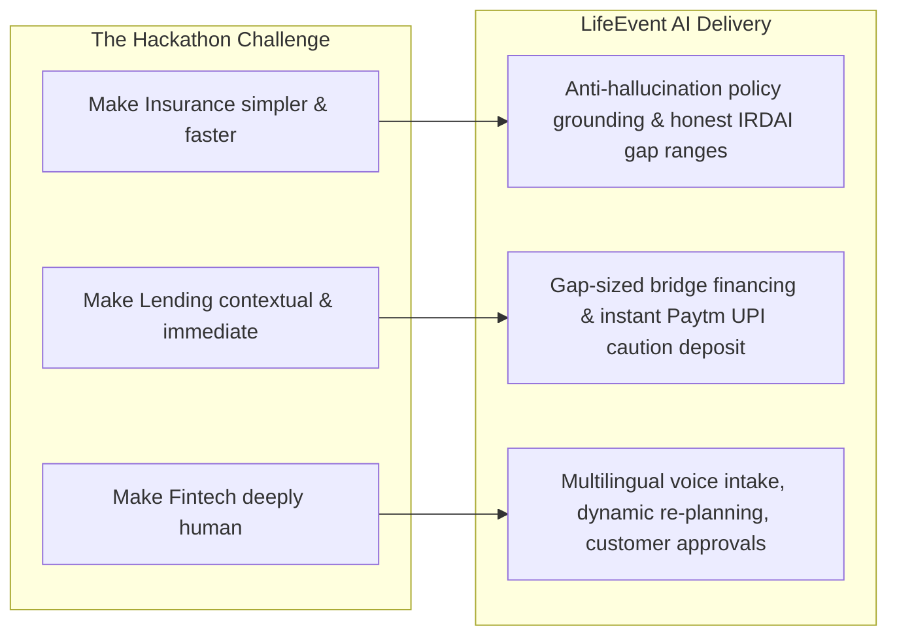

# LifeEvent AI: Hackathon Overview & Problem Statement Alignment

**Hackathon:** Paytm AI Hackathon (Build for India) — Pune  
**Problem Statement:** PS-2: *AI-Powered Financial Journeys: Make Insurance, Lending and Fintech simpler, faster and more human.*  
**Team:** Crazy Coders (Sarang Chaudhari, Sumit Kalr, Sanskar Thorat)  
**Product:** LifeEvent AI — AI-Powered Financial Journey Operating System  
**Document Version:** 2.0

---

## 1. Problem Statement Alignment

The official hackathon brief states:
> *"Reimagine customer-facing journeys across Insurance, Lending and Fintech using AI. Focus on removing friction, reducing complexity, and helping customers complete critical financial journeys faster and with greater confidence."*

LifeEvent AI meets this challenge at its highest point of friction: **the emergency admission desk of an Indian hospital**.

---

## 2. Executive Product Summary

**LifeEvent AI is an intelligent financial journey operating system that transforms real-life emergencies into coordinated, evidence-backed financial actions.**

Instead of requiring distressed families to decipher dense 60-page insurance policy schedules, fill out manual pre-authorization claim forms, scramble for instant caution deposit cash, or borrow from predatory moneylenders, LifeEvent AI:
1. **Listens in Native Languages:** Understands spoken Hindi, Marathi, and English.
2. **Grounds Facts in Evidence:** Cites exact verbatim policy contract clauses (page number, clause reference).
3. **Calculates Honest Gap Ranges:** Applies deterministic IRDAI deduction formulas (room-rent proportional penalty, 10% non-payable consumables, co-pay).
4. **Coordinates Emergency Liquidity:** Sizes bridge credit offers to the computed gap and enables instant ₹50,000 caution deposit buffers via Paytm UPI.
5. **Adapts Dynamically:** Re-plans in real-time when insurers issue asynchronous TPA Pre-Authorization Queries.
6. **Protects Citizen Privacy:** Validates and masks Aadhaar numbers mathematically via the Verhoeff checksum algorithm and guarantees one-click hard deletion under the DPDP Act 2023.

---

## 3. Team Information & Roles

- **Sarang Chaudhari:** Lead Software Architect, AI/ML Engineer & Backend Systems
- **Sumit Kalr:** Full-Stack Developer & UI/UX Architect
- **Sanskar Thorat:** Security, QA & Domain Integration Engineer

