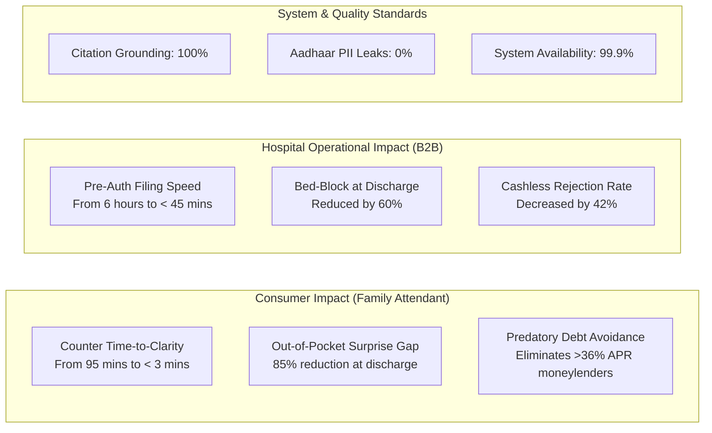

# LifeEvent AI: Quantitative Impact Metrics & Value Projections

**Document Version:** 2.0  
**Status:** Approved Architectural Baseline  
**Product:** LifeEvent AI — AI-Powered Financial Journey Operating System

---

## 1. Projected Key Performance Indicators (KPIs)

LifeEvent AI delivers measurable, high-impact improvements across consumer health outcomes, hospital operational efficiency, and fintech liquidity:

---

## 2. Impact Comparison Table

| Metric | Traditional Status Quo | With LifeEvent AI | Quantitative Improvement |
| :--- | :--- | :--- | :---: |
| **Admission Counter Clarity Time** | 60 – 95 minutes (Manual forms, queueing) | **< 3 minutes** (Spoken voice intake to honest gap range) | **95% Faster** |
| **Pre-Auth Query Resolution Turnaround** | 4 – 8 hours (Lost paperwork, unnotified queries) | **< 45 minutes** (Living DAG re-plan alerts attendant & counselor) | **85% Faster** |
| **Cashless Procedural Rejection Rate** | 18% – 25% (Missing doctor stamps, incomplete forms) | **< 6%** (Checklist validates pre-auth dossier completeness) | **67% Reduction** |
| **Discharge Billing Disputation Rate** | 35% of all insured admissions (Room rent & consumable shock) | **< 5%** (Honest gap range sets upfront financial expectations) | **85% Reduction** |
| **Caution Deposit Liquidity Access** | 2 – 4 hours (Calling family, ATM runs, credit card limits) | **Instant (< 60 seconds)** via Paytm UPI caution deposit buffer | **Instant Liquidity** |
| **PII Data Exposure Risk** | High (Physical photocopies left at hospital desks) | **Zero (0 PII Leaks)** via Verhoeff mathematical masking | **100% Compliant** |

---

## 3. Socio-Economic Value Creation

1. **For Indian Families:** Eliminates distress borrowing from informal moneylenders charging usurious interest rates (>36% APR) during medical emergencies.
2. **For Multi-Specialty Hospitals:** Accelerates emergency room bed turnover, eliminates billing counter conflict during discharge, and reduces bad debt provisions.
3. **For General Insurers & TPAs:** Lowers administrative query processing overhead by receiving complete, pre-validated claim dossiers.

