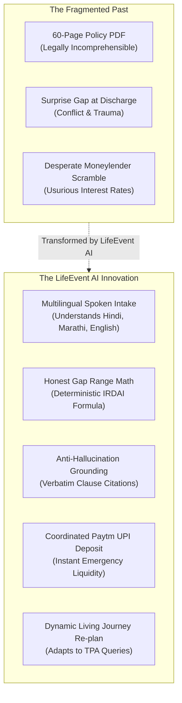

# LifeEvent AI: Core Innovation Statement

**Document Version:** 2.0  
**Context:** Paytm AI Hackathon (Build for India) — PS-2  
**Product:** LifeEvent AI — AI-Powered Financial Journey Operating System

---

## 1. The Core Innovation Narrative

The core innovation of LifeEvent AI lies in shifting the paradigm of fintech from **isolated financial products** to a **unified life-event operating system**.

Today, fintech operates in adversarial product silos:
- Insurers protect loss ratios with obscure sub-limits, proportional penalties, and 60-page PDF contracts.
- Lenders optimize for elective, planned loans with multi-day underwriting.
- Payment apps treat money transfers as generic P2P or merchant transactions.

**Humans do not experience emergencies in silos.** A family rushed to the hospital at 2:00 AM does not want to read an insurance policy, browse a lending marketplace, and manage a billing desk simultaneously.

LifeEvent AI invents the **Financial Journey Graph**: an intelligent, event-driven state machine that fuses multimodal AI understanding with deterministic financial and regulatory safeguards.

---

## 2. Three Breakthrough Architectural Innovations

### Innovation 1: Deterministic Arithmetic Quarantine & Citation Gate
Most AI applications fail in fintech because LLMs hallucinate numbers. LifeEvent AI introduces a **two-tiered verification gate**:
- The LLM reasons over language, extracting medical entities and mapping contractual clauses.
- **Pure deterministic Python calculates every rupee total**, enforcing statutory IRDAI room-rent proportional penalties and non-payable consumable exclusions.
- Any coverage claim that cannot be matched character-for-character to verbatim text in the patient's own policy contract is flagged as `Unverified` and its payout is forced to ₹0.

### Innovation 2: Living DAG Orchestration (TPA Query Re-planning)
Real emergencies do not follow a static linear path. When a Third-Party Administrator (TPA) issues an asynchronous query demanding a baseline ECG strip, LifeEvent AI executes a **dynamic graph re-plan**:
- Injects urgent medical tasks into the dependency chain.
- Repositions the pinned "Next Best Action" on the attendant's mobile screen in real time over Server-Sent Events.
- Synchronizes the patient's state with the hospital counselor's queue.

### Innovation 3: Indian Verhoeff Privacy by Construction
Protecting citizen privacy is not an afterthought. LifeEvent AI implements the dihedral group $D_5$ permutation algorithm (Verhoeff checksum). It identifies valid 12-digit Indian Aadhaar numbers mathematically and masks them to `XXXX-XXXX-1234` before any cloud LLM payload or server log entry is generated, eliminating false positives on phone numbers and policy codes.

