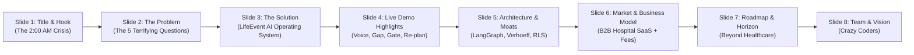

# LifeEvent AI: 5-Minute Pitch Deck Structure

**Context:** Paytm AI Hackathon (Build for India) — Final Pitch  
**Product:** LifeEvent AI — AI-Powered Financial Journey Operating System  
**Presentation Time:** 5 Minutes (with 2 Minutes Q&A)

---

## 1. Slide-by-Slide Deck Outline

---

## 2. Slide Details & Presenter Notes

### Slide 1: Title & Opening Hook
- **Visual:** High-contrast graphic of a distressed attendant at an emergency hospital counter at night.
- **Header:** **LifeEvent AI: The Financial Journey Operating System**
- **Tagline:** *Turning life's critical emergencies into coordinated financial actions.*
- **Presenter Note:** Start with the human story of an attendant holding papers at 2:00 AM. Hook the judges emotionally.

### Slide 2: The Core Problem: Fragmentation in the Triage Deadzone
- **Visual:** Broken diagram showing the 3 isolated silos: Insurance Policy PDF (60 pages) ↔ Hospital Billing Desk (₹50k deposit demand) ↔ Fragmented Lending Apps.
- **Key Points:**
  - 47% Out-of-Pocket health expenditure in India; 55M citizens impoverished annually.
  - Room-rent proportional penalties and consumable lists shock families at discharge.
  - 15–25% of cashless claims delayed or rejected due to procedural query loops.

### Slide 3: The Solution: LifeEvent AI Operating System
- **Visual:** Clean diagram showing the unified operating system: Multimodal Ingestion → Financial Journey Graph → Deterministic Gap Math → Customer Approval Gateway → Hospital Clearance.
- **Key Points:**
  - Single Living Journey connecting insurance pre-auth, gap sizing, and emergency funding.
  - Pinned "Next Best Action" eliminates decision paralysis.

### Slide 4: Live Demonstration Summary
- **Visual:** 4 split screenshots: Multilingual Voice Intake (Hindi), Honest Gap Range Card, Evidence Inspector with Verbatim Clauses, Dynamic TPA Re-planning alert.
- **Key Points:**
  - Zero hallucinations: deterministic Python arithmetic.
  - Planted citation traps caught with 100% precision.
  - Verhoeff Aadhaar masking protects citizen identity.

### Slide 5: Technical Moats & Architecture
- **Visual:** System architecture topology (FastAPI, LangGraph, Gemini 2.0, Supabase PostgreSQL, `pgvector`, RLS).
- **Key Points:**
  - Dual-Engine Router ensures 100% availability.
  - Provider Abstraction Layer isolates simulated mocks from live partner sandboxes.
  - Full DPDP Act 2023 compliance with one-click hard erasure.

### Slide 6: Market Sizing & Business Model
- **Visual:** TAM (₹8.5L Cr) → SAM (₹1.2L Cr) → SOM (₹1,800 Cr). Dual revenue stream chart.
- **Key Points:**
  - B2B Hospital SaaS: ₹25,000/month per hospital branch for counselor console (reduces counter time from 95 mins to <15 mins).
  - Fintech Origination: Sub-1% origination fee on emergency bridge credit and caution deposit lines.

### Slide 7: Long-Term Product Horizon
- **Visual:** Evolution timeline from Medical Emergencies to Overseas Education Financing, Bereavement & Estate Settlement, and Home Ownership.
- **Key Points:**
  - LifeEvent AI is the universal operating system for complex financial life events.

### Slide 8: Team & Closing
- **Visual:** Team Crazy Coders (Sarang Chaudhari, Sumit Kalr, Sanskar Thorat).
- **Closing Call to Action:**  
  *"We built LifeEvent AI to ensure that no family at a hospital counter ever has to fight both a medical emergency and a financial nightmare alone. Thank you!"*

