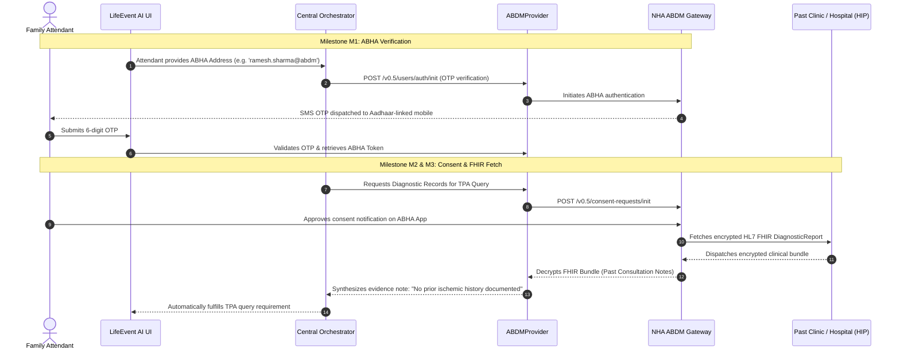

# LifeEvent AI: Ayushman Bharat Digital Mission (ABDM) Integration

**Document Version:** 2.0  
**Status:** `[Proposed / Architecture Specified]`  
**Governing Authority:** National Health Authority (NHA), Government of India  
**Standard:** Ayushman Bharat Digital Mission (ABDM) Milestone M1, M2, M3 / HL7 FHIR  
**Product:** LifeEvent AI — AI-Powered Financial Journey Operating System

---

## 1. Context: Resolving Pre-Existing Disease Queries via ABHA

When a patient is admitted for an emergency procedure (e.g., emergency angioplasty or gallbladder surgery), insurance TPAs frequently raise Pre-Authorization Queries questioning whether the condition was pre-existing before policy inception:
> *"Submit past 3 years' medical consultation papers, physician notes, and past hospitalization records to rule out pre-existing hypertension/diabetes."*

Gathering physical past prescriptions during an emergency is nearly impossible, causing cashless pre-authorization to lapse.

**ABDM Integration resolves this instantly** by linking the patient's **Ayushman Bharat Health Account (ABHA)** to retrieve past electronic health records (EHR) via the national Health Information Exchange:



---

## 2. Technical API Specification (`ABDMProvider`)

```python
class ABHAAuthRequest(BaseModel):
    journey_id: str
    abha_address: str # 'user@abdm' or 14-digit ABHA Number
    auth_mode: str = "MOBILE_OTP"

class ABDMConsentRequest(BaseModel):
    journey_id: str
    abha_address: str
    hi_types: List[str] = ["DiagnosticReport", "DischargeSummary", "Prescription"]
    date_from: str
    date_to: str

class ABDMProvider(ABC):
    @abstractmethod
    async def verify_abha(self, request: ABHAAuthRequest) -> Dict[str, Any]:
        """Initiates NHA ABDM M1 authentication challenge."""
        pass

    @abstractmethod
    async def request_health_records(self, request: ABDMConsentRequest) -> str:
        """Creates ABDM electronic consent artifact for clinical records (M2)."""
        pass

    @abstractmethod
    async def fetch_fhir_bundle(self, consent_id: str) -> Dict[str, Any]:
        """Retrieves and decrypts FHIR bundle containing clinical history (M3)."""
        pass
```

---

## 3. Compliance & Security Boundaries

1. **Ephemeral Clinical Cache:** Clinical records fetched via ABDM are processed transiently in memory to resolve specific TPA query parameters. Raw medical dossiers are never retained in persistent storage without explicit user archiving consent.
2. **End-to-End Encryption:** Data transferred between Health Information Providers (HIPs) and LifeEvent AI (HIU) is encrypted using ephemeral Diffie-Hellman keys adhering to NHA cryptographic standards.
3. **Audit Trail:** Every ABDM fetch event is recorded in `audit_logs` with the unique ABDM transaction reference number.

