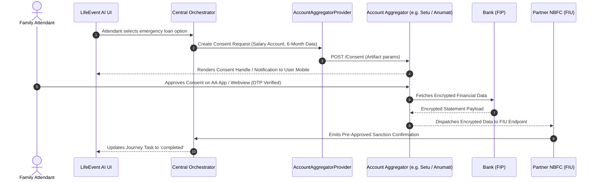

# LifeEvent AI: Account Aggregator (AA) Integration Specification

**Document Version:** 2.0  
**Status:** `[Proposed / Architecture Specified]`  
**Regulatory Framework:** Reserve Bank of India (RBI) Master Directions on NBFC-Account Aggregator  
**Ecosystem Standard:** Sahamati Open Financial Data Exchange  
**Product:** LifeEvent AI — AI-Powered Financial Journey Operating System

---

## 1. Context & Use Case

Under RBI regulations, retrieving a citizen's bank statements for emergency loan underwriting via screen-scraping or uploading PDF passwords violates security norms. 

The **Account Aggregator (AA)** network provides a consent-driven, cryptographically secure framework for sharing financial information between:
- **Financial Information Providers (FIPs):** Banks (SBI, HDFC, ICICI, etc.) holding citizen deposits.
- **Financial Information Users (FIUs):** Regulated lending partners underwriting emergency medical loans.
- **Account Aggregators (AAs):** RBI-licensed intermediaries (Setu, Anumati, OneMoney, Finvu) routing encrypted data without viewing plaintext.

In LifeEvent AI, the AA flow enables **instant 60-second income verification** for emergency bridge financing without requiring the family attendant to search for bank passwords in the middle of a hospital emergency.



---

## 2. Technical API Specification (`AccountAggregatorProvider`)

```python
class AAConsentRequest(BaseModel):
    journey_id: str
    customer_vpa: str # e.g. '9820123456@anumati'
    fip_id: Optional[str] # Specific bank identifier
    data_types: List[str] = ["DEPOSIT"] # Bank account transactions
    date_range_months: int = 6
    consent_mode: str = "VIEW"
    fetch_type: str = "ONETIME"

class AAConsentStatus(BaseModel):
    consent_handle: str
    status: str # 'PENDING', 'ACTIVE', 'REJECTED', 'REVOKED'
    consent_id: Optional[str]

class AccountAggregatorProvider(ABC):
    @abstractmethod
    async def create_consent_request(self, request: AAConsentRequest) -> AAConsentStatus:
        """Initiates electronic consent request via the AA gateway."""
        pass

    @abstractmethod
    async def poll_consent_status(self, consent_handle: str) -> AAConsentStatus:
        """Checks if the user has approved the consent request on their AA handle."""
        pass
```

---

## 3. Compliance & DPDP Alignment

1. **Explicit Purpose Limitation:** The electronic consent artifact strictly defines the purpose as `"Medical Emergency Loan Assessment"`.
2. **Zero-Retention on Device:** Financial statements are decrypted inside the licensed lending partner's enclave. LifeEvent AI stores only the derived eligibility score and credit sanction amount, minimizing data exposure.
3. **Revocation Rights:** The user can revoke ongoing consent at any time directly through their Account Aggregator application.

