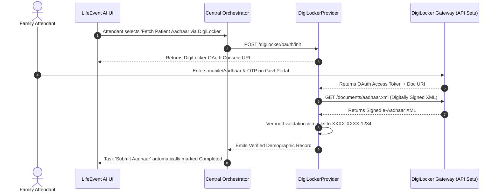

# LifeEvent AI: DigiLocker & Identity Verification Integration

**Document Version:** 2.0  
**Status:** `[Proposed / Architecture Specified]`  
**Governing Authority:** Ministry of Electronics and Information Technology (MeitY) / API Setu  
**Product:** LifeEvent AI — AI-Powered Financial Journey Operating System

---

## 1. Context: Physical ID Friction at the Counter

When arriving at hospital admission desks, attendants are routinely turned away or delayed because they do not have a physical photocopy of the patient's Aadhaar card. 

Hospitals require Aadhaar to:
- Establish patient identity for insurance claims under IRDAI guidelines.
- Link patient files to government health schemes (PM-JAY).
- Comply with know-your-customer (KYC) requirements for high-value cashless claims.

**DigiLocker Integration eliminates physical paper friction** by enabling instant, user-consented retrieval of digitally signed, legally valid identity documents directly from MeitY's API Setu.



---

## 2. Technical API Specification (`DigiLockerProvider`)

```python
class DigiLockerAuthRequest(BaseModel):
    journey_id: str
    patient_phone: str
    doc_type: str = "ADHAR" # Aadhaar XML

class DigiLockerProfile(BaseModel):
    full_name: str
    dob: str
    gender: str
    masked_aadhaar: str # Guaranteed XXXX-XXXX-1234
    digital_signature_valid: bool
    issuer: str # UIDAI

class DigiLockerProvider(ABC):
    @abstractmethod
    async def get_authorization_url(self, request: DigiLockerAuthRequest) -> str:
        """Generates standard DigiLocker OAuth2 redirect URI."""
        pass

    @abstractmethod
    async def fetch_verified_document(self, auth_code: str) -> DigiLockerProfile:
        """Exchanges auth code for digitally signed XML and extracts masked demographics."""
        pass
```

---

## 3. Privacy & Compliance Guarantees

1. **Digital Signature Verification:** The e-Aadhaar XML contains an embedded PKCS#7 digital signature issued by the Unique Identification Authority of India (UIDAI). The adapter validates this signature using public UIDAI root certificates.
2. **Instant Masking:** As mandated by the Supreme Court of India and DPDP Act 2023, the full 12-digit UID is never stored or rendered. The first 8 digits are permanently purged in memory, outputting strictly `XXXX-XXXX-1234`.
3. **Legal Validity:** Under Section 9A of the Information Technology Act 2000, documents pulled via DigiLocker are legally equivalent to original physical documents.

