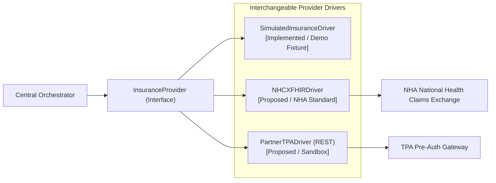

# LifeEvent AI: Insurance & TPA Integration Specification

**Document Version:** 2.0  
**Status:** `[Partially Implemented / Simulated Driver Available]`  
**Target Standard:** National Health Claims Exchange (NHCX) / HL7 FHIR Health Claims  
**Product:** LifeEvent AI — AI-Powered Financial Journey Operating System

---

## 1. Insurance Integration Architecture

In India, health insurance claims are administered either through Third-Party Administrators (TPAs) like Medi Assist, Vidal Health, Paramount, or directly by insurer in-house claim desks. The National Health Authority (NHA) has introduced the **National Health Claims Exchange (NHCX)** to standardize digital claim exchange.

LifeEvent AI integrates with insurance ecosystems through an abstract adapter architecture:



---

## 2. Implementation Status & Modes

| Integration Component | Status | Implementation Details |
| :--- | :--- | :--- |
| **Policy Verification** | `[Simulated]` | Validates policy numbers against pre-seeded synthetic insurer fixtures; extracts sum insured, active status, and co-pay rules. |
| **Pre-Auth Dossier Assembly** | `[Partially Implemented]` | Compiles patient demographics, hospital estimate lines, ICD-10 codes, and doctor signatures into standard pre-auth format. |
| **TPA Query Re-planning** | `[Implemented]` | Ingests incoming TPA queries (e.g., casualty ECG request) via `POST /replan` and dynamically updates the Journey Graph. |
| **NHCX FHIR Adapter** | `[Proposed]` | Target production architecture conforming to NHA FHIR profiles (`Claim`, `ClaimResponse`, `Coverage`). |

---

## 3. Data Schemas & API Contracts

### 3.1 Pre-Authorization Request Schema (`PreAuthRequest`)
```json
{
  "journey_id": "7b29a8f4-6e1c-4b3d-9f2e-0a1c2d3e4f5a",
  "insurer_id": "INS-STAR-HEALTH",
  "tpa_id": "TPA-MEDI-ASSIST",
  "policy_number": "SH-2026-908124",
  "patient": {
    "name": "Ramesh Sharma",
    "relation": "father",
    "age": 58,
    "gender": "Male",
    "aadhaar_masked": "XXXX-XXXX-2346"
  },
  "hospital": {
    "rohn_id": "HOSP-RUBY-PUNE",
    "hospital_name": "Ruby Hall Clinic",
    "attending_doctor": "Dr. S. Kulkarni",
    "doctor_reg_number": "MMC-2004-98124"
  },
  "clinical": {
    "admission_type": "Emergency",
    "provisional_diagnosis": "Acute Myocardial Infarction",
    "icd10_code": "I21.9",
    "proposed_procedure": "Coronary Angioplasty with Stenting"
  },
  "financial": {
    "estimated_cost": 420000.0,
    "room_category": "ICU",
    "daily_room_rent": 8500.0,
    "stay_days": 4
  },
  "documents": [
    "StarHealth_Policy_Schedule.pdf",
    "RubyHall_PreAuth_Estimate.pdf"
  ]
}
```

---

## 4. Error Handling & TPA Discrepancy Workflows

1. **Pre-Existing Disease (PED) Queries:** If the TPA raises a query suspecting pre-existing condition non-disclosure, the adapter flags the task `needs_review` and prompts the attendant for previous discharge summaries.
2. **Room Rent Discrepancies:** If the hospital estimate states a room rent exceeding the policy cap, the adapter automatically alerts the counselor console to discuss downgrade options with the family before admission.
3. **Cashless Denial Fallback:** If cashless pre-authorization is denied due to procedural query timeouts, the system automatically transitions the journey to **Reimbursement Claim Mode**, archiving all original bills and receipts for post-discharge submission.

