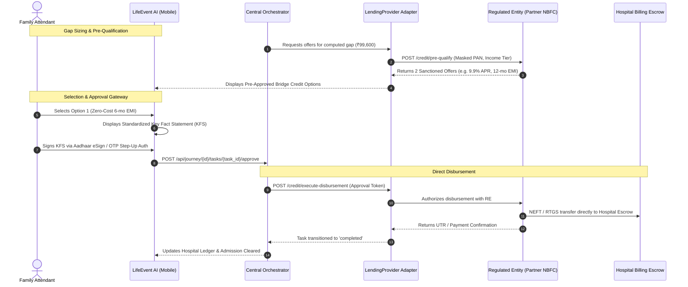

# LifeEvent AI: Digital Lending & Bridge Credit Integration

**Document Version:** 2.0  
**Status:** `[Demonstrated / Simulated Driver Available]`  
**Regulatory Framework:** Reserve Bank of India (RBI) Digital Lending Guidelines (DLG) 2022/2023  
**Role:** Lending Service Provider (LSP) Interface  
**Product:** LifeEvent AI — AI-Powered Financial Journey Operating System

---

## 1. Regulatory Context: RBI Digital Lending Guidelines

Under RBI's Regulatory Framework for Digital Lending, strict boundaries govern digital lending platforms:
1. **LSP Role:** LifeEvent AI acts strictly as a **Lending Service Provider (LSP)**. It does not carry loans on its own balance sheet, nor does it make credit underwriting decisions.
2. **Regulated Entity (RE) Principal:** All loans must be underwritten, sanctioned, and disbursed directly by an RBI-regulated entity (Scheduled Commercial Bank or NBFC).
3. **No Pass-Through Accounts:** Loan funds cannot flow through LifeEvent AI corporate bank accounts. Disbursements must flow directly from the RE to the borrower's verified bank account or directly to the hospital's verified billing escrow account.
4. **Key Fact Statement (KFS):** Before loan agreement execution, a standardized Key Fact Statement (KFS) stating all-inclusive Annual Percentage Rate (APR), processing fees, and recovery mechanisms must be displayed to the borrower.
5. **Cool-Off Period:** Borrowers must be provided a statutory look-up / cool-off period to exit the loan without penalty.

---

## 2. Integration Architecture & Workflow



---

## 3. Data Schemas & API Contracts

### 3.1 Pre-Qualification Request
```json
{
  "journey_id": "7b29a8f4-6e1c-4b3d-9f2e-0a1c2d3e4f5a",
  "applicant_name": "Rohan Sharma",
  "pan_masked": "ABCDE1234F",
  "monthly_income_declared": 85000.0,
  "required_gap_amount": 99600.0,
  "hospital_name": "Ruby Hall Clinic",
  "hospital_escrow_account": "HOSP-ESCROW-RUBY-01"
}
```

### 3.2 Standardized Loan Offer & KFS Schema
```json
{
  "offer_id": "OFFER-NBFC-90214",
  "lender_name": "CareCredit Financial Services NBFC",
  "sanctioned_amount": 100000.0,
  "net_disbursed_amount": 98500.0,
  "processing_fee_inr": 1500.0,
  "annual_percentage_rate_apr": 9.9,
  "tenure_months": 12,
  "monthly_emi": 8788.0,
  "total_repayment_amount": 105456.0,
  "cooling_off_period_days": 3,
  "key_fact_statement_url": "https://api.carecredit.in/kfs/OFFER-NBFC-90214.pdf",
  "badge": "Demo Partner — Illustrative terms for hackathon evaluation"
}
```

---

## 4. Current Status: Simulated Driver

In the current prototype, the lending flow is implemented via `SimulatedLendingDriver`:
- Pre-seeded with realistic healthcare financing options (Zero-cost 6-month EMI, 12-month low-interest bridge line).
- Explicitly labeled in the UI with demo partner badges to ensure total transparency.
- Pluggable to live NBFC sandboxes via the `LendingProvider` interface when sandbox agreements are executed.

