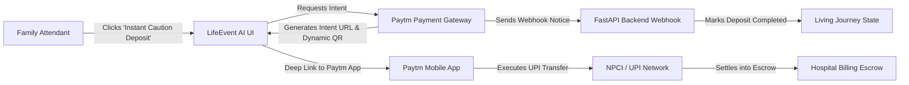

# LifeEvent AI: Paytm UPI & Payment Integration Specification

**Document Version:** 2.0  
**Status:** `[Demonstrated / Simulated Driver Available]`  
**Target Provider:** Paytm Payment Gateway & UPI Autopay  
**Product:** LifeEvent AI — AI-Powered Financial Journey Operating System

---

## 1. Context: The Hospital Caution Deposit Friction

When a patient is admitted for emergency care in India, private hospitals routinely demand an immediate **caution deposit** (typically ₹25,000 to ₹75,000) at the reception desk before transferring the patient to the ICU or Operation Theatre.

Families are forced to make immediate high-value transfers under duress. If cashless insurance is subsequently approved, retrieving this deposit at discharge is notoriously slow, taking 15 to 45 business days.

**LifeEvent AI reimagines this through the Paytm UPI Caution Deposit Buffer:**
1. Generates instant UPI deep-links and dynamic QR codes sized exactly to the required deposit (~₹50,000).
2. Holds funds in a transparent hospital escrow sub-account.
3. Automatically triggers instant refund or reconciliation against final out-of-pocket gap upon cashless settlement.



---

## 2. Technical API Specifications

### 2.1 UPI Intent Generation (`PaymentProvider.create_caution_deposit_intent`)
```python
class UPIIntentRequest(BaseModel):
    journey_id: str
    amount: float
    payee_vpa: str # e.g. 'rubyhallclinic@paytm'
    payee_name: str # 'Ruby Hall Clinic Billing Desk'
    patient_admission_ref: str
    callback_url: str

class UPIIntentResponse(BaseModel):
    txn_id: str
    intent_url: str
    qr_data: str
    expires_at: str
    status: str
```

### 2.2 Standard Paytm Deep-Link Intent URI
```text
upi://pay?pa=rubyhallclinic@paytm&pn=Ruby+Hall+Clinic&tr=PTM-TXN-90218491&am=50000.00&cu=INR&tn=Emergency+Caution+Deposit+Ramesh+Sharma
```

---

## 3. Inbound Settlement Webhook (`POST /webhooks/paytm-settle`)

When the payment settles on the UPI network, Paytm dispatches an asynchronous webhook:

```json
{
  "event": "PAYMENT_SUCCESS",
  "txn_id": "PTM-TXN-90218491",
  "order_id": "ORDER-CAUTION-7b29a8f4",
  "amount": 50000.00,
  "currency": "INR",
  "gateway_ref": "BANK-RRN-981240981",
  "signature": "hmac_sha256_signature_string",
  "timestamp": "2026-11-14T10:02:45.000000Z"
}
```

### Backend Processing:
1. Validates HMAC-SHA256 signature using `PAYTM_MERCHANT_KEY`.
2. Inspects `integration_events` table for idempotency.
3. Transitions `task_caution_deposit` status from `awaiting_approval` to `completed`.
4. Emits real-time SSE event to the attendant's phone: `"Caution deposit verified. Patient admission cleared."`

---

## 4. Current Status: Simulated Driver

For the hackathon demonstration:
- Operates via `SimulatedPaytmUPIDriver`.
- Simulates dynamic QR generation and one-click demo payment completion.
- Clearly labeled with **"Demo Partner — Illustrative terms"** disclosures.
- Can be switched to Paytm Staging Sandbox credentials (`MID` and `Merchant Key`) via environment variables without code modification.

