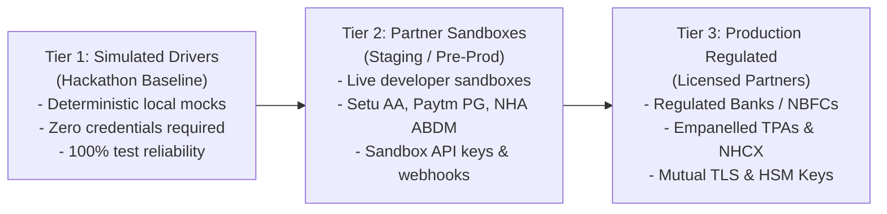

# LifeEvent AI: Sandbox Strategy & Integration Progression

**Document Version:** 2.0  
**Status:** Approved Architectural Baseline  
**Product:** LifeEvent AI — AI-Powered Financial Journey Operating System

---

## 1. The Three-Tier Integration Strategy

Fintech and healthtech integrations in India involve heavy regulatory licensing, legal contracts, and private network interconnects. 

To maintain rapid engineering velocity while ensuring production readiness, LifeEvent AI operates a **Three-Tier Progression Strategy**:



---

## 2. Integration Status & Graduation Matrix

| Integration Domain | Tier 1: Simulated (Current) | Tier 2: Sandbox (Target) | Tier 3: Production (Target) | Graduation Prerequisites |
| :--- | :--- | :--- | :--- | :--- |
| **Insurance / TPA** | `SimulatedInsuranceDriver` (Pre-seeded cardiac/ortho scenarios) | Medi Assist / NHCX Developer Sandbox | Empanelled TPAs on National Health Claims Exchange | TPA partnership agreement; NHCX FHIR client certification |
| **Emergency Lending** | `SimulatedLendingDriver` (Pre-calculated credit terms) | Partner NBFC Digital Lending Sandbox | RBI Regulated Entity (Bank/NBFC) balance sheet | LSP Master Service Agreement; KFS audit; DLG compliance sign-off |
| **Paytm UPI Payments** | `SimulatedPaytmUPIDriver` (Instant simulated settlement) | Paytm Payment Gateway Staging Environment | Live Paytm Merchant ID (MID) & Production Keys | Current account KYC; merchant onboarding; webhook callback IP whitelist |
| **Account Aggregator** | `SimulatedAADriver` (Synthetic statement data) | Setu AA Sandbox / Sahamati Test Harness | Licensed NBFC-AA Gateway | FIU registration under Sahamati; data privacy audit |
| **DigiLocker Identity** | `SimulatedDigiLockerDriver` (Synthetic masked Aadhaar) | API Setu Staging Sandbox | Production MeitY DigiLocker Gateway | MeitY API Setu enterprise application approval |
| **ABDM / ABHA** | `SimulatedABDMDriver` (Synthetic consultation notes) | NHA ABDM Sandbox (M1/M2/M3) | National Health Authority Production Bridge | NHA Sandbox Exit Certificate; HIPAA/DISHA security clearance |

---

## 3. Configuration & Runtime Switching

Switching integration modes requires **zero code changes**. The backend inspects the `PROVIDER_MODE` environment variable in `backend/app/config.py`:

```bash
# Environment Variable in .env

# Mode options: 'simulated' | 'sandbox' | 'production'
PROVIDER_MODE=simulated

# Tier 2 Sandbox Credentials (when PROVIDER_MODE=sandbox)
PAYTM_MID=YOUR_STAGING_MID
PAYTM_MERCHANT_KEY=YOUR_STAGING_KEY
PAYTM_GATEWAY_URL=https://securegw-stage.paytm.in

SETU_AA_CLIENT_ID=YOUR_SETU_SANDBOX_ID
SETU_AA_SECRET=YOUR_SETU_SANDBOX_SECRET

ABDM_CLIENT_ID=YOUR_NHA_SANDBOX_ID
ABDM_CLIENT_SECRET=YOUR_NHA_SANDBOX_SECRET
```

---

## 4. Fallback & Graceful Degradation Protocols

If a live sandbox provider experiences an outage, high latency (>5s), or rate-limiting during evaluation:
1. **Circuit Breaker:** The adapter trips after 3 consecutive HTTP timeouts.
2. **Automatic Fixture Fallback:** The orchestrator logs an alert and falls back gracefully to the `SimulatedDriver`, returning deterministic scenario data.
3. **Transparent Disclosure:** The response payload includes an alert flag:  
   `"provider_status": "simulated_fallback_active"`, ensuring that testers are immediately aware of the fallback state.

