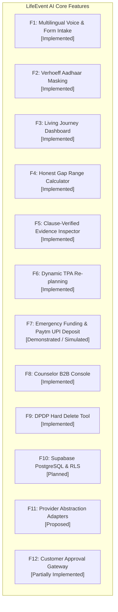

# LifeEvent AI: Feature Specification

**Document Version:** 2.0  
**Status:** Approved  
**Product:** LifeEvent AI — AI-Powered Financial Journey Operating System

---

## 1. Feature Map & Status Overview



---

## 2. Detailed Feature Specifications

### Feature 1: Multilingual Voice & Form Intake (`/intake`)
- **Status:** `[Implemented]`
- **Purpose:** Enables distressed attendants to input emergency context effortlessly via voice or structured form in English, Hindi, or Marathi.
- **Inputs:**
  - Patient demographics (name, age, gender, relation).
  - Hospital details (name, city, room category).
  - Medical condition description (free-form text or speech transcript).
  - Urgency level (`critical`, `urgent`, `standard`).
  - Financial/Policy inputs (sum insured, allowed room rent, actual room rent, stay days, co-pay %).
  - Identity & Document files (Aadhaar number, policy PDF, hospital estimate slip).
- **Processing Logic:**
  - Voice dictation runs client-side via the browser's native `webkitSpeechRecognition` / `SpeechRecognition` API.
  - Automatically handles Devanagari script for Hindi (`hi-IN`) and Marathi (`mr-IN`).
  - One-click demo loaders inject pre-validated cardiac and orthopedic scenarios.
- **Outputs:** Validated `LifeEventIntake` Pydantic payload dispatched to `POST /api/journey/intake`.

---

### Feature 2: Indian Verhoeff Checksum Redactor
- **Status:** `[Implemented]`
- **Purpose:** Protects citizen privacy under the DPDP Act 2023 by detecting genuine 12-digit Indian Aadhaar numbers and masking the first 8 digits.
- **Mathematical Mechanics:**
  - Uses the dihedral group $D_5$ permutation and multiplication tables.
  - Validates that the 12th digit satisfies the Verhoeff check equation $\sum_{i=0}^{11} F(d_i) \equiv 0$.
  - Replaces valid numbers with `XXXX-XXXX-1234` format.
  - **Exclusion Safeguard:** Phone numbers, policy numbers, PIN codes, and random 12-digit numbers with invalid checksums pass through unmasked.
- **Outputs:** Masked strings in both client UI and server logs.

---

### Feature 3: Living Journey Dashboard (`/journey/[id]`)
- **Status:** `[Implemented]`
- **Purpose:** Central command center for the patient's family, presenting real-time clarity on financial liabilities and next actions.
- **Key UI Components:**
  - **Pinned Next Best Action:** High-contrast callout directing the attendant to the single most urgent task.
  - **Honest Gap Range Card:** Visual range bar displaying Low, Expected, and High out-of-pocket amounts.
  - **Living Timeline:** Dynamic chronological event stream with actor badges (`Family`, `Hospital TPA`, `Insurer`, `LifeEvent AI`).
  - **Pre-Auth Checklist:** Categorized checklist with completion toggles and critical badges.
  - **Live Re-plan Trigger:** Interactive simulation button triggering a TPA Pre-Auth Query.

---

### Feature 4: Honest Gap Range Calculator
- **Status:** `[Implemented]`
- **Purpose:** Eliminates discharge billing surprises by computing realistic out-of-pocket liabilities using deterministic IRDAI formulas.
- **Mathematical Specification:**
  ```
  1. Non-Payable Consumables (IRDAI Clause 4.8 / List I):
     non_payables = 0.10 * total_estimate

  2. Admissible Base:
     admissible_base = total_estimate - non_payables

  3. Room-Rent Proportional Deduction:
     excess_rate = max(0, actual_room_rent - allowed_room_rent)
     if excess_rate > 0:
         direct_excess = excess_rate * stay_days
         associated_expense_loss = 0.50 * (admissible_base - (actual_room_rent * stay_days)) * (excess_rate / actual_room_rent)
         room_deduction = direct_excess + associated_expense_loss
     else:
         room_deduction = 0

  4. Base Covered Before Co-pay:
     covered_before_copay = min(max(0, admissible_base - room_deduction), remaining_sum_insured)

  5. Co-Payment:
     co_pay_amount = (copay_percent / 100.0) * covered_before_copay

  6. Expected Out-of-Pocket Gap:
     insurer_net_payable = covered_before_copay - co_pay_amount
     gap_expected = total_estimate - insurer_net_payable

  7. Honest Range Bounds:
     gap_low  = max(0, gap_expected - (0.30 * non_payables) - (0.20 * room_deduction))
     gap_high = gap_expected + (0.05 * total_estimate)
  ```
- **Guarantees:** Computed purely in Python; LLMs never produce or modify rupee totals.

---

### Feature 5: Clause-Verified Evidence Inspector (`/journey/[id]/coverage`)
- **Status:** `[Implemented]`
- **Purpose:** Provides 100% anti-hallucination evidence grounding for all coverage claims.
- **Components:**
  - Table of coverage categories (Room Rent, ICU, Surgery, Diagnostics, Consumables).
  - For every line item, displays:
    - Estimated Cost (₹)
    - Likely Covered Amount (₹)
    - Out-of-Pocket Share (₹)
    - Confidence Grade (`High`, `Medium`, `Needs TPA Confirmation`)
    - Source Document Name
    - Page Number
    - Exact Clause Reference (e.g., `Section 2.1`)
    - Verbatim Passage Quote
  - **Citation Gate Enforcement:** Any claim generated by an LLM that cannot be matched to verbatim source document text is marked `Unverified` and its covered amount is forced to ₹0.

---

### Feature 6: Dynamic TPA Re-planning (`POST /replan`)
- **Status:** `[Implemented]`
- **Purpose:** Models the living nature of emergency workflows when an insurer raises a query during pre-authorization.
- **Workflow:**
  - Ingests incoming TPA query notice.
  - Dynamically injects urgent tasks (e.g., casualty ECG strip submission) to the top of the checklist.
  - Updates journey stage to `tpa_query_pending`.
  - Re-evaluates next best action and pushes updates over Server-Sent Events (SSE).

---

### Feature 7: Emergency Funding & Simulated Paytm UPI Deposit (`/funding`)
- **Status:** `[Demonstrated / Simulated]`
- **Purpose:** Coordinates emergency liquidity to bridge the computed out-of-pocket gap.
- **Components:**
  - Pre-qualified emergency credit card sized to `gap_expected`.
  - Instant Paytm UPI caution deposit buffer (~₹50,000) for immediate hospital clearance.
  - Transparent disclosures: labeled as demo partner terms for hackathon evaluation.
  - Extensible to live NBFC/UPI gateways via provider abstraction interfaces.

---

### Feature 8: Hospital Counselor B2B Console (`/counselor`)
- **Status:** `[Implemented]`
- **Purpose:** Provides hospital financial counselors and TPA desks with a queue view of all admitted patients.
- **Metrics Displayed:**
  - Patient Name & Urgency
  - Estimated Bill & Expected Out-of-Pocket Gap
  - Readiness Score (e.g., `5/6 tasks completed`)
  - Active TPA query status and resolution turnaround ETA
  - Pinned Next Action per patient

---

### Feature 9: DPDP Hard Delete & Privacy Charter (`/privacy`)
- **Status:** `[Implemented]`
- **Purpose:** Delivers regulatory-grade privacy and data sovereignty under India's DPDP Act 2023.
- **Capabilities:**
  - Full disclosure of Verhoeff masking algorithm and zero-retention rules.
  - Active hard-delete tool invoking `DELETE /api/journey/{id}`.
  - Idempotent permanent erasure of all journey records, documents, and logs.

