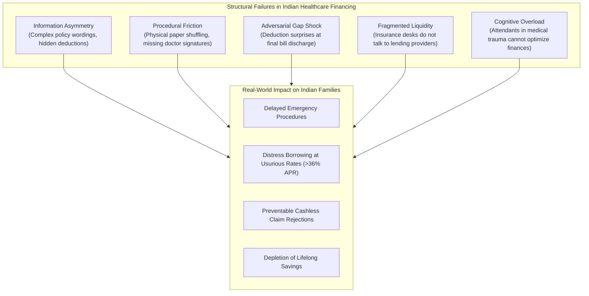

# LifeEvent AI: Problem Statement & Hackathon Alignment

**Hackathon Track:** Paytm AI Hackathon (Build for India) — Pune  
**Problem Statement PS-2:** *AI-Powered Financial Journeys: Make Insurance, Lending and Fintech simpler, faster and more human.*  
**Product:** LifeEvent AI  
**Document Version:** 2.0  
**Status:** Approved

---

## 1. The Hackathon Problem Statement

The official problem statement reads:

> *"AI-Powered Financial Journeys: Make Insurance, Lending and Fintech simpler, faster and more human.*  
> *Reimagine customer-facing journeys across Insurance, Lending and Fintech using AI. Focus on removing friction, reducing complexity, and helping customers complete critical financial journeys faster and with greater confidence."*

---

## 2. The Real-World Crisis: The Hospital Counter

Nowhere is the failure of modern financial services more acute than at the **emergency admission desk of an Indian hospital**.

### The Scenario:
At 2:00 AM, a 55-year-old father suffers acute chest pain and is rushed to a private hospital in Pune. The triage doctor diagnoses an acute myocardial infarction requiring emergency coronary angioplasty. 

The patient is rolled into the ICU. The family attendant—often a stressed son or daughter with limited financial or insurance literacy—is directed to the billing counter and TPA desk.

### The Five Devastating Questions:
1. **"Does our insurance cover this?"**  
   The family holds a 60-page health insurance policy schedule loaded with legal exclusions, sub-limits, and waiting periods. The hospital TPA desk cannot provide definitive answers until pre-authorization is reviewed by an off-site insurer.
2. **"Which documents do we need to submit right now?"**  
   The TPA desk demands the initial emergency admission note, indoor case papers, first consultation paper, and Aadhaar card. Missing a single stamp or doctor's signature can delay cashless pre-authorization by 6 to 12 hours.
3. **"How much will we actually have to pay out of our own pocket?"**  
   The hospital estimate is ₹4,20,000. The policy has a ₹5,00,000 sum insured. Naive families assume insurance will pay 100%. In reality, hidden clauses (1% room rent cap, 10% co-pay, non-payable consumables) mean the family faces an unexpected ₹1,00,000+ out-of-pocket gap.
4. **"Where do we get ₹50,000 right now for the admission caution deposit?"**  
   The hospital demands an immediate caution deposit before the patient is wheeled into the catheterization laboratory. Traditional personal loans take days; emergency liquidity is urgently required.
5. **"What is our single next best action right now?"**  
   Paralyzed by dozens of competing instructions, the attendant has no single prioritized checklist.

---

## 3. Structural Industry Failures

### Key Indian Healthcare Realities:
- **Out-of-Pocket Expenditure (OOPE):** Out-of-pocket health expenditure accounts for over **47%** of total healthcare expenditure in India (National Health Accounts).
- **Cashless Settlement Disconnect:** Even in empanelled "cashless" hospitals, 15% to 30% of the total bill is routinely disallowed due to consumables (List I under IRDAI Master Circular), room-rent sub-limits, and co-payment clauses.
- **Room-Rent Multiplier Penalties:** If a patient chooses an ICU or private room costing ₹8,500/day when their policy caps room rent at 1% of Sum Insured (₹5,000/day), Indian insurers legally apply **proportionate deductions** across surgeon fees, nursing charges, and OT costs—multiplying the out-of-pocket shortfall.

---

## 4. How LifeEvent AI Reimagines the Journey

| Traditional Customer Experience | LifeEvent AI Reimagined Experience |
| :--- | :--- |
| **Intimidating Physical Forms:** Attendants fill out 4-page paper claim forms by hand while standing at the counter. | **Multilingual Voice Intake:** Attendant speaks their situation in Hindi, Marathi, or English; Gemini multimodal models extract structured entities. |
| **False Security of "Full Coverage":** Families discover huge deductions at discharge, leading to conflict at billing. | **Honest Gap Range:** Instant, transparent out-of-pocket gap range (Low–Expected–High) computed upfront using IRDAI deduction formulas. |
| **Hallucinated or Vague Reassurances:** General promises of "it should be covered" without contractual proof. | **Clause-Verified Grounding:** Every covered item quotes verbatim policy clause text with page number and clause reference. |
| **Scattered Financial Scramble:** Family calls relatives, pledges gold, or borrows from predatory loan apps. | **Coordinated Emergency Funding:** Integrated bridge credit sizing and instant Paytm UPI caution deposit workflows. |
| **Passive Waiting & Blind Spots:** Family waits 6 hours for TPA responses without understanding status. | **Living Journey & Re-plan:** Dynamic updates when TPA queries arrive, instantly reprioritizing the family's next best action. |

---

## 5. Summary

LifeEvent AI meets the exact intent of Paytm Hackathon Problem Statement PS-2: it makes insurance transparent, lending accessible in emergencies, and fintech deeply human by wrapping cutting-edge AI and deterministic financial safeguards around the most vulnerable moments of human life.

