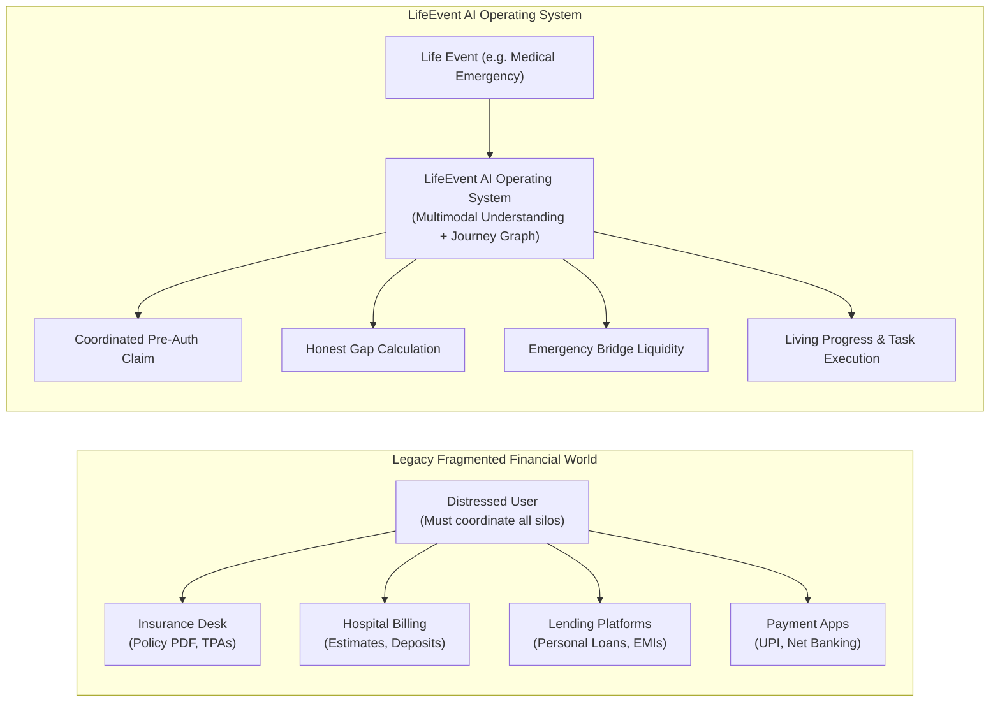

# LifeEvent AI: Product Vision & Operating System Strategy

**Document Version:** 2.0  
**Status:** Approved Architectural Vision  
**Product:** LifeEvent AI — AI-Powered Financial Journey Operating System

---

## 1. The Core Paradigm Shift

Financial services in India and globally are organized around **products**:
- Health insurance is sold as an annual policy PDF.
- Emergency credit is sold as an EMI loan or overdraft.
- Payments are executed via UPI or net banking gateways.
- Government health schemes (ABDM, PM-JAY) exist in specialized portals.

However, humans do not live in "products"—humans live in **life events**:
- A parent suffers a sudden cardiac arrest and is rushed to ICU.
- A student receives an overseas university admission letter.
- A family prepares for the birth of a child or copes with bereavement.

When a life event strikes, the burden of discovering, understanding, coordinating, and executing fragmented financial products falls entirely on the individual. In high-stakes moments like medical emergencies, this friction causes severe financial trauma, catastrophic out-of-pocket expenditure, and medical debt.

**LifeEvent AI is the operating system that translates real-world life events into coordinated, evidence-backed financial actions.**

---

## 2. Core Pillars of the Operating System

### 1. Multimodal Situation Understanding
LifeEvent AI ingests the chaos of human emergencies: spoken voice in regional languages (Hindi, Marathi, English), crumpled hospital fee estimates, scanned insurance policy schedules, and doctor prescriptions. It converts unstructured physical documents into a structured financial graph.

### 2. Dependency-Aware Orchestration (Financial Journey Graph)
Financial journeys are not rigid, linear forms. They are dynamic graphs of tasks, prerequisites, and approvals. If an insurer issues a TPA query requesting an ECG strip, the Journey Graph dynamically re-plans: inserting urgent medical tasks, updating the out-of-pocket gap range, and adjusting the next best action.

### 3. Mathematical Rigor & Anti-Hallucination Evidence
LLMs are powerful reasoning engines but unreliable accountants. LifeEvent AI decouples reasoning from arithmetic:
- **Math:** 100% deterministic Python calculation adhering to IRDAI room-rent limits, non-payable consumable lists, and co-pay rules.
- **Evidence:** Every financial assertion must point to an exact verbatim clause, document name, and page number. Unsupported claims are forced to ₹0.

### 4. Customer-Controlled Approval Gateway (Human-in-the-Loop)
An autonomous agent must never disburse loans, commit patient funds, or file irreversible legal claims without consent. LifeEvent AI implements a cryptographic approval gateway where consequential actions require explicit, time-limited, step-up customer authorization.

### 5. Multi-Sided Coordination (B2C + B2B)
While the patient's family receives a calm, guided mobile interface, the hospital financial counselor and insurer TPA desk access a synchronized queue view. This dual visibility aligns incentives, clears admission bottlenecks, and prevents cashless claim rejections.

---

## 3. Long-Term Horizon: Beyond Healthcare

While the hackathon MVP targets **Medical Emergency Financial Journeys**, the underlying architecture (Intake → Document Extraction → Gap Modeling → Journey Graph → HITL Approvals → Provider Execution) generalizes to critical life events across an individual's lifecycle:

| Life Event | Intake Signals | Financial Coordination | Provider Ecosystem |
| :--- | :--- | :--- | :--- |
| **Medical Emergency (Current Focus)** | Voice, admission slip, policy PDF, estimate | Pre-auth filing, out-of-pocket gap modeling, caution deposit, bridge credit | TPAs, General Insurers, Hospital HIS, Paytm UPI, NBFCs |
| **Higher Education Overseas** | Admission letter, fee structure, I-20 form | Education loan pre-qualification, forex remittance, collateral pledge, scholarship check | NBFCs, Forex Gateways, DigiLocker, University Portals |
| **Home Ownership & Relocation** | Sale agreement, property papers, salary slips | Home loan sanctioning, stamp duty payment, property title insurance, moving budget | Scheduled Commercial Banks, Sub-Registrar Portals, UPI |
| **Bereavement & Inheritance** | Death certificate, will, bank account statements | Asset succession, nominee claim settlement, term life insurance payout, debt resolution | Life Insurers, EPFO, Asset Management Companies, Banks |

---

## 4. Summary: The Promise of LifeEvent AI

LifeEvent AI delivers **calm in the crisis, clarity in the chaos, and coordination in the fragmentation**. By pairing multimodal artificial intelligence with deterministic financial safeguards, it ensures that no family at a hospital counter ever has to fight both a medical emergency and a financial nightmare alone.

