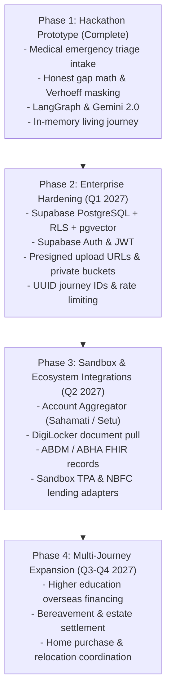

# LifeEvent AI: Product Roadmap & Strategic Evolution

**Document Version:** 2.0  
**Status:** Approved  
**Product:** LifeEvent AI — AI-Powered Financial Journey Operating System

---

## 1. Roadmap Horizon Overview

LifeEvent AI follows a phased, four-stage evolution: from the current hackathon MVP to a commercialized healthcare financial operating system, culminating in a multi-life-event financial platform.

---

## 2. Phased Milestone Breakdown

### Phase 1: Hackathon Prototype (Milestone: Prototype Complete)
- **Status:** `[Implemented & Demonstrated]`
- **Core Deliverables:**
  - Multilingual voice and form intake (EN/HI/MR) via Web Speech API.
  - Verhoeff checksum algorithm for Aadhaar validation and masking to `XXXX-XXXX-1234`.
  - Deterministic IRDAI honest gap calculator (10% non-payables, room rent penalty, co-pay).
  - Living journey dashboard with pinned next action, timeline, and checklist.
  - Interactive TPA query simulation (`POST /replan`) with dynamic task re-planning.
  - Clause-verified evidence inspector citing verbatim policy schedule passages.
  - Hospital counselor console queue with readiness scoring.
  - One-click hard delete complying with DPDP Act 2023.

---

### Phase 2: Enterprise Hardening & Durable Cloud (Milestone: Q1 2027)
- **Status:** `[Planned]`
- **Core Deliverables:**
  - **Database Migration:** Transition from in-memory dictionary to **Supabase PostgreSQL** with full relational schema and Row Level Security (RLS).
  - **Authentication & Multi-Tenancy:** Implement Supabase Auth (JWT Bearer tokens); resolve Security Audit Findings A1 (CORS), A2 (Auth/IDOR), A3 (Unbounded store), and A4 (UUID IDs).
  - **Secure Storage:** Private Supabase Storage bucket for policy PDFs with 15-minute time-limited signed URLs and AES-256 server-side encryption.
  - **Semantic Policy Retrieval:** Implement `pgvector` hybrid search (embeddings + BM25) for multi-clause policy wordings.
  - **Rate Limiting & Hardening:** Enforce `slowapi` rate limits across all mutating routes (`replan`, `delete`, `pilot-request`).

---

### Phase 3: Sandbox Partnerships & Provider Adapters (Milestone: Q2 2027)
- **Status:** `[Proposed]`
- **Core Deliverables:**
  - **Insurance TPA Adapter:** Connect to National Health Claims Exchange (NHCX) sandbox or partner TPA API (e.g., Medi Assist) for real pre-auth submission and query retrieval.
  - **Digital Lending (DLG) Adapter:** Connect to partner NBFC sandbox for pre-approved emergency medical credit lines under RBI Digital Lending Guidelines.
  - **Account Aggregator (AA) Integration:** Integrate with Setu / Sahamati AA ecosystem to retrieve verified bank statements for instant credit underwriting.
  - **DigiLocker Integration:** Pull verified government identity documents (Aadhaar, PAN, Driving License) directly via MeitY / API Setu.
  - **ABDM Integration:** Link Ayushman Bharat Health Account (ABHA) to retrieve past health records and discharge summaries using HL7 FHIR standards.

---

### Phase 4: Multi-Journey Platform & Scale (Milestone: Q3–Q4 2027)
- **Status:** `[Proposed]`
- **Core Deliverables:**
  - **Higher Education Journey:** Ingestion of overseas university offers; coordination of student loans, forex remittance, and visa financial documentation.
  - **Bereavement & Inheritance Journey:** Asset succession, life insurance claim coordination, and debt closure.
  - **Mobile Native Applications:** React Native / Expo apps for iOS and Android with offline-first local encryption.
  - **Hospital SaaS Integration:** Certified HL7 / FHIR bi-directional connectors for major Indian Hospital Information Systems (HIS) including Epic, Cerner, and KareXpert.

