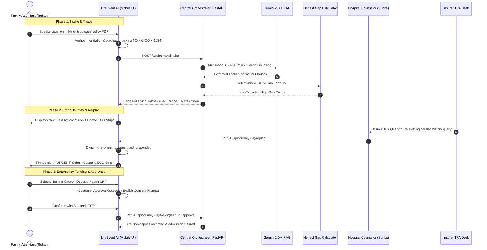

# LifeEvent AI: End-to-End User Journeys & Interaction Flows

**Document Version:** 2.0  
**Status:** Approved  
**Product:** LifeEvent AI — AI-Powered Financial Journey Operating System

---

## 1. Journey Architecture

LifeEvent AI maps the end-to-end journey across three distinct phases:
1. **Phase 1: Emergency Ingestion & Triage (Minutes 0–5)**
2. **Phase 2: Living Financial Journey & Gap Management (Hours 1–48)**
3. **Phase 3: Financial Settlement & Discharge Closure (Hour 48+)**

---

## 2. Detailed Scenario Walkthrough: Cardiac Emergency

### Step 1: Emergency Multilingual Intake (`/intake`)
- **Actor:** Rohan Sharma (Family Attendant).
- **Trigger:** Father admitted to Ruby Hall Clinic ICU with acute chest pain.
- **Action:**
  - Opens `https://lifeevent.ai/intake`.
  - Clicks microphone icon and dictates in Hindi:  
    *"मेरे पिताजी रमेश शर्मा को सीने में तेज दर्द के बाद रूबी हॉल क्लिनिक में भर्ती कराया गया है। डॉक्टर ने एंजियोप्लास्टी के लिए 4.2 लाख का एस्टीमेट दिया है। हमारे पास स्टार हेल्थ की 5 लाख की पॉलिसी है।"*
  - System transcribes speech into text and extracts entities:
    - Patient Name: Ramesh Sharma
    - Hospital: Ruby Hall Clinic, Pune
    - Condition: Acute myocardial infarction / Angioplasty
    - Urgency: Critical
    - Estimated Amount: ₹4,20,000
    - Allowed Room Rent: ₹5,000 (1% of ₹5,00,000 SI)
    - Actual Room Rent: ₹8,500 (ICU/Deluxe)
    - Co-pay: 10%
  - Rohan enters Aadhaar number: `2341 2341 2346`.
  - **Security Action:** Frontend Verhoeff check runs instantly; input masks to `XXXX-XXXX-2346`.

---

### Step 2: Living Journey Dashboard (`/journey/[id]`)
- **Actor:** Rohan Sharma.
- **System Processing:**
  - Server-Sent Events (SSE) stream 7 progress milestones to Rohan's screen in 2.8 seconds:
    1. Masking Aadhaar and ingesting emergency parameters.
    2. Parsing hospital admission estimate line by line.
    3. Matching policy clauses with verified citations.
    4. Modeling room rent proportional deduction and out-of-pocket range.
    5. Generating pre-authorization checklist.
    6. Assembling emergency funding options.
    7. Activating living financial journey.
- **Interface State:**
  - **Honest Gap Range:** ₹87,600 (Low) — ₹99,600 (Expected) — ₹120,600 (High).
  - **Transparent Assumptions Displayed:**
    - Non-payable consumables (~10% under Clause 4.8): ₹42,000.
    - Room-rent excess penalty (actual ₹8,500 vs allowed ₹5,000 over 4 days): ₹49,350.
    - Policy co-payment (10% on admissible base): ₹32,040.
  - **Pinned Next Best Action:**  
    *"Submit Ramesh Sharma's Aadhaar & Doctor Signature to Ruby Hall Clinic Insurance Desk (Counter #4)."*

---

### Step 3: Clause-Verified Evidence Inspector (`/journey/[id]/coverage`)
- **Actor:** Rohan Sharma.
- **Action:** Rohan clicks into the Evidence Inspector to understand why ₹99,600 is out-of-pocket.
- **Display:**
  - **Item 1: Room Rent & Nursing Expenses:**
    - Estimated: ₹34,000 | Covered: ₹20,000 | Out-of-pocket: ₹14,000.
    - Verbatim Passage: *"The company indemnifies room and nursing expenses up to a maximum of INR 5,000 per day."*
    - Document: `Policy_Schedule.pdf`, Page 2, Clause: `Section 2.1`.
  - **Item 2: Coronary Angioplasty Procedure & Stents:**
    - Estimated: ₹2,60,000 | Covered: ₹2,34,000 (after 10% co-pay) | Out-of-pocket: ₹26,000.
    - Verbatim Passage: *"Coronary angioplasty covered up to sum insured subject to applicable sub-limits and co-payment."*
    - Document: `Policy_Schedule.pdf`, Page 4, Clause: `Section 3.4.b`.
  - **Item 3: Unverified Five-Star Deluxe Suite Claim (Planted Hallucination Test):**
    - Estimated: ₹45,000 | Covered: ₹0 | Out-of-pocket: ₹45,000.
    - Status: `⚠️ Unverified Claim — Rejected by Citation Gate`.

---

### Step 4: The TPA Query & Dynamic Re-plan (`POST /replan`)
- **Actor:** Sunita Deshmukh (Hospital Financial Counselor) / TPA Desk.
- **Event:** Insurer reviews initial pre-authorization and raises Query #1: *"Provide first casualty consultation note and baseline ECG strip to rule out pre-existing ischemic disease."*
- **Action:**
  - TPA desk issues webhook / counselor triggers `/replan`.
  - The Journey Graph dynamically mutates:
    - Adds `TPA_Query_Query1_ECG.pdf` to the document list.
    - Prepends urgent checklist item: `"URGENT: Collect casualty admission ECG strip from Dr. Kulkarni and deliver to Counter #4"`.
    - Updates journey stage to `tpa_query_pending`.
    - Pinned Next Best Action updates instantly on Rohan's phone via SSE.

---

### Step 5: Emergency Bridge Funding & Instant Caution Deposit (`/funding`)
- **Actor:** Rohan Sharma.
- **Context:** The hospital requires ₹50,000 caution deposit before shifting to ICU.
- **Action:**
  - Rohan navigates to `/funding`.
  - System presents two structured options sized to the computed gap:
    1. **Option 1: Instant Caution Deposit via Paytm UPI** (₹50,000 zero-interest 30-day buffer).
    2. **Option 2: Emergency Medical Credit Line** (₹1,00,000 at illustrative 9.9% APR from partner NBFC).
  - Rohan selects Option 1.
  - **Customer Approval Gateway:** Rohan reviews the terms, Key Fact Statement (KFS), and approves using simulated step-up authentication.
  - System issues immediate confirmation, updates hospital billing ledger, and marks the caution deposit task `completed`.

---

### Step 6: DPDP Act Data Erasure (`/privacy`)
- **Actor:** Rohan Sharma (Post-Discharge).
- **Context:** 30 days post-discharge, claim is settled. Rohan wishes to exercise his right to erasure under India's Digital Personal Data Protection Act 2023.
- **Action:**
  - Rohan clicks "Erase My Data" on the Privacy page.
  - Executes `DELETE /api/journey/{id}`.
  - All records across in-memory cache, relational database tables, and document storage are permanently purged. Subsequent lookups return `404 Not Found`.

