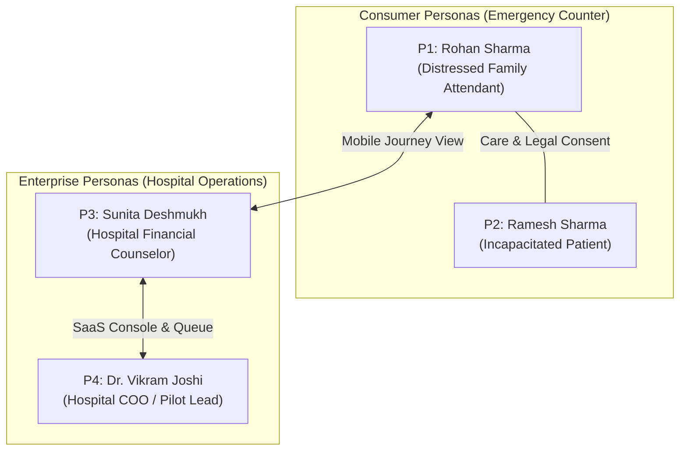

# LifeEvent AI: User Personas & Stakeholder Profiles

**Document Version:** 2.0  
**Status:** Approved  
**Product:** LifeEvent AI — AI-Powered Financial Journey Operating System

---

## 1. Persona Overview

LifeEvent AI operates at the intersection of consumer emergency triage and institutional hospital operations. The system serves two primary consumer personas and two key enterprise B2B personas.

---

## 2. Detailed Persona Profiles

### Persona 1: Rohan Sharma — The Distressed Family Attendant (Primary B2C)
- **Age:** 28  
- **Occupation:** Software Quality Analyst, Pune  
- **Language Proficiency:** English (Fluent), Hindi (Native), Marathi (Conversational)  
- **Context:**  
  Rohan's 58-year-old father suffered chest pain at 1:30 AM and was rushed to Ruby Hall Clinic. Rohan is standing in the hospital corridor holding a blue folder containing his father's Aadhaar card, employer mediclaim card, and an emergency admission estimate slip.
- **Psychological State:**  
  High cognitive stress, sleep-deprived, fearful of making a mistake that could jeopardize his father's treatment.
- **Pain Points:**
  - Cannot parse the 45-page policy document to understand if angioplasty stents are covered.
  - The hospital demands ₹50,000 caution deposit immediately before shifting to the Cath Lab.
  - TPA desk says "cashless pre-authorization will take 4 to 6 hours," leaving him unsure how much cash to arrange.
- **Jobs to be Done (JTBD):**
  - "Tell me in plain Hindi/English what insurance will pay, how much out-of-pocket money I must arrange, and what paper I need to hand over right now."
- **How LifeEvent AI Solves This:**
  - Multilingual voice intake lets Rohan speak naturally.
  - Honest gap calculator gives a Low-Expected-High shortfall range with transparent assumptions.
  - Pinned "Next Best Action" tells him exactly which desk and document require his immediate attention.

---

### Persona 2: Ramesh Sharma — The Incapacitated Patient (Beneficiary)
- **Age:** 58  
- **Condition:** Acute ST-Elevation Myocardial Infarction (STEMI)  
- **Context:** Undergoing emergency cardiac catheterization in the Cath Lab.  
- **Core Vulnerabilities:**  
  Cannot advocate for himself, provide signatures, or protect his sensitive medical or identity data.
- **Regulatory Protections Required:**  
  Under India's Digital Personal Data Protection (DPDP) Act 2023, Ramesh's Aadhaar number and health diagnosis are sensitive personal data.
- **How LifeEvent AI Protects Him:**
  - Mathematical Verhoeff validation and instant client-side Aadhaar masking (`XXXX-XXXX-1234`).
  - Strict zero-retention policy for raw identity card photos.
  - Absolute right to erasure via one-click hard delete (`DELETE /api/journey/{id}`).

---

### Persona 3: Sunita Deshmukh — Hospital Financial Counselor / TPA Executive (Primary B2B)
- **Age:** 36  
- **Role:** Senior TPA Desk Executive, Ruby Hall Clinic  
- **Experience:** 8 years handling cashless health insurance claims  
- **Daily Volume:** 25–40 emergency admissions and 15–20 discharge reconciliations daily  
- **Pain Points:**
  - Family attendants submit incomplete document sets, causing TPA query rejections.
  - Spends 45 minutes per patient explaining why the final bill contains ₹40,000 of non-payable consumables and room rent deductions.
  - Disputed bills cause bed-block at discharge, delaying new admissions.
- **Jobs to be Done (JTBD):**
  - "Help me ensure patient files are 100% pre-auth compliant before sending to the insurer, and set honest out-of-pocket expectations early so there are no conflicts at discharge."
- **How LifeEvent AI Solves This:**
  - Counselor B2B Console displays active patient journeys with real-time "Readiness Scores" (e.g., "5/6 tasks ready").
  - Instant visibility into active TPA queries with prioritized action items.
  - Objective, IRDAI-compliant gap math eliminates billing counter friction.

---

### Persona 4: Dr. Vikram Joshi — Hospital Chief Operating Officer (Enterprise B2B Stakeholder)
- **Age:** 52  
- **Role:** COO, Multi-Specialty Hospital Network (500 beds)  
- **Strategic Priorities:**  
  Bed turnover rate, patient satisfaction (NPS), minimizing accounts receivable days, mitigating bad debt.
- **Pain Points:**
  - Average patient admission clearance takes 95 minutes, causing emergency room congestion.
  - Cashless claim repudiation rate sits at 8.2%, leading to delayed collections and write-offs.
  - Patients leave negative reviews due to surprise out-of-pocket bills at discharge.
- **Jobs to be Done (JTBD):**
  - "Deploy a digital triage layer that accelerates admission, eliminates TPA query loops, and speeds up patient financial settlement."
- **How LifeEvent AI Solves This:**
  - Reduces counter-to-pre-auth filing time by over 60%.
  - Transparent gap modeling dramatically reduces billing disputes at discharge.
  - Modular SaaS pilot offering (`/for-hospitals`) at ₹25,000/month per hospital branch.

