# LifeEvent AI: Core Technical Differentiation & Moats

**Document Version:** 2.0  
**Status:** Approved Research Baseline  
**Product:** LifeEvent AI — AI-Powered Financial Journey Operating System

---

## 1. Why LifeEvent AI is NOT a "Chatbot Wrapper"

A common criticism of modern AI applications is that they are thin "prompt wrappers" around commodity LLMs. 

LifeEvent AI is an **enterprise-grade financial operating system** engineered with deterministic state machines, mathematical verification gates, and statutory compliance protocols.

```mermaid
graph TD
    subgraph Wrapper ["Generic AI Wrapper (Fragile)"]
        W1["Single Prompt with Policy Text"] --> W2["LLM Hallucinates Figures & Math"]
        W2 --> W3["No Source Citations"]
        W3 --> W4["Raw Aadhaar Leaks in Logs"]
        W4 --> W5["Uncontrolled Autonomous Actions"]
    end

    subgraph LifeEventOS ["LifeEvent AI Operating System (Defensible Moat)"]
        L1["Multimodal Ingestion (Vision + Speech)"] --> L2["Verhoeff Dihedral Checksum Redactor"]
        L2 --> L3["Hybrid RAG with pgvector Cosine Search"]
        L3 --> L4["Citation Validator: Verbatim Text Gate"]
        L4 --> L5["Deterministic Python Arithmetic: IRDAI Math"]
        L5 --> L6["Financial Journey Graph: DAG State Machine"]
        L6 --> L7["Customer Approval Gateway: Step-Up Consent"]
    end
```

---

## 2. The Five Defensible Technical Moats

### Moat 1: The Financial Journey Graph (DAG State Machine)
- **Difference:** While generic chatbots spit out unstructured conversational advice, LifeEvent AI constructs an executable **Directed Acyclic Graph (DAG)** of tasks.
- **Value:** Tasks maintain explicit dependencies (`depends_on`), roles, critical path flags, and state validation rules. The journey adapts dynamically when out-of-order events (e.g., TPA queries) occur.

### Moat 2: Deterministic Arithmetic Isolation
- **Difference:** LLMs are notoriously error-prone at arithmetic. LifeEvent AI treats the LLM strictly as an entity parser and clause classifier.
- **Value:** All monetary figures—including IRDAI room-rent proportional deduction penalties, List I non-payable consumable exclusions, and co-payment amounts—are executed in deterministic Python. Hallucinated rupee figures are impossible by construction.

### Moat 3: The Citation Verification Gate
- **Difference:** Generic AI claims that an item is "likely covered" without contractual proof.
- **Value:** Every coverage finding must supply a verbatim passage quote, document name, page number, and clause identifier. Our backend verifies the passage character-by-character against the source document. Claims lacking verified citations are rejected and assigned ₹0 covered.

### Moat 4: Mathematical Verhoeff Checksum Masking
- **Difference:** Standard regex masking either misses complex patterns or redacts valid 12-digit policy and phone numbers.
- **Value:** LifeEvent AI implements the dihedral group $D_5$ permutation algorithm. It identifies genuine Indian Aadhaar numbers mathematically and masks them to `XXXX-XXXX-1234` before any LLM payload or server log entry is created.

### Moat 5: The Customer Approval Gateway
- **Difference:** Unsafe agentic demonstrations execute money transfers or loan applications autonomously.
- **Value:** LifeEvent AI enforces a cryptographic pause on all consequential actions. Actions require explicit step-up authentication, parameter hash verification, and 15-minute expiration timers.

