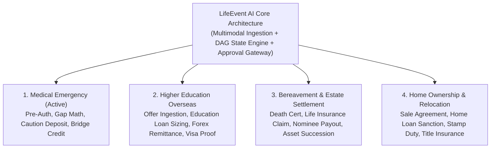

# LifeEvent AI: Future Research & Life Event Horizon

**Document Version:** 2.0  
**Status:** Approved Research Baseline  
**Product:** LifeEvent AI — AI-Powered Financial Journey Operating System

---

## 1. Expanding the Financial Journey Operating System

While the current release focuses on the acute medical emergency journey, the underlying architecture—**Multimodal Intake → Document Grounding → Gap Calculation → DAG Task Orchestration → Customer Approval Gateway**—generalizes to complex life events across a citizen's lifecycle:

---

## 2. Advanced Research Directions

### 2.1 On-Device Compact Models (Edge Intelligence)
- **Goal:** Enable offline-first document understanding directly on mobile devices without sending data to cloud servers.
- **Approach:** Quantize lightweight multimodal vision-language models (e.g., Gemma 2B / MobileNet-OCR) for WebAssembly (Wasm) and WebGPU execution in modern mobile browsers.

### 2.2 Zero-Knowledge Proofs (ZKP) for Privacy-Preserving Underwriting
- **Goal:** Enable lending partners and insurers to verify income, eligibility, and absence of fraud without receiving plaintext bank statements or medical diagnoses.
- **Approach:** Generate cryptographic zk-SNARK proofs of financial solvency via Account Aggregators, proving `income > threshold` without revealing transactions.

### 2.3 Automated Medical Billing Fraud & Overcharge Detection
- **Goal:** Protect patients and insurers from fraudulent billing inflation (e.g., billing for unused consumables, double-charging for nursing kits).
- **Approach:** Cross-examine itemized hospital bills against standard clinical treatment protocols (NHA Standard Treatment Guidelines) to flag anomalies before pre-authorization submission.

