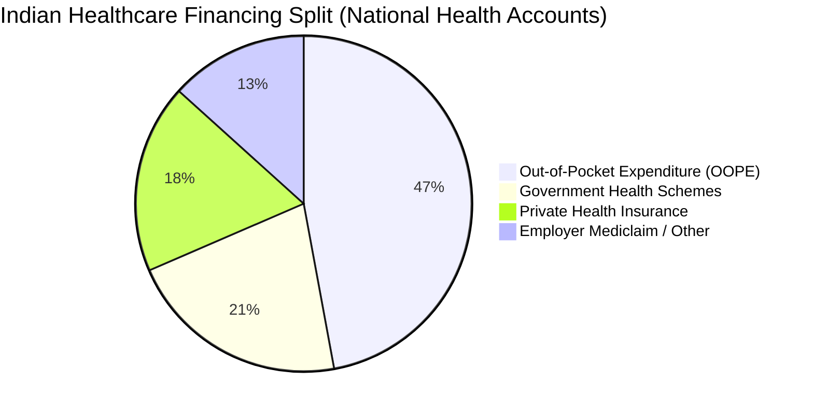
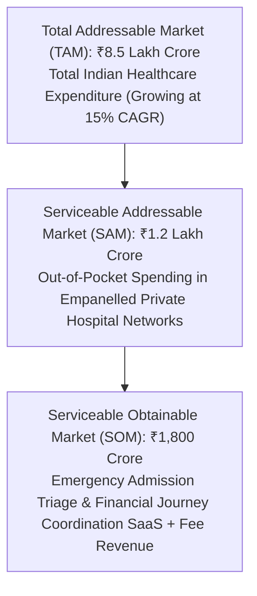

# LifeEvent AI: Market Opportunity & Healthcare Financing in India

**Document Version:** 2.0  
**Status:** Approved Research Baseline  
**Data Sources:** National Health Accounts (NHA) India, IRDAI Annual Reports, NITI Aayog Health Reports  
**Product:** LifeEvent AI — AI-Powered Financial Journey Operating System

---

## 1. The Indian Healthcare Financing Landscape

India's healthcare financing presents one of the most critical socio-economic challenges in the developing world:

### Key Market Realities:
1. **High Out-of-Pocket Expenditure (OOPE):**  
   Out-of-pocket health spending accounts for **47.1%** of total healthcare expenditure in India. According to NITI Aayog, catastrophic healthcare expenses push approximately **55 to 60 million Indian citizens** below the poverty line every single year.
2. **The "Missing Middle":**  
   While the bottom 40% of the population is nominally covered under government schemes (Ayushman Bharat / PM-JAY) and the top 10% holds comprehensive corporate insurance, over **400 million citizens (the "Missing Middle")** either lack insurance entirely or hold under-insured retail policies with high deductibles and sub-limits.
3. **The Cashless Hospital Disconnect:**  
   Even for citizens who diligently purchase health insurance, **cashless hospital admission is fraught with procedural failure**:
   - Over **15% to 25%** of cashless pre-authorization requests face queries or initial rejection due to missing casualty doctor notes, incomplete diagnostic reports, or administrative delays.
   - At final discharge, patients routinely discover that **15% to 30%** of their total hospital bill is disallowed due to room-rent proportional deduction penalties and non-payable medical consumable lists (IRDAI List I).

---

## 2. Addressable Market Sizing (TAM, SAM, SOM)

- **TAM (Total Addressable Market):** ₹8.5 Lakh Crore ($100B+ USD), representing total healthcare expenditure across private and public sectors in India.
- **SAM (Serviceable Addressable Market):** ₹1.2 Lakh Crore ($15B USD), representing the acute out-of-pocket hospital expenditure occurring across India's 45,000+ empanelled private multi-specialty hospitals and nursing homes.
- **SOM (Serviceable Obtainable Market):** ₹1,800 Crore ($220M USD), capturing:
  1. **B2B Hospital SaaS Licensing:** ₹25,000/month per hospital branch for the Counselor & TPA Triage Console.
  2. **Fintech Origination Fees:** Sub-1% origination fee on emergency bridge credit and caution deposit credit lines disbursed by partner NBFCs.

---

## 3. The Socio-Economic Impact

By providing instant transparency on insurance deductions, eliminating pre-auth query delays, and arranging zero-cost caution deposit liquidity, LifeEvent AI:
- Reduces emergency room admission clearance time from **95 minutes to under 15 minutes**.
- Prevents procedural cashless claim rejections for thousands of vulnerable families.
- Eliminates emergency borrowing from informal moneylenders charging predatory interest rates (>36% APR).

