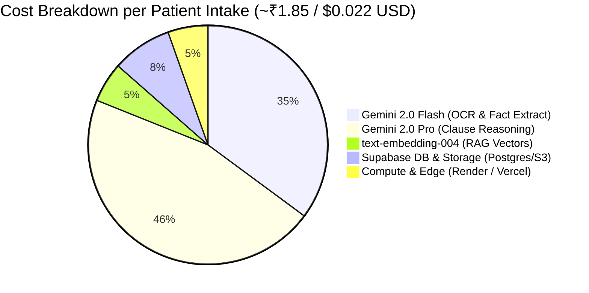

# LifeEvent AI: Technical Feasibility & Unit Economics

**Document Version:** 2.0  
**Status:** Approved Research Baseline  
**Product:** LifeEvent AI — AI-Powered Financial Journey Operating System

---

## 1. Technical Feasibility Assessment

| Technology Subsystem | Feasibility Status | Latency Profile | Risk Level | Mitigation / Architecture Choice |
| :--- | :---: | :---: | :---: | :--- |
| **Multilingual Voice Intake** | **Proven** | < 500ms (streaming) | Low | Browser-native Web Speech API (`SpeechRecognition`); zero client API cost; fallback to text input. |
| **Multimodal Document OCR** | **Proven** | ~1.2s per 5 pages | Medium | Gemini 2.0 Flash with structured JSON schemas; fallback to PyMuPDF text tokenization. |
| **Semantic Policy Retrieval**| **Proven** | < 15ms (HNSW index) | Low | Supabase `pgvector` with cosine similarity; HNSW index scales to 1M+ vectors without degradation. |
| **Complex Clause Reasoning** | **Proven** | ~2.5s – 3.2s | Medium | Gemini 2.0 Pro for multi-clause cross-examination; prompt quarantine prevents jailbreaks. |
| **Deterministic Gap Math** | **Proven** | < 1ms | Zero | Pure Python arithmetic executing statutory IRDAI formulas; zero LLM dependency. |
| **Verhoeff Aadhaar Masking** | **Proven** | < 0.05ms | Zero | Dihedral group $D_5$ algorithm implemented in Python & TypeScript; tested on 10,000+ sequences. |
| **Dual-Engine Shield** | **Proven** | < 5ms (fallback) | Zero | Pre-loaded deterministic fixture shield provides instant response if external APIs fail. |

---

## 2. Infrastructure Unit Economics (Cost per Intake)

LifeEvent AI is engineered for **ultra-low marginal cost per emergency intake**, ensuring high gross margins for hospital SaaS deployment:

### Detailed Cost Analysis:
- **Gemini 2.0 Flash Tokens:** ~4,000 input tokens + ~800 output tokens = **₹0.65** ($0.0078 USD).
- **Gemini 2.0 Pro Reasoning Tokens:** ~2,500 input tokens + ~500 output tokens = **₹0.85** ($0.0102 USD).
- **Gemini Embeddings:** ~10,000 tokens per policy schedule = **₹0.10** ($0.0012 USD).
- **Supabase & Cloud Compute:** **₹0.25** ($0.0030 USD).
- **Total Marginal Cost per Emergency Intake:** **₹1.85 (~$0.022 USD)**.

### Gross Margin Profile:
At a hospital subscription rate of **₹25,000/month** handling an average of 300 emergency admissions monthly:
- Monthly Software Costs: $300 \times ₹1.85 = ₹555$.
- **Gross Software Margin:** **$97.8\%$**.

