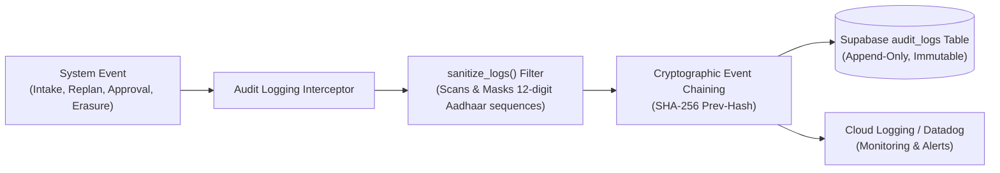

# LifeEvent AI: Audit Logging & Tamper-Evident Security Architecture

**Document Version:** 2.0  
**Status:** Approved Architectural Baseline  
**Standards:** ISO 27001 / DPDP Act 2023 / IRDAI Claims Auditability  
**Product:** LifeEvent AI — AI-Powered Financial Journey Operating System

---

## 1. Audit Logging Architecture & Invariants

In financial operating systems, audit logging serves two vital functions:
1. **Regulatory Traceability:** Providing legal proof that out-of-pocket estimations, customer approvals, and claim submissions adhered to statutory guidelines.
2. **Security Forensics:** Detecting unauthorized access attempts, prompt injection attacks, and anomalous data mutations.



### Core Audit Invariants:
- **Append-Only Immutability:** Audit tables have `INSERT` and `SELECT` permissions only. `UPDATE` and `DELETE` queries are blocked by PostgreSQL database triggers.
- **Strict PII Redaction:** No raw Aadhaar number, patient diagnosis description, or bank credentials may ever be committed to audit tables or console logs.
- **Cryptographic Chaining:** Each audit log record contains a hash of the previous record, creating a tamper-evident audit ledger.

---

## 2. Audit Log Record Schema (`audit_logs`)

```sql
CREATE TABLE audit_logs (
    id UUID PRIMARY KEY DEFAULT uuid_generate_v4(),
    journey_id UUID REFERENCES journeys(id) ON DELETE SET NULL,
    event_name VARCHAR(100) NOT NULL,
    actor_id VARCHAR(100) NOT NULL,
    actor_role VARCHAR(50) NOT NULL,
    action_status VARCHAR(30) NOT NULL, -- 'SUCCESS', 'FAILED', 'BLOCKED'
    ip_address_hash VARCHAR(64) NOT NULL, -- SHA-256 of caller IP
    old_state JSONB,
    new_state JSONB,
    previous_log_hash VARCHAR(64),
    current_log_hash VARCHAR(64) NOT NULL,
    created_at TIMESTAMPTZ DEFAULT NOW()
);
```

---

## 3. Audited Event Catalog

| Event Name | Trigger | Recorded Metadata | Retention Period |
| :--- | :--- | :--- | :--- |
| `JOURNEY_CREATED` | Attendant submits emergency intake | Journey ID, hospital name, urgency, language | 90 days (or until hard delete) |
| `AADHAAR_MASKED` | Verhoeff engine scrubs Aadhaar input | Checksum validation result, masked suffix (`XXXX-XXXX-1234`) | 90 days |
| `TPA_QUERY_REPLAN` | Counselor / Webhook injects TPA query | Query reference, requested document, new stage | 90 days |
| `APPROVAL_GRANTED` | Customer authorizes consequential action | Approval ID, action type, parameter hash, auth mode | 7 years (Statutory financial requirement) |
| `APPROVAL_EXPIRED` | Customer approval challenge lapses | Approval ID, expiration timestamp | 90 days |
| `PROVIDER_DISPATCH`| Outgoing call to payment or lending adapter | Provider name, transaction reference, latency ms | 1 year |
| `DATA_ERASED` | User triggers DPDP hard delete | Anonymized journey hash, erasure timestamp | Permanent (Tombstone record) |
| `INJECTION_BLOCKED`| Malicious prompt injection trapped in doc | Document ID, suspicious pattern token hash | 1 year |

---

## 4. Log Sanitization Engine (`backend/app/core/security.py`)

The `sanitize_logs()` function intercepts all egress strings and nested JSON dictionaries before writing to standard out or database logs:

```python
def sanitize_logs(data: Any) -> Any:
    """
    Recursively scrubs dictionary keys and string values to ensure zero PII leakage.
    """
    if isinstance(data, dict):
        sanitized = {}
        for k, v in data.items():
            if k in ["aadhaar_number", "aadhaar_raw", "patient_id_proof"]:
                sanitized[k] = mask_aadhaar_verhoeff(str(v))
            else:
                sanitized[k] = sanitize_logs(v)
        return sanitized
    elif isinstance(data, list):
        return [sanitize_logs(item) for item in data]
    elif isinstance(data, str):
        return mask_aadhaar_verhoeff(data)
    return data
```
This guarantees institutional-grade compliance with Indian privacy and insurance regulations.

