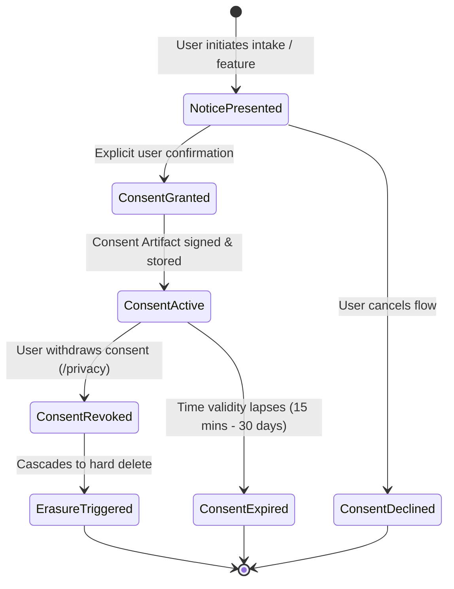

# LifeEvent AI: Consent Management & DPDP Consent Receipts

**Document Version:** 2.0  
**Status:** Approved Architectural Baseline  
**Standard:** Electronic Consent Architecture / DPDP Act 2023 Section 6  
**Product:** LifeEvent AI — AI-Powered Financial Journey Operating System

---

## 1. Consent Lifecycle Architecture

Under the DPDP Act 2023, consent must be **free, specific, informed, unconditional, and unambiguous**, with clear notice provided in English or any 8th Schedule language (including Hindi and Marathi).

LifeEvent AI models the consent lifecycle as a deterministic state machine:



---

## 2. Standardized Consent Receipt Schema (`ConsentArtifact`)

Every granted consent produces an immutable digital receipt stored in `audit_logs`:

```json
{
  "consent_id": "CONSENT-7b29a8f4-8901",
  "journey_id": "7b29a8f4-6e1c-4b3d-9f2e-0a1c2d3e4f5a",
  "data_principal_id": "user-8921-anon",
  "data_fiduciary": "LifeEvent AI Health Systems Pvt Ltd",
  "purpose_code": "EMERGENCY_HEALTHCARE_FINANCIAL_COORDINATION",
  "purpose_description": "Extracting facts from policy schedules and hospital estimates to model out-of-pocket gap and pre-authorization requirements.",
  "data_categories": [
    "HEALTH_POLICY_TERMS",
    "HOSPITAL_ESTIMATE_CHARGES",
    "MASKED_AADHAAR_IDENTIFIER"
  ],
  "language": "hi",
  "notice_text_hash": "sha256_hash_of_presented_notice_text",
  "granted_at": "2026-11-14T10:00:00.000000Z",
  "expires_at": "2026-12-14T10:00:00.000000Z",
  "revocation_endpoint": "/api/journey/7b29a8f4-6e1c-4b3d-9f2e-0a1c2d3e4f5a",
  "status": "ACTIVE"
}
```

---

## 3. Multilingual Consent Notices

### English Notice:
> *"I authorize LifeEvent AI to analyze my health insurance policy schedule and hospital admission estimate solely for estimating out-of-pocket costs and assisting with pre-authorization documents. I understand my Aadhaar number is masked and raw images are not stored. I retain the absolute right to erase this data at any time."*

### Hindi Notice (हिन्दी):
> *"मैं LifeEvent AI को अपनी स्वास्थ्य बीमा पॉलिसी और अस्पताल के अनुमान पर्चे का विश्लेषण करने की सहमति देता/देती हूँ, जिसका एकमात्र उद्देश्य अस्पताल के खर्चों का अनुमान लगाना और क्लेम दस्तावेजों को व्यवस्थित करना है। मुझे ज्ञात है कि मेरा आधार नंबर सुरक्षित रूप से मास्क किया गया है और मैं किसी भी समय अपना डेटा स्थायी रूप से मिटा सकता/सकती हूँ।"*

### Marathi Notice (मराठी):
> *"मी LifeEvent AI ला माझ्या आरोग्य विमा पॉलिसी आणि रुग्णालयाच्या बिलाचे विश्लेषण करण्याची संमती देतो/देते. याचा उद्देश केवळ उपचाराचा अंदाजे खर्च काढणे आणि क्लेम प्रक्रिया सुलभ करणे हा आहे. माझा आधार क्रमांक सुरक्षित ठेवला जाईल आणि मला माझा डेटा कधीही हटवण्याचा पूर्ण अधिकार आहे."*

