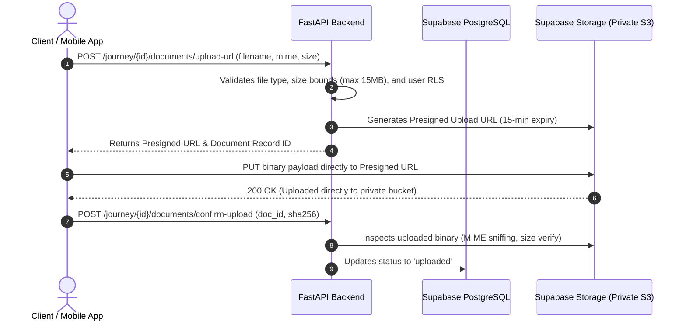

# LifeEvent AI: Secure File Handling & Storage Architecture

**Document Version:** 2.0  
**Status:** Approved Architectural Baseline  
**Storage Tier:** Supabase Storage Private Buckets (S3 Compatible)  
**Encryption Standard:** AES-256 Server-Side Encryption (SSE-S3 / SSE-KMS)  
**Product:** LifeEvent AI — AI-Powered Financial Journey Operating System

---

## 1. Storage Security Philosophy

In healthcare and financial applications, handling uploaded files (policy schedules, hospital admission slips, diagnostic scans) introduces significant security vulnerabilities:
1. **Malicious Payloads:** Uploaded PDFs or images may contain embedded malware, macro exploits, or prompt injection strings.
2. **Bandwidth & Memory Exhaustion:** Transmitting large binary files directly through API application servers degrades performance and causes out-of-memory crashes.
3. **Unauthorized Data Exposure:** Storing files in publicly readable cloud buckets leads to catastrophic medical data leaks.

LifeEvent AI eliminates these vulnerabilities through a **Zero-Trust Private Storage Architecture**:



---

## 2. Storage Buckets & Access Controls

All documents are segregated across two isolated Supabase Storage buckets:

| Bucket Name | Access Policy | Allowed MIME Types | Max Size | Retention Policy |
| :--- | :--- | :--- | :--- | :--- |
| `journey-documents` | Strictly Private (RLS Protected) | `application/pdf`, `image/jpeg`, `image/png` | 15 MB | Retained during active journey; permanently deleted upon user hard delete (`DELETE /api/journey/{id}`) |
| `transient-previews`| Strictly Private (Ephemeral) | `image/jpeg`, `image/png` | 5 MB | Auto-purged by S3 lifecycle rule after **2 hours** |

---

## 3. Presigned URL Generation (`backend/app/api/v1/documents.py`)

```python
from fastapi import APIRouter, Depends, HTTPException, status
from pydantic import BaseModel
import os
import uuid

router = APIRouter()

class UploadURLRequest(BaseModel):
    filename: str
    mime_type: str
    file_size_bytes: int

class UploadURLResponse(BaseModel):
    document_id: str
    upload_url: str
    storage_path: str
    expires_in_seconds: int = 900

ALLOWED_MIME_TYPES = ["application/pdf", "image/jpeg", "image/png"]
MAX_FILE_SIZE = 15 * 1024 * 1024 # 15 MB

@router.post("/journey/{journey_id}/documents/upload-url", response_model=UploadURLResponse)
async def generate_presigned_upload_url(journey_id: str, payload: UploadURLRequest):
    # 1. Enforce strict MIME whitelisting
    if payload.mime_type not in ALLOWED_MIME_TYPES:
        raise HTTPException(
            status_code=status.HTTP_400_BAD_REQUEST,
            detail=f"Unsupported file type '{payload.mime_type}'. Only PDF, JPEG, and PNG are permitted."
        )

    # 2. Enforce file size bounds
    if payload.file_size_bytes > MAX_FILE_SIZE or payload.file_size_bytes <= 0:
        raise HTTPException(
            status_code=status.HTTP_400_BAD_REQUEST,
            detail="File size exceeds the 15 MB limit."
        )

    # 3. Generate unique document storage path
    doc_id = str(uuid.uuid4())
    safe_filename = payload.filename.replace(" ", "_").replace("/", "")
    storage_path = f"journeys/{journey_id}/{doc_id}_{safe_filename}"

    # 4. Generate presigned PUT URL via Supabase Storage client
    # Signed URL expires in 15 minutes (900 seconds)
    upload_url = supabase_client.storage.from_("journey-documents").create_signed_upload_url(
        path=storage_path,
        expires_in=900
    )

    return UploadURLResponse(
        document_id=doc_id,
        upload_url=upload_url["signed_url"],
        storage_path=storage_path
    )
```

---

## 4. Antivirus & Content Inspection Rules

1. **MIME Sniffing:** When the client confirms upload, the backend reads the first 512 bytes (the magic numbers) to confirm that the file header matches its claimed extension (`%PDF-` for PDFs, `\xFF\xD8\xFF` for JPEGs). Executable files renamed to `.pdf` are immediately rejected and deleted.
2. **Zero Raw ID Image Retention:** Raw photos of identity cards (Aadhaar/PAN) uploaded during intake are processed exclusively in volatile memory to extract the masked sequence (`XXXX-XXXX-1234`). The image binary is **permanently discarded** from disk and memory.
3. **Encrypted at Rest:** All objects stored in Supabase Storage are encrypted using **AES-256** server-side encryption keys managed via KMS.

