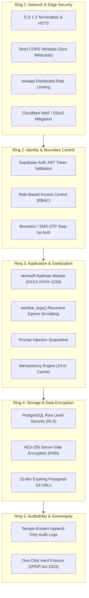

# LifeEvent AI: Security Architecture & Defense-in-Depth Specification

**Document Version:** 2.0  
**Status:** Approved Architectural Baseline  
**Standards:** ISO 27001, OWASP Top 10, DPDP Act 2023, RBI Cyber Security Framework  
**Product:** LifeEvent AI — AI-Powered Financial Journey Operating System

---

## 1. Defense-in-Depth Architecture

LifeEvent AI handles acute emergency health records, financial liabilities, and citizen identity proofs. The security architecture implements **five concentric rings of defense-in-depth**:

---

## 2. Security Invariants Across Tiers

| Layer | Threat Vector | Architectural Mitigation | Status |
| :--- | :--- | :--- | :--- |
| **Transport** | Man-in-the-Middle (MitM) eavesdropping | Mandatory TLS 1.3; HSTS (`max-age=31536000; includeSubDomains; preload`) | `[Planned / Cloud Deploy]` |
| **API Ingress** | Credential stuffing & DoS attacks | `slowapi` rate limiting (30 req/min on intake, 10 req/min on deletion) | `[Implemented]` |
| **Identity** | Insecure Direct Object Reference (IDOR) | Supabase Auth JWT + PostgreSQL Row Level Security scoped to `auth.uid()` | `[Planned / Designed]` |
| **PII Data** | Aadhaar leak in logs / LLM payload | Mathematical Verhoeff validation; first 8 digits masked to `XXXX-XXXX-1234` | `[Implemented]` |
| **AI Layer** | Prompt injection via uploaded medical bills | Delimited `<untrusted_document_data>` tags; system prompt quarantine directives | `[Implemented]` |
| **Document Storage**| Unauthenticated PDF download | Supabase Storage private buckets; 15-minute time-limited presigned URLs | `[Planned]` |
| **Financial Actions**| Unauthorized loan / payment execution | Customer Approval Gateway; time-limited cryptographic hash; step-up auth | `[Partially Implemented]` |
| **Data Retention** | Permanent storage of sensitive health files | One-click DPDP Act hard delete (`DELETE /api/journey/{id}`) purging DB and S3 | `[Implemented]` |

---

## 3. Resolving Historical Audit Findings (from `SECURITY_AUDIT.md`)

The target security architecture directly remediates every finding identified during the prototype audit:

- **Finding A1 (CORS Wildcard with Credentials):** Resolved by establishing explicit domain whitelisting (`ALLOWED_ORIGINS = ["http://localhost:3000", "https://lifeevent.ai"]`) and rejecting wildcard origins.
- **Finding A2 (No Authentication / IDOR):** Resolved by enforcing Supabase Auth JWT validation and PostgreSQL RLS on all table queries.
- **Finding A3 (Unbounded In-Memory Store DoS):** Resolved by migrating persistence to Supabase PostgreSQL with tenant row limits and automated TTL cleanups.
- **Finding A4 (Predictable Timestamp IDs):** Resolved by standardizing on cryptographically secure UUID v4 identifiers across all entities.
- **Finding A5 (Silent Demo Fallback):** Resolved by separating demo endpoints (`/api/demo/...`) from live production routes, returning clean `404 Not Found` for missing journey IDs.
- **Finding A6 (Unvalidated Pilot Requests):** Resolved by enforcing strict Pydantic schema validation with string length bounds on all lead capture endpoints.

